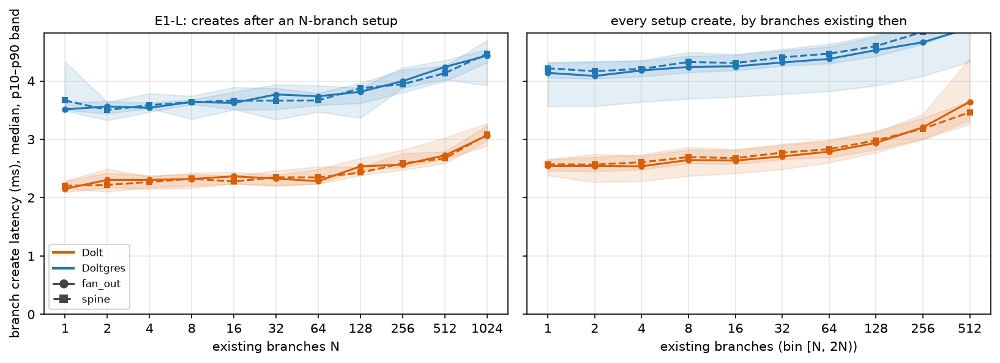
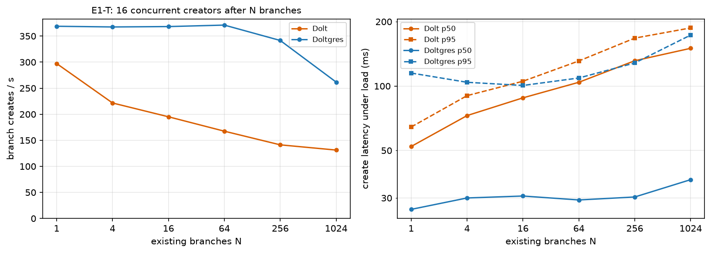
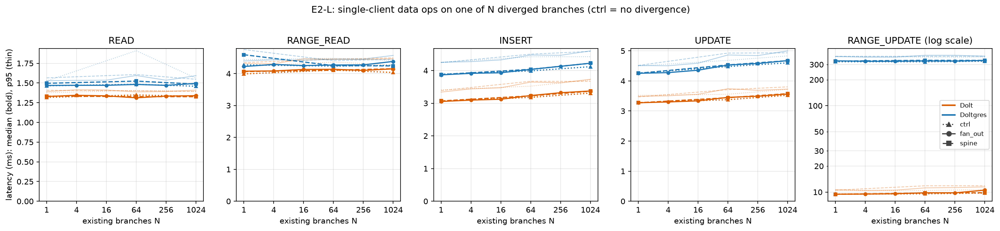
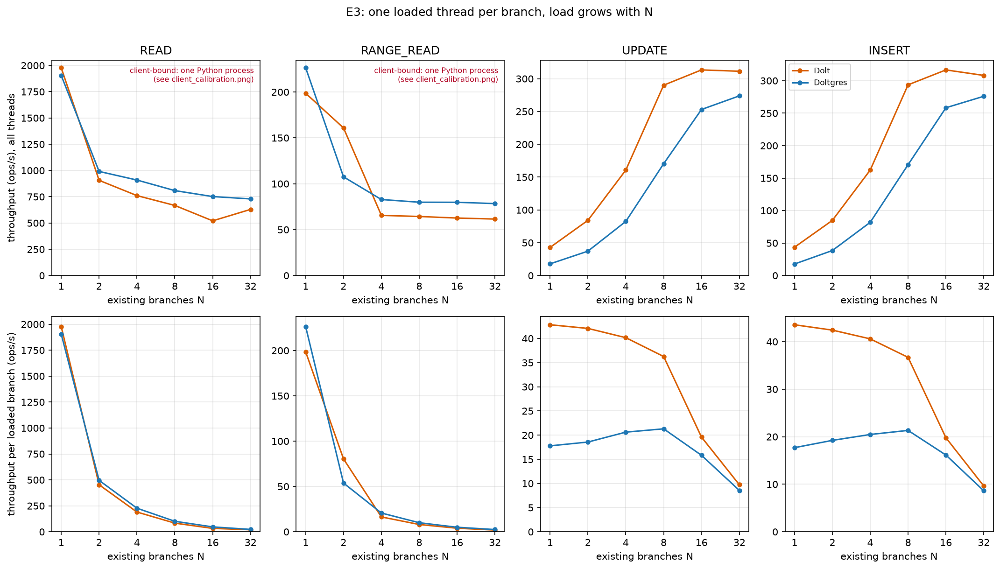
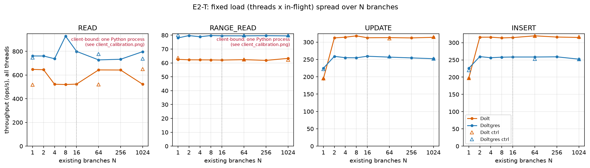
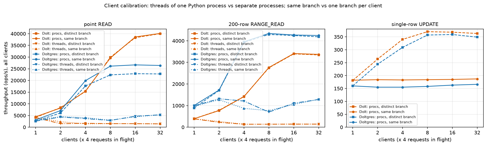

# Dolt Branch Scaling

*Experiment 1 · CloudLab c220g2 · 15-16 Oct 2026 · Markdown version of the report first published on 16 Oct, with one
correction (see "Correction" under H3).*

Does a branchable database that lives on one machine get slower as branches pile up? Three hypotheses were tested on
**Dolt** 2.4.2 (MySQL protocol) and **Doltgres** 1.4.0 (Postgres protocol), each measured as single-client latency and
as throughput under concurrent load, against the number of existing branches N from 1 to 1,024.

Each server ran alone on its own node (2× Xeon E5-2660 v3, 157 GB RAM, data on a local SSD), pinned to one CPU socket,
with the benchmark client on the other socket of the same machine. Client and server share the physical host but not
CPU cores or memory: the server's CPUs and memory are bound to socket 0 and the client's to socket 1, and the client
connects over loopback (`127.0.0.1`), with no physical network in between. Data: CH-benCHmark at one warehouse, about 608,000 rows. Every setup
branch was given 100 untimed row updates so branches hold distinct data. 312 benchmark runs: 5.3 hours on Dolt and
6.3 hours on Doltgres.

Most runs in this experiment kept branches other than the measured one idle. Experiment 2
(`experiment/2-dolt-busy-branches`) repeats the data-operation and interference questions with every branch busy.

## Verdict

| Hypothesis | Verdict | What the data says |
|---|---|---|
| H1 · Branch creation is slow | **No** alone, **partly** concurrent | One client creates a branch in 2-4.5 ms. That grows by 43% (Dolt) and 26% (Doltgres) from 1 to 1,024 branches, mostly past ~128. Concurrent creates are serialized: 16 creators get at most 1.3× the rate of one, and Dolt's concurrent create rate halves as branches accumulate. |
| H2 · Data operations slow down with more branches | **No** for reads, **slightly** for writes | With the other branches idle, point and range reads do not change (within 2%) between 1 and 1,024 branches. Writes get 6-11% slower. The same rise appears when branches hold no distinct data, so the cost tracks the number of branches. |
| H3 · Branches interfere with each other | **No** for idle branches and reads, **yes** for writes | Idle branches cost nothing, and reads on different branches run in parallel (on Doltgres, reads spread over branches run 10-15% slower). Writes share one server-wide ceiling of about 350-370 single-row updates/s, reached at about 8 busy branches. Past that, each added busy branch slows all the others. |

The benchmark runner drives every client thread from one Python process, and for reads that process saturates first.
It tops out near 650 point reads/s on Dolt, where separate client processes reach 40,000. The read-interference
conclusions come from a separate calibration with independent client processes, shown under H3.

## H1 · Branch creation

E1-L creates 10 branches with one client after building N branches. E1-T has 16 threads each create 50 branches after
building N. Both forms were run on a flat set of branches off `main` (fan_out) and on a chain (spine).

| Branch create | N = 1 | N = 64 | N = 1,024 | Change |
|---|---:|---:|---:|---:|
| Dolt, 1 client, median | 2.15 ms | 2.28 ms | 3.07 ms | +43% |
| Doltgres, 1 client, median | 3.51 ms | 3.74 ms | 4.43 ms | +26% |
| Dolt, 16 creators, creates/s | 297 | 167 | 131 | −56% |
| Dolt, 16 creators, median | 52 ms | 104 ms | 150 ms | ×2.9 |
| Doltgres, 16 creators, creates/s | 369 | 371 | 262 | −29% |
| Doltgres, 16 creators, median / p95 | 27 / 115 ms | 29 / 109 ms | 37 / 173 ms | |



*Left: median and p10-p90 of the 10 timed creates in each run. Right: all 43,618 setup creates, binned by how many
branches existed at that moment. Chain (spine) and flat (fan_out) shapes behave the same.*



*E1-T, 16 concurrent creators. Each run adds its own 800 branches, so a run labelled N ends with about N + 800.*

At these latencies branch creation is not slow for a single client. Concurrency is where it shows. One Dolt client
creates about 450 branches per second, and 16 concurrent creators reach only 297 at N = 1. The extra clients only
queue. Dolt's concurrent rate then falls steadily with the number of branches already present, and the first 100
creates of each run slow from 45 ms (1 setup branch) to 126 ms (1,024 setup branches). The 800 clean branches a run
adds raise latency much less, so the cost follows the number of branches with their own changes more than the raw
branch count.

## H2 · Data operations against N branches

E2-L runs 1,000 point operations or 200 range operations of 200 rows with one client, on one branch, after building
N branches. The other N−1 branches are idle. The control repeats it with branches that hold no distinct data.

| Median latency | Dolt N=1 | N=1,024 | Change | Doltgres N=1 | N=1,024 | Change |
|---|---:|---:|---:|---:|---:|---:|
| READ (point) | 1.33 ms | 1.34 ms | +1% | 1.47 ms | 1.49 ms | +2% |
| RANGE_READ (200 rows) | 4.08 ms | 4.15 ms | +2% | 4.22 ms | 4.38 ms | +4% |
| INSERT | 3.05 ms | 3.37 ms | +10% | 3.87 ms | 4.22 ms | +9% |
| UPDATE | 3.27 ms | 3.56 ms | +9% | 4.25 ms | 4.67 ms | +10% |
| RANGE_UPDATE (200 rows) | 9.46 ms | 10.53 ms | +11% | 331 ms | 334 ms | +1% |
| INSERT, no divergence | 3.06 ms | 3.31 ms | +8% | 3.89 ms | 4.12 ms | +6% |
| UPDATE, no divergence | 3.28 ms | 3.52 ms | +7% | 4.26 ms | 4.60 ms | +8% |



*Bold lines are medians, thin lines p95. Linear axes from zero, except RANGE_UPDATE (log scale).*

Reads do not notice how many idle branches exist. Writes get about 10% slower over three orders of magnitude of
branches, and the no-divergence control rises almost as much, so the cost comes with the branch count itself rather
than with stored differences.

The 331 ms RANGE_UPDATE on Doltgres is a planner gap, unrelated to branches. A 200-row update written as a row-value
range `(s_w_id, s_i_id) >= (1, k) AND (s_w_id, s_i_id) <= (1, k+199)` takes 327 ms. The same update written as
`s_w_id = 1 AND s_i_id BETWEEN …` takes 8 ms, and the same predicate in a SELECT uses the index (1.5 ms). Doltgres
cannot EXPLAIN an UPDATE, so the plan itself could not be shown.

## H3 · Interference between branches

Three views. E2-T keeps the load fixed (16 threads × 4 requests in flight) and spreads it over N branches: for N ≤ 16
the same load lands on more branches, and for N > 16 the extra branches sit idle. E3 gives every branch its own
thread, so load grows with N. The client calibration repeats the reads and a single-row update from separate
processes, either all on one branch or one branch per client.

### Writes contend inside a branch and share one ceiling across branches

| Single-row updates/s (calibration) | 1 × 1 | 1 × 4 | 8 × 4 | 32 × 4 |
|---|---:|---:|---:|---:|
| Dolt, all on one branch | 291 | 182 | 184 | 187 |
| Dolt, one branch per client | | 181 | 370 | 363 |
| Doltgres, all on one branch | 229 | 160 | 158 | 166 |
| Doltgres, one branch per client | | 160 | 357 | 349 |

*Columns are clients × requests in flight per client.*

Writes to one branch run one at a time. A single sequential writer is faster than any number of concurrent ones (291
against about 185 updates/s on Dolt), and latency grows in proportion to the writers waiting (Dolt: 22 ms at 4 in
flight, 707 ms at 128). Spreading writers over branches roughly doubles throughput, up to about 8 busy branches. Then
the whole server is capped at about 350-370 updates/s, and per-branch throughput falls as 1/N.

**Correction.** The first version of this report used E3's per-branch write rates (Dolt 43 writes/s per branch at
1 branch, Doltgres 18) as server measurements, and explained the gap to the calibration by row width. That was wrong.
Before every write, the benchmark's INSERT and UPDATE operations ran an untimed information_schema query for the
table's columns (19 ms of server work on Dolt, 32 ms on Doltgres). In async mode that query blocks the worker's event
loop, which caps one worker thread near 50 writes/s (Dolt) and 30 (Doltgres). So E3's per-branch write rates at low N
measure the client. The totals at 16-32 branches (about 310 on Dolt, 275 on Doltgres) are server-bound but carry that
extra metadata load. The calibration numbers above have no such query and are the valid ones. The query is fixed for
experiment 2 (column lists are now looked up once per client process).



*E3, one thread with 4 requests in flight per branch. Read panels are capped by the single Python client process.
Write panels at low N are capped by the per-write metadata query described above.*



*E2-T. Moving the same write load from one branch to two lifts throughput by 61% (Dolt) and 16% (Doltgres). After
that, 1,000 idle branches change nothing. Triangles are the no-divergence control.*

### Reads on different branches do not interfere



*Each client keeps 4 requests in flight for 20 s. Solid and dashed lines (processes, same or distinct branch) show
the server. Dotted lines (threads of one process) show the client limit the benchmark runner hits.*

With independent client processes, Dolt serves point reads at the same rate whether 32 clients read one branch or
32 different branches, up to about 40,000 reads/s. Range reads reach about 3,400/s either way. Doltgres peaks lower,
at about 26,700 point reads/s, and reads spread over distinct branches run 10-15% below reads on one branch. A single
Doltgres client also reads a non-default branch about 16% slower than `main` (2,590 against 3,100 reads/s). Range
reads show no such gap on either server.

Write conflicts were rare. Of about 1.0 million timed writes across both servers, 296 updates failed with a
serialization error (MySQL 1213 on Dolt), at most 0.4% of one run. Almost all came when 16 threads hammered a single
branch and revisited keys they had just written.

## What this does not show

- One data size (one warehouse, about 608k rows) and one hot table (`stock`). Larger databases may change both the
  per-write branch cost and the write ceiling.
- In H2 and in E2-T beyond 16 branches, the other branches were idle. Experiment 2 keeps every branch busy.
- Branch divergence was 100 uncommitted updates per branch. A chained (spine) branch forks from its parent's last
  commit, so it does not inherit those changes. Spine and fan_out therefore differ in ancestry only.
- Read throughput from the benchmark runner (E2-T and E3 read panels) reflects its single Python process. E3's
  per-branch write rates reflect the per-write metadata query. The calibration is the measurement of the servers.
- Release binaries only (Dolt 2.4.2, Doltgres 1.4.0). Dolt's automatic GC was off during runs. Storage growth was
  not measured.
- Client and server shared a machine on separate CPU sockets.

## Method and benchmark changes

All experiments use the repo's microbenchmark runner (`microbench/runner2.py`) through its two scripts. Everything
specific to this study (driver, calibration, plotting, node setup, raw data, figures and this report) is in
`experiment/1-dolt-branch-scaling/`.

| Run | What varies | N values | Ops per run |
|---|---|---|---|
| E1-L | BRANCH_CREATE, 1 client, fan_out and spine | 1 … 1,024 (×2) | 10 creates |
| E1-T | BRANCH_CREATE, 16 threads | 1, 4, 16, 64, 256, 1,024 | 800 creates |
| E2-L | 5 data ops, 1 client, fan_out (and spine at 1, 64, 1,024) | 1, 4, 16, 64, 256, 1,024 | 1,000 point / 200 range |
| E2-T | 4 data ops, 16 threads × 4 in flight | 1, 2, 4, 8, 16, 64, 256, 1,024 | 16,000 point / 4,800 range |
| E3 | 4 data ops, 1 thread × 4 per branch | 1, 2, 4, 8, 16, 32 | 1,000 point / 300 range per thread |
| Control | E2-L and E2-T with no divergence | 1, 64, 1,024 | as above |

Changes made to the shared benchmark code for this study, all covered by tests on the in-memory fake backend:

- **Fixed reversed primary keys.** The key-column lookup sorted composite keys backwards, so every 200-row range
  scanned the whole index (70 ms instead of 4 ms).
- **Generated data instead of a dump.** The scripts' dump file no longer existed, so the runner now seeds
  CH-benCHmark in the server (`--generated-scale`), optionally copying from a seed database in 7 s instead of
  60-115 s (`--seed-db`).
- **Branch count on every result row.** The `branch_count` column was always 0. It now records the branches present
  when each row was taken, in async runs too.
- **Branch-create sweep that sweeps.** BRANCH_CREATE used to skip the N-branch setup, so its sweep measured nothing.
- **Load only on the requested branches.** Threads were also assigned to `main`, so "N branches" loaded N + 1.
- **Diverging branches, cheaply.** New `--updates-per-branch` flags; the setup no longer re-reads the schema before
  every row.
- **Latency quantiles in the run summary** (p50/p95/p99 for verbs and statements).

Reproduce (from the repo root):

```bash
X=experiment/1-dolt-branch-scaling
$X/scripts/setup_cloudlab_dolt.sh dolt_mysql <host>          # server on SSD + client venv
ssh <host> "cd db-fork && $X/scripts/run_dolt_scaling.sh dolt_mysql --seed-db ch_w1_seed"
ssh <host> "cd db-fork && $X/scripts/calibrate_dolt_clients.sh dolt_mysql"
uv run python $X/scripts/plot_branch_scaling.py \
    --run-dir $X/data/dolt_mysql --run-dir $X/data/dolt --outdir $X/figures
```
