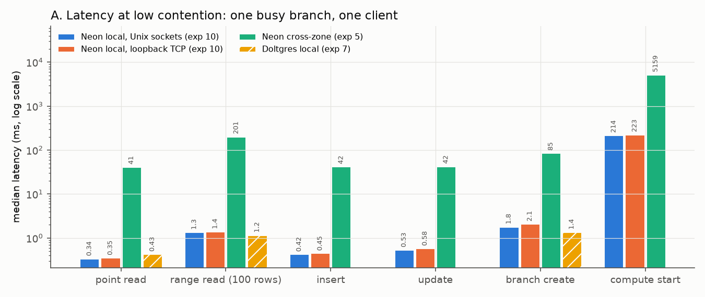
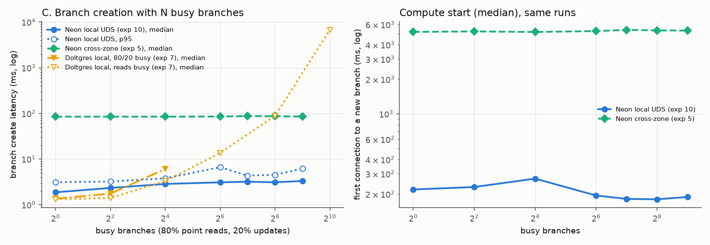
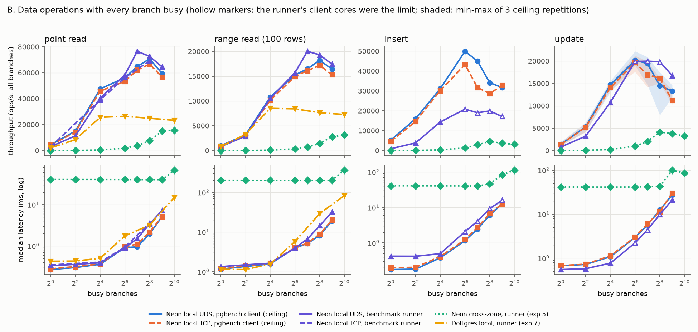
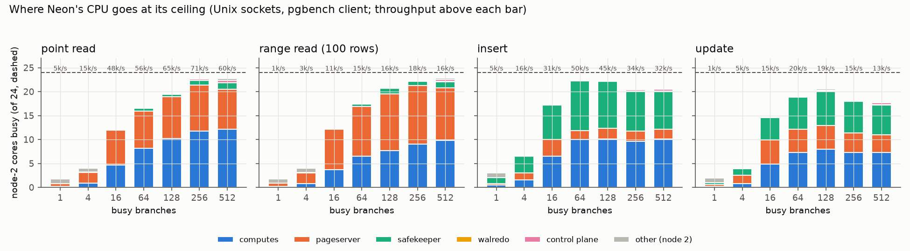
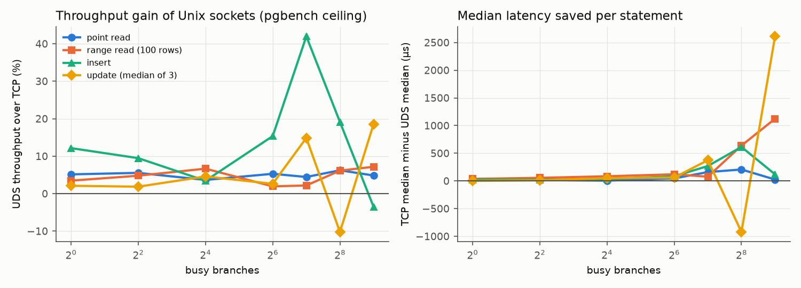

# Experiment 10 report: Neon on one machine, every connection on a Unix socket

25-26 Oct 2026, `dassl-serv-01`. Neon (fork branch `local-uds`) on NUMA node 2 (24 cores, 64 GB), benchmark client on
node 3. Setup, fork changes and file formats: [README.md](README.md); commands: [REPRODUCE.md](REPRODUCE.md).

## Summary

1. **Without the network, Neon is a sub-millisecond database.** One busy branch, one client: point read 0.34 ms,
   range read (100 rows) 1.34 ms, insert 0.42 ms, update 0.54 ms (medians), branch create 1.8 ms, compute start
   (first connection to a new branch) 0.21 s. Cross-zone (experiment 5) the same operations took 41 / 201 / 42 / 42 /
   85 ms and 5.2 s; Doltgres on the same machine (experiment 7) takes 0.43 ms per point read and 1.4 ms per branch create.
2. **Reads saturate node 2's CPU.** Point reads reach 71k/s and range reads 18k/s at N = 256 busy branches, with
   22.5-23 of the 24 cores busy: about 12 in the computes' Postgres processes and 9-12 in the pageserver. Doltgres
   on 10 cores of the same node plateaued at 26k / 8.5k per second.
3. **Inserts saturate the CPU too, mostly in the safekeeper's write path.** 50k inserts/s at N = 64 with 22.2 cores
   busy (computes 10.0, safekeeper 10.4, pageserver 1.9).
4. **Updates are limited by synchronous writes to the one NVMe, not by CPU.** They peak at 20k/s (N = 64-128) with
   4-7 cores idle and fall to 13-15k/s at N = 256-512 while the safekeeper's mean fsync grows from 0.15 ms (N = 16)
   to 7 ms (N = 512). Each branch is its own timeline with its own WAL, so every commit of every branch is its own
   `fdatasync`; there is no group commit across branches. Each update writes 6.3 KiB of WAL and 22 KiB to the
   safekeeper's disk.
5. **Memory caps the number of busy branches at 512.** Each running compute costs 77 MB of node 2 memory that cannot
   be reclaimed (PSS: 43 MB of shared buffers plus the rest of Postgres's shared memory and private memory); 512 of
   them leave node 2 at 0.3 GB free. N = 1,024 was not run.
6. **Branch creation stays flat under load.** Median 1.9 ms with 1 busy branch, 3.3 ms with 512 (p95 3-7 ms); a
   new branch's compute answers its first query in 0.18-0.27 s. Doltgres's create rose to 6 ms at 16 busy branches
   (80/20 mix) and to 7 s at 1,024 (reads only).
7. **Unix sockets help only where the CPU is the limit, and only by 4-7%.** A raw round trip is 3x cheaper (6 vs 18 µs
   on node 2), but Neon spends 0.2-1.3 ms of CPU per statement, so the socket saves 13-47 µs per statement at low
   load and 4-7% of throughput at the CPU-bound read plateaus. Disk-bound updates gain nothing measurable.

So the single-machine branchable-DB bottleneck shown here is, in order of N: CPU for reads and inserts (Postgres
in the computes plus the pageserver, or plus the safekeeper for writes), the device's synchronous-write rate for
updates, and memory for the number of branches that can be busy at once. None of the three is an engineering defect
of the kind experiment 7 found in Dolt's write path.

## What was run

| Part | What | Client | Transports |
|---|---|---|---|
| A low load | READ 40,000, RANGE_READ 10,000, INSERT 6,000, UPDATE 6,000 on one branch; 100 branch creates (every 5th connected) with one busy branch | benchmark runner (`runner2.py`), one thread | uds, tcp |
| B scaling | N = 1, 4, 16, 64, 128, 256, 512 busy branches, one client each, experiment 5's op counts | benchmark runner | uds; tcp READ at N = 1, 16, 64, 256 |
| B ceiling | same N; one `pgbench -c 1` per branch, 30 s per point; point, range, insert once, update three times | `ceiling_pgbench.py` | uds, tcp |
| C branch create | 100 creates (every 5th connected) with N = 1..512 MIXED (80% point read, 20% update) busy branches | benchmark runner | uds |
| IPC | C ping-pong round trip; Neon's `pagebench` GetPage; fio on the NVMe | | uds, tcp |

Every compute has 43 MB of shared buffers (30% of `stock` + `stock_pkey`, prewarmed with the key and the first 30%
of the heap) and no local file cache, at the user's request: on one machine an LFC hit is a read from the same NVMe
(or its page cache) that a GetPage over a socket would do.

**Why a second client.** The benchmark runner spends about 0.3 ms of client CPU per statement (Python, psycopg2,
one statement per call). With 24 client cores it cannot offer more than about 20k writes/s, so at N >= 64 its insert
and update numbers measure the runner, not Neon (hollow markers in the figure). `ceiling_pgbench.py` runs one
pgbench process per branch instead; pgbench needs 13-16 µs of client CPU per point read, insert or update and
86 µs per range read (0.3-1.6 node-3 cores at the plateaus), so its numbers are Neon's.

## A. Latency at low contention

| operation | UDS p50 | UDS mean | TCP p50 | TCP mean | cross-zone p50 (exp 5) | Doltgres p50 (exp 7) |
|---|---:|---:|---:|---:|---:|---:|
| point read | 0.339 | 0.294 | 0.353 | 0.307 | 40.9 | 0.426 |
| range read (100 rows) | 1.344 | 1.201 | 1.387 | 1.248 | 201 | 1.154 |
| insert | 0.424 | 0.439 | 0.445 | 0.464 | 41.6 | |
| update | 0.535 | 0.603 | 0.577 | 0.644 | 42.4 | |
| branch create | 1.79 | 1.70 | 2.07 | 1.95 | 84.7 | 1.36 |
| compute start | 214 | | 223 | | 5,159 | |

All in ms ([figures/low_load.md](figures/low_load.md)). The point read's mean is below its median because about 30%
of reads hit shared buffers (no GetPage) and the rest pay one GetPage round trip to the pageserver, which reads the
page from a layer file on the NVMe (pagebench: 207 µs per GetPage with one client). Neon's local point read is 20%
faster than Doltgres's; its range read is 16% slower (up to 100 rows across several heap pages, each a possible
GetPage, against Dolt's in-memory chunk cache). Neon's branch create is a metadata operation in the storage
controller and pageserver (a new timeline at an LSN), 0.4 ms slower than Doltgres's in-process create; the cost the
user sees for a usable branch is the compute start, 214 ms. Over all 10,482 compute starts of the experiment,
`compute_ctl`'s own startup takes a median 200 ms: basebackup from the pageserver 75 ms, syncing with the safekeeper
52 ms, starting Postgres 42 ms (`/mydata/jiyu/neon-exp10/archive/starts.jsonl`).

## C. Branch creation with busy branches

| busy branches | create p50 | create p95 | compute start p50 | background ops/s | Neon cores | pageserver | computes | safekeeper |
|---:|---:|---:|---:|---:|---:|---:|---:|---:|
| 1 | 1.87 | 3.12 | 219 | 1,973 | 2.8 | 2.1 | 0.3 | 0.3 |
| 4 | 2.33 | 3.21 | 230 | 7,703 | 4.4 | 2.7 | 0.8 | 0.8 |
| 16 | 2.85 | 3.78 | 272 | 26,178 | 12.3 | 5.2 | 4.4 | 2.6 |
| 64 | 3.09 | 6.62 | 194 | 21,368 | 12.1 | 5.3 | 4.4 | 2.2 |
| 128 | 3.19 | 4.33 | 181 | 18,144 | 11.9 | 5.5 | 4.1 | 2.1 |
| 256 | 3.10 | 4.50 | 180 | 16,393 | 12.3 | 5.4 | 4.4 | 2.1 |
| 512 | 3.31 | 6.17 | 188 | 16,094 | 12.4 | 4.9 | 4.7 | 2.2 |

Times in ms; cores averaged over the timed window ([figures/branch_create.md](figures/branch_create.md)). The
background clients here are the benchmark runner's (client-limited from N = 16 on: node 2 never exceeds 13.7 busy
cores), so this part shows that a create is unaffected by a moderately loaded node, not by a saturated one. Creates
rise from 1.9 to 3.3 ms between N = 1 and N = 512, roughly the extra queueing for the pageserver's and storage
controller's threads. Compute start stays at 0.18-0.27 s at every N (its drop after N = 16 is not explained by
the data collected). Doltgres's create
time grows with every busy branch because its creates contend with the reads for the server's 10 cores and its
branch metadata; Neon's create touches neither the computes nor the busy timelines.

## B. Data operations with every branch busy

Top row throughput (all branches together), bottom row median latency. Blue/orange are this experiment's pgbench
ceiling (Unix sockets / loopback TCP), purple the benchmark runner, green experiment 5 (Neon cross-zone, runner),
yellow experiment 7 (Doltgres on 10 cores of node 2, runner; reads only). Update is the median of three repetitions,
shaded min-max. Numbers: [figures/ceiling.md](figures/ceiling.md), [figures/data_ops.md](figures/data_ops.md).

| kind | N=1 | 4 | 16 | 64 | 128 | 256 | 512 | peak, where |
|---|---:|---:|---:|---:|---:|---:|---:|---|
| point read | 4,516 | 15,038 | 47,552 | 56,233 | 64,878 | 70,779 | 59,526 | 71k at 256 (runner: 77k at 128) |
| range read | 984 | 3,154 | 10,799 | 15,259 | 16,482 | 18,229 | 16,432 | 18k at 256 (runner: 20k at 128) |
| insert | 5,243 | 16,001 | 31,188 | 49,959 | 45,082 | 34,172 | 31,735 | 50k at 64 |
| update (median of 3) | 1,409 | 5,307 | 14,719 | 20,209 | 19,447 | 14,536 | 13,281 | 20k at 64-128 |
| update min-max | 1.1-1.9k | 4.2-6.3k | 13.1-15.6k | 19.0-22.2k | 14.7-20.9k | 7.9-17.5k | 12.0-14.6k | |

ops/s, Unix sockets, pgbench client. The cross-zone deployment (experiment 5) reaches 15.7k reads/s and 3.1-4.7k
writes/s at N = 512-1,024, all limited by its 39 ms round trip; the local deployment is 4-5x higher on reads and
5-10x on writes with half the branches.

### Where the time goes

Node-2 cores busy per process group, from `/proc` walked up to each service's pid file, averaged over each 30 s
ceiling point ([figures/scaling_cpu.md](figures/scaling_cpu.md)). "Control plane" is storage controller, its
Postgres, broker, hook, agent and `compute_ctl`; "other" is node-2 CPU used by processes outside Neon (three
Hadoop JVMs of another user, about 1 core in total; visible only at N <= 4).

**Point and range reads: CPU.** Node 2 has 22.5-23 of 24 cores busy from N = 256 on, and throughput falls at
N = 512 (point 71k -> 60k, range 18k -> 16k) as 512 computes' Postgres processes and the pageserver's tasks contend
for them. Per point read the node spends 320 µs of CPU: about 165 µs in the compute (parse, plan, execute, buffer
lookups, the libpq round trips to the client and the pageserver) and 135 µs in the pageserver (GetPage: find the
layer, direct-I/O read of the page from the layer file, reconstruct when deltas apply, reply). A range read costs
1.2 ms of CPU, 55% in the pageserver (several GetPages per statement). The NVMe is far from its limit: about 300 MB/s
and 60-85k IOPS against fio's 3.8 GB/s and 487k IOPS. Walredo is negligible (under 0.3 cores): the seed
was image-compacted, so GetPages rarely need WAL replay.

**Inserts: CPU, mostly the safekeeper.** At the 50k/s peak (N = 64) the safekeeper uses 10.4 cores and the computes
10.0; the pageserver's ingest only 1.9. The safekeeper's work per insert is receiving the WAL record from the
walproposer, appending it, `fdatasync`, acknowledging, and streaming it to the pageserver. Past N = 64 throughput
falls to 32-34k/s with 20.5 cores busy: the per-commit fsyncs get slower (0.1 ms at N = 128 -> 0.75 ms at N = 512,
write-path table below), and with the CPU nearly full the extra connections add switching rather than throughput. The insert ceiling is
therefore CPU first and synced writes second.

**Updates: synchronous writes.** Updates peak at 20k/s with only 19-21 cores busy and fall to 13-15k/s with 17-18
busy: the CPU is not the limit. Each update is one commit, and each commit is one safekeeper flush (`fdatasync`) of
that branch's WAL file: the safekeeper's flush count equals the statement count in every run. Branches never share
a flush, because each branch is a separate timeline with its own WAL; Postgres's group commit only merges commits
of one timeline. The device sees 600-800 MB/s of writes (safekeeper WAL plus its backup copy to the `local_path`
remote storage, the pageserver's new layer files) under 20k fsyncs/s. fio on the same NVMe, idle, sustains 31-34k
8 KiB `fdatasync`'d writes/s at 16-64 writers (mean fdatasync 0.5-1.9 ms) and 260 MB/s; Neon is at the same
order of synced-write rate with larger and concurrent background writes. The fsync times in the write-path table
come from the runner's runs, whose offered load at N >= 64 is lower than pgbench's, so the ceiling's fsyncs were at
least that slow.

The update repetitions vary by up to 2.2x at N = 256 (7.9k-17.5k/s). The low repetitions come with bursts of
pageserver disk reads (513 MB/s in repetition 3 at N = 256 against 75-86 MB/s in the others): the pageserver
compacting the layers that the earlier repetitions' updates produced, on the same device. At N = 1-16 throughput
drops 20-40% from repetition 1 to 3 with less disk writing, consistent with each branch's growing amount of
updated, now unprefetched pages (repetition 1 starts with freshly prewarmed shared buffers and no dead tuples).
The median is the reported value; the figure shades the range.

### The write path

| operation | N | WAL per commit (KiB) | safekeeper disk writes per commit (KiB) | mean `fdatasync` (ms) | mean WAL write (ms) |
|---|---:|---:|---:|---:|---:|
| insert | 1 | 0.72 | 9.5 | 0.05 | 0.02 |
| insert | 16 | 0.77 | 10.9 | 0.07 | 0.02 |
| insert | 128 | 0.77 | 10.7 | 0.10 | 0.04 |
| insert | 256 | 0.77 | 10.8 | 0.41 | 0.11 |
| insert | 512 | 1.03 | 16.9 | 0.75 | 0.20 |
| update | 1 | 5.29 | 18.9 | 0.09 | 0.03 |
| update | 16 | 6.33 | 22.2 | 0.15 | 0.03 |
| update | 64 | 6.32 | 21.9 | 0.35 | 0.11 |
| update | 128 | 6.30 | 21.9 | 0.52 | 0.21 |
| update | 256 | 6.31 | 21.9 | 1.50 | 0.52 |
| update | 512 | 6.96 | 33.6 | 7.00 | 1.46 |

From the safekeeper's Prometheus counters before and after each runner scaling run (Unix sockets; the flush count
equals the statements the run executed, timed, warm-up and setup), normalized per flush ([figures/write_path.md](figures/write_path.md)). An update's WAL is mostly a full-page image (the first
change to a page after a checkpoint logs the whole 8 KiB page; with uniformly random rows across 17k heap pages
almost every update is such a first change). The safekeeper writes 3.5x (update) to 14x (insert) more bytes than
the WAL. This is consistent with page-granular writeback (each flush of a small record writes the partly filled
4 KiB tail page again) plus each 16 MiB WAL segment being zero-filled when created and copied once to the
`local_path` remote storage; the split between the three was not measured. The fsync time is
where N shows: 0.05-0.15 ms when few branches commit, 7 ms with 512.

### Memory

| computes | PSS per compute | node 2 free | shared memory | anonymous | file pages (incl. shared) |
|---:|---:|---:|---:|---:|---:|
| 1 | 65 MB | 55.9 GB | 3.7 GB | 2.4 GB | 4.5 GB |
| 64 | 78 MB | 34.7 GB | 7.6 GB | 3.8 GB | 23.9 GB |
| 256 | 77 MB | 7.8 GB | 19.0 GB | 7.1 GB | 46.3 GB |
| 512 | 77 MB | 0.3 GB | 34.2 GB | 11.4 GB | 48.5 GB |

From the agent (`agent_stats_n<N>.json` of the ceiling; PSS sampled over 16 computes' process trees). 512 computes
pin 34 GB of shared memory plus 11 GB of anonymous memory (computes, pageserver, safekeeper) on a 64 GB node; the
remaining 14 GB of page cache holds layer files and WAL. 1,024 computes would need about 80 GB of unreclaimable memory
and were not run. Memory pressure also lowers throughput before it fails: the first ceiling run, which kept all 512
computes running at every N, measured a median 14.9k updates/s at N = 128 against 19.4k here (`data/superseded/ceiling_*_512_resident`).

## Unix sockets against loopback TCP

| measurement | Unix socket | TCP | saved |
|---|---:|---:|---:|
| raw round trip, 64 B, both ends on node 2 (p50) | 6.2 µs | 18.2 µs | 12 µs |
| raw round trip, 64 B request, 8 KiB reply, node 2 (p50) | 13.0 µs | 20.9 µs | 8 µs |
| raw round trip, 64 B, node 3 -> node 2 (p50) | 10.8 µs | 27.9 µs | 17 µs |
| GetPage, pagebench, 1 client (mean) | 207 µs | 214 µs | 7 µs |
| GetPage, pagebench, 16 clients | 64.4k/s | 62.6k/s | +2.8% |
| point read, runner, one branch (mean) | 0.294 ms | 0.307 ms | 13 µs |
| range read, runner, one branch (mean) | 1.201 ms | 1.248 ms | 47 µs |
| insert / update, runner, one branch (mean) | 0.439 / 0.603 ms | 0.464 / 0.644 ms | 25 / 41 µs |
| branch create (mean) | 1.70 ms | 1.95 ms | 246 µs |
| point read ceiling, N = 64 / 128 / 256 / 512 | 56.2 / 64.9 / 70.8 / 59.5k | 53.4 / 62.1 / 66.6 / 56.8k | +4 to +6% |
| range read ceiling, N = 64 / 128 / 256 / 512 | 15.3 / 16.5 / 18.2 / 16.4k | 15.0 / 16.1 / 17.2 / 15.3k | +2 to +7% |
| node-2 CPU per point read at N = 256 | 321 µs | 341 µs | 6% |

Full tables: [figures/tcp_vs_uds.md](figures/tcp_vs_uds.md). The savings per statement match the number of round
trips: a point read makes 1-2 (client to compute, maybe compute to pageserver), a range read several GetPages, an
update a GetPage plus the WAL round trip to the safekeeper, and a branch create about a dozen HTTP requests between
the runner, agent, storage controller and pageserver (on TCP each a new connection). Against 0.3-1.3 ms of CPU per
statement in Postgres and the pageserver, 6-17 µs per round trip is 4-7% at the CPU-bound plateaus. Insert and update
ceilings differ between transports by -10% to +42% in both directions without a pattern (single insert runs;
update's own repetitions vary by up to 2.2x): they are bound by the device's synced-write rate, which the transport
does not change. Replacing the sockets by shared memory would remove at most the remaining 6 µs per round trip.

## Neon local against Doltgres local

The comparison the experiment was designed for, both measured with the benchmark runner on node 3 (experiment 7
gave Doltgres 10 of node 2's cores; Neon here has all 24, so per-core numbers are fairer for the reads):

| | Doltgres (exp 7) | Neon local UDS |
|---|---|---|
| point read, N = 1 (p50) | 0.43 ms | 0.34 ms |
| point read plateau | 26k/s on 10 cores (2.6k/s per core) | 71-77k/s on 24 cores (3.0-3.2k/s per core) |
| range read plateau | 8.5k/s (0.85k/s per core) | 18-20k/s (0.75-0.83k/s per core) |
| writes | not run locally in experiment 7 (Dolt's write path is the bottleneck) | 50k inserts/s (CPU), 20k updates/s (synced writes) |
| branch create, 1 busy branch | 1.4 ms | 1.9 ms |
| branch create, busy branches | 6 ms at 16 (80/20), 7 s at 1,024 (reads) | 3.3 ms at 512 |
| what saturates | CPU (reads), Dolt's commit path (writes) | CPU (reads, inserts), synced writes (updates), memory (number of branches) |

Per core, the two serve reads at about the same rate; Neon's advantage on one machine is that its reads scale across
24 cores with one Postgres per branch, its writes reach a device limit, and its branch creation is independent of
the load.

## Deviations from the plan

- **Shared buffers 43 MB, not 45 MB**, and prewarm of 4,130 heap pages, not 4,350: the plan's sizes came from
  experiment 5's seed; this experiment's own seed is slightly smaller (stock 133 MiB, key 8.6 MiB) and the 30% rule
  was applied to it.
- **The ceiling uses pgbench, not a minimal asyncio client** (`ceiling_check.py` in the plan): pgbench is C, already
  in the Neon build, and needs 15-25 µs of client CPU per statement.
- **The ceiling was run three times.** (1) Right after branch-create's 512 computes started, without waiting for their
  disk writes to settle: the N = 1 point was disturbed by 300 MB/s of writeback (`data/superseded/ceiling_uds_no_settle`).
  (2) With a settle wait but all 512 computes resident at every N: memory pressure lowered write throughput at
  N <= 256 (`data/superseded/ceiling_{uds,tcp}_512_resident`). (3) The reported run: exactly N computes at each N,
  a wait for disk writes under 20 MB/s for 5 s before each measurement, updates three times.
- **The TCP arm also ran the ceiling** (not planned) because the runner could not separate the transports on writes.
- **The pageserver page cache is 1 GiB**, not 8 GiB as in experiment 5: GetPage data reads use direct I/O and bypass
  it, and 1 GiB gave the same ceiling (55.3k vs 54.6k point reads/s at N = 16; `data/superseded/smoke_ceiling_uds_pc1g`).
- **Separate analysis scripts became one** (`analyze.py`), and the CPU sampler counts process groups by walking ppid
  chains from pid files instead of process names.
- **The plan's `dynamic_shared_memory_type=mmap` workaround was unnecessary**: the user enabled lingering, so logind
  no longer removes the user's shared memory.
- **Not run: N = 1,024** (memory, see above) and branch creation over TCP (the transport effect on a create is
  measured at low load).

## Data quality

- Every runner run passed its checks (no failed operation, no failed background operation, intended process count,
  CPU labels present), except `create_n512`, flagged under the first memory rule (node-2 `MemFree` under 4 GB; it was
  154 MB). That rule was wrong: `MemFree` sits at the kernel's watermark whenever the page cache is full. The rule now
  uses free plus file-backed page cache (`mem_Available`), which was about 14 GB in that run. The run had no failed
  operation and is kept.
- Every pgbench row has `failed = 0`.
- Runner and pgbench read numbers differ in both directions: at N <= 16 the runner is 15-32% lower (its own
  per-statement time adds to every client's cycle, one statement in flight), at N = 64 and 256 they agree within 4%,
  and at N = 128 the runner measured 77k point reads/s against pgbench's 65k (and range 20k against 16.5k). Ceiling
  points are single 30 s measurements except updates; noise of 10-15% between points is plausible (the pgbench point
  read at N = 128 had a p99 of 44 ms, against 6 ms at N = 64). Peaks are therefore quoted as ranges.
- "Other (node 2)" CPU, about 1 core at N <= 4, is the Hadoop JVMs and the kernel's housekeeping on node 2; the TCP
  arm's N = 1 points happened to see less of it, so per-op CPU at N = 1 is not comparable between transports.
- The NVMe's busy fraction (`disk_util`) is 1.0 in every run, including read-only N = 1 runs at 3.5k IOPS: for an
  NVMe with deep queues it does not indicate saturation and is not used as evidence.
- The disk is shared with other users of the machine (`/mydata`); their I/O, if any, is in the device counters.
- The runner's write numbers at N >= 64 are client-limited and shown hollow; they are not Neon's ceiling.

## What would move each limit

- **Reads (CPU):** fewer cycles per GetPage (the pageserver's request path), or a compute cache that avoids the
  GetPage: a larger shared buffer or an in-memory LFC, at a cost in the memory that caps N.
- **Updates (synced writes):** batching flushes across timelines in the safekeeper (one fsync for many branches'
  WAL), or a device with a faster flush (a write cache with power-loss protection). Neither exists in Neon today.
- **Branches (memory):** smaller computes (shared buffers are 56% of each compute's footprint) or suspending idle ones,
  which Neon does in production.
