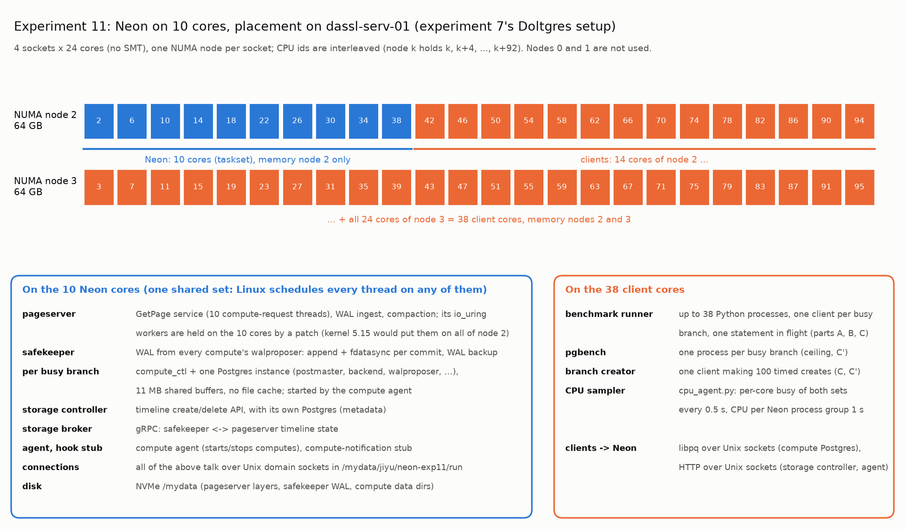

# Reproducing experiment 11

Experiment 10's local Neon (every inter-service connection on a Unix domain socket) on experiment 7's hardware
setup: Neon on 10 cores of NUMA node 2, clients on the other 38 cores of nodes 2 and 3, experiment 7's W=1 dataset.
Everything runs as user `jiyu` without sudo; lingering must be on (`loginctl enable-linger jiyu`, done 26 Oct 2026).

## Machine and placement

| | |
|---|---|
| Host | `dassl-serv-01`: 4x Intel Xeon Gold 6418H, 96 cores, no SMT, 4 NUMA nodes of 24 cores (64 GB each); CPU ids interleaved, node k holds k, k+4, ..., k+92 |
| Neon | CPUs `2,6,10,14,18,22,26,30,34,38` (experiment 7's server cores), memory node 2: `taskset -c <cpus> numactl --membind=2` |
| Clients | CPUs `42,46,...,94` (rest of node 2) and `3,7,...,95` (node 3): 38 cores, memory nodes 2 and 3: `numactl --physcpubind=<cpus> --membind=2,3` |
| Disk | `/mydata` NVMe (`nvme2n1`, I/O counters on `nvme2c2n1`), ext4, shared with other users |
| OS | Ubuntu 22.04, kernel 5.15.0-131 |
| Other load | root-owned Hadoop JVMs (about 0.1 core each, allowed on every CPU), occasional light processes of other users |



## Software

- Neon fork `/mydata/jiyu/neon`, branch `local-uds` on `4187e2da7`, uncommitted changes in
  [code/neon_fork.patch](code/neon_fork.patch): experiment 10's Unix-socket support plus a vendored copy of
  `tokio-epoll-uring` (`vendor/tokio-epoll-uring`, wired in by a `[patch]` section in the workspace `Cargo.toml`). Its
  only change, [code/tokio_epoll_uring.patch](code/tokio_epoll_uring.patch) against upstream commit `781989b`, keeps
  the pageserver's io_uring worker threads on the process's CPUs (see pitfalls). Build as in experiment 10:
  ```bash
  cd /mydata/jiyu/neon && export PROTOC=$HOME/.local/protoc/bin/protoc PATH=$HOME/.local/protoc/bin:$PATH
  BUILD_TYPE=release CARGO_BUILD_FLAGS="--features=testing" make -j48 -s
  ```
- Binary snapshot in `/mydata/jiyu/neon-exp11/bin` (`neon_services.sh install`), hashes in
  [code/bin_sha256.txt](code/bin_sha256.txt).
- This repo at the commit in [code/base_commit.txt](code/base_commit.txt) (branch `experiments-4-to-10`), no
  uncommitted shared-code changes.

## Parameters

| | |
|---|---|
| Services | experiment 10's: 1 pageserver (page cache 1 GiB), 1 safekeeper, broker, storage controller + its Postgres, hook stub, compute agent; Unix sockets in `/mydata/jiyu/neon-exp11/run` |
| Dataset | CH-benCHmark W=1 (experiment 7's), database `bench`; stock heap 33.3 MiB, `stock_pkey` 2.2 MiB |
| Compute | `shared_buffers = 11MB` (30% of stock + key), no local file cache, `max_connections = 25`; prewarm `pg_prewarm('stock', 'buffer', 'main', 0, 1061)` then `pg_prewarm('stock_pkey')` on every busy branch |
| A low load | one branch, one client: READ 40,000, RANGE_READ 10,000, INSERT 6,000, UPDATE 6,000; 100 creates (every 5th connected) with one MIXED busy branch |
| B scaling | N = 1, 4, 16, 64, 128, 256, 512; one client per branch, `min(N, 38)` processes; READ `min(4000, max(50, ceil(200000/N)))`, RANGE_READ `min(1000, max(10, ceil(50000/N)))` per client (experiment 7); INSERT/UPDATE `max(2500, ceil(6000/N))`, at most 640,000 per run (experiment 5); 10% untimed warm-up |
| B ceiling | `ceiling_pgbench.py`: same N, one `pgbench -c 1` per branch, 30 s; point, range, insert once, update three times |
| C branch create | N = 1, 4, 16, 64, 128, 256, 512 busy branches, background READ (experiment 7) and MIXED 80/20 (experiments 2/5/10); 100 timed creates after 10 untimed, every 5th connected |
| C' creates under pgbench | `create_under_pgbench.py`: N = 1, 16, 64, 256, 512 pgbench clients running point reads or updates for 120 s; after 10 s, 10 untimed + up to 100 timed creates (every 5th connected), stopping 5 s before pgbench ends |
| CPU | `cpu_agent.py` per run: busy, user, system, softirq of every server and client core every 0.5 s; CPU per Neon process group every 1 s; NVMe and node-2 memory counters |

## Commands, in order

```bash
cd ~/db-fork
X=experiment/11-neon-local-10cores/scripts
source $X/env.sh                        # NUMA_CLIENT, NUMA_SERVER, CPU lists

# 1. binaries and services (about 30 s); every pid must show cpus 2,6,...,38
$X/neon_services.sh install
$X/neon_services.sh start --transport uds
$X/neon_services.sh status

# 2. seed W=1 (about 30 s); env-init again after any restart of the services is done by the drivers
"${NUMA_CLIENT[@]}" uv run python $X/neon_ctl.py seed

# 3. smoke tests (about 6 minutes; data/superseded/smoke_*)
"${NUMA_CLIENT[@]}" $X/smoke.sh

# 4. everything (resumable; 1 h 38 min on 26 Oct 2026): low_load 2 min, branch_create_read 8 min,
#    branch_create_mixed 10 min, scaling 22 min, ceiling 31 min, create_under_pgbench 24 min
setsid nohup "${NUMA_CLIENT[@]}" $X/run_all.sh > experiment/11-neon-local-10cores/logs/run_all.log 2>&1 < /dev/null &

# 5. follow-up probes (about 12 minutes; restarts the services on 24 cores, then back on 10): 24-core ceiling
#    points and run-queue wait. The 26 Oct runs used the same commands in two parts (logs/probe_24cores.log,
#    logs/probe_sched.log).
setsid nohup numactl --cpunodebind=3 --membind=3 $X/run_probes.sh > experiment/11-neon-local-10cores/logs/probes.log 2>&1 < /dev/null &

# 6. tables and figures (any CPUs; node 1 keeps them off both sets)
numactl --cpunodebind=1 --membind=1 uv run python $X/analyze.py
numactl --cpunodebind=1 --membind=1 uv run python $X/plot_placement.py
```

## Pass checks

- Every `progress.log` line reads `DONE ... ok` (no failed operations, intended client processes, CPU labels present,
  node-2 available memory above 4 GB).
- `ceiling_pgbench.csv` and `create_under_pgbench/summary.csv`: `failed` / `background_failed` 0.
- During a run, every thread of every Neon process, including the pageserver's `iou-wrk-*` threads, has
  `Cpus_allowed_list` `2,6,...,38`:
  `for t in /proc/$(cat /mydata/jiyu/neon-exp11/run/pageserver.pid)/task/*; do awk '/Cpus_allowed_list/{print $2}' $t/status; done | sort | uniq -c`

## Cleanup

```bash
uv run python experiment/11-neon-local-10cores/scripts/neon_ctl.py purge
experiment/11-neon-local-10cores/scripts/neon_services.sh stop
rm -rf /mydata/jiyu/neon-exp11
```

## Known pitfalls

- **io_uring workers escape CPU pinning on kernel 5.15.** The pageserver's file I/O goes through io_uring
  (`tokio-epoll-uring`); the kernel's io-wq worker threads (`iou-wrk-*`) get their NUMA node's CPU mask, not the
  process's affinity or cpuset, and refuse `sched_setaffinity`. Unpatched, about 1.3 cores of the pageserver's work ran
  on the clients' node-2 cores (`data/superseded/before_iowq_pin`). A cpuset cgroup does not help on this kernel. The
  vendored patch registers each submitting thread's affinity with `IORING_REGISTER_IOWQ_AFF` before its first real
  submission (a NOP on a throwaway ring creates the thread's io-wq first; workers created before the registration keep
  the node mask).
- **numactl --physcpubind rejects CPUs outside the caller's affinity.** The drivers run bound to the client CPUs and
  restart the services, so the services are bound with `taskset -c` (plus `numactl --membind=2`).
- **Per-core busy time from `/proc/stat` reads below the processes' CPU time when the cores are not full** (4.3
  against 5.9 cores for point reads at N = 16). `/proc/stat` user and system time is sampled at timer ticks, which
  stop on idle cores; the per-thread scheduler clock (`/proc/<pid>/task/*/schedstat`, `scripts/sched_probe.py`)
  agrees with the per-process numbers. At saturation the two agree. The tables keep experiment 7's per-core method
  so the two experiments compare like for like; the per-group split is scaled to it.
- **Relative output paths and pgbench.** pgbench runs in each point's directory; `ceiling_pgbench.py` resolves its
  output path.
- **`pkill -f <pattern>` from a shell whose command line contains the pattern kills that shell.**
- Experiment 10's pitfalls apply (lingering, socket path length, NVMe multipath counters, memory per compute,
  never writing the repo's `.env`).

## Addendum, 27 Oct 2026: Doltgres writes and the branch-creation analysis

Same machine and placement. Doltgres is experiment 7's 1.4.0 binary (sha256 `76f81076...ddab21c`, in
[code/bin_sha256.txt](code/bin_sha256.txt)), run by hand from `/mydata/jiyu/doltgres-exp11` on port 5433, with the
server on the same 10 cores as Neon. **Neon and Doltgres must never run at the same time**; the drivers check this.
The Go trace analyzer needs Go 1.26 (the server is built with go1.26.8), fetched by the local Go 1.25 through
`GOTOOLCHAIN=go1.26.8`. Shared code is unchanged (base commit in [code/base_commit.txt](code/base_commit.txt)).
Source versions cited in the report: [code/doltgres_sources.txt](code/doltgres_sources.txt).

### Parameters

| | |
|---|---|
| Server | `GOMAXPROCS=10 taskset -c 2,6,...,38 numactl --membind=2 doltgres -config config.yaml` (experiment 7's config: `log_level: warning`, listener 127.0.0.1:5433); `GODEBUG=schedtrace=1000,gctrace=1` for T and H |
| Writes | `scripts/dolt/run_busy_branches.sh`: N = 1, 4, 16, 64, 256, 1,024; INSERT and UPDATE; per client `min(6000, max(20, ceil(30000/N)))`; experiment 7's flags (`--mode sync --warmup-fraction 0.1 --table-name stock --updates-per-branch 100 --seed-db ch_w1_seed`), `min(N, 38)` processes |
| T | `create_under_reads.py`: 1,024 branches per set from main of `ch_w1_seed`: `rd_*` with 100 uncommitted single-row updates each, then (after deleting them) `rc_*` plain. N connections read back to back (one point read in flight each, 38 client processes); after 15 s, 100 creates (30 at N = 1,024) from one more connection. Points D64, D256, D1024, D1024half (reads paced to half of D1024's rate), U64 (updates, no creates, 20 s), C1024; each untraced and traced (`doltgres --prof trace --prof-path DIR`) |
| H | no busy branch, the `rd_*` branches present; T spinning threads (`cpu_hog.c`) on the server cores, in the server's session (`--hog T` of `doltgres_server.sh`) or their own (`setsid taskset`); T = 0, 10, 128, 1,024; 100 creates |
| N | `create_under_pgbench.py --kinds point --sched`: N = 64, 256, 512 pgbench point-read clients, 120 s, 10 untimed + 100 timed creates (every 5th connected); at N = 256 with `--nice-storcon 19`, then also `--nice-pageserver 19` |

### Commands, in order

```bash
cd ~/db-fork
X=experiment/11-neon-local-10cores/scripts
source $X/dolt/env.sh
# 0. Neon stopped ($X/neon_services.sh stop); server files: copy experiment 7's dl/ (or doltgres_server.sh install),
#    then write the config
$X/dolt/doltgres_server.sh install
gcc -O1 -pthread -o /mydata/jiyu/doltgres-exp11/cpu_hog $X/dolt/cpu_hog.c
( cd $X/dolt/gotrace && GOPATH=/mydata/jiyu/doltgres-exp11/go GOCACHE=/mydata/jiyu/doltgres-exp11/go/cache \
  GOTOOLCHAIN=go1.26.8 GOFLAGS=-modcacherw go build -o /mydata/jiyu/doltgres-exp11/gotrace . )

# 1. writes (smoke 2 min, full 18 min; the first run builds ch_w1_seed)
$X/dolt/doltgres_server.sh start 10
numactl --physcpubind=$CLIENT_CPUS --membind=$CLIENT_MEM $X/dolt/run_busy_branches.sh --smoke
setsid nohup numactl --physcpubind=$CLIENT_CPUS --membind=$CLIENT_MEM $X/dolt/run_busy_branches.sh \
    --ns 1,4,16,64,256,1024 > experiment/11-neon-local-10cores/logs/dolt/driver_writes.log 2>&1 < /dev/null &
$X/dolt/doltgres_server.sh stop        # after "study done"

# 2. T and H (restarts the server per point; setup_rd 1.5 min, T 18 min, H 4 min, setup_rc 10 s, C 2 min;
#    the trace analyses run between points)
setsid nohup numactl --physcpubind=$CLIENT_CPUS --membind=$CLIENT_MEM $X/dolt/run_create_analysis.sh \
    > experiment/11-neon-local-10cores/logs/dolt/create_analysis.log 2>&1 < /dev/null &
#    (the 27 Oct run: --smoke --phases setup_rd,T first, then --phases T,H,setup_rc,C)

# 3. N (Doltgres stopped; 15 min; leaves the Neon services stopped)
source $X/env.sh
setsid nohup "${NUMA_CLIENT[@]}" $X/run_create_sched.sh > experiment/11-neon-local-10cores/logs/create_sched.log 2>&1 < /dev/null &

# 4. re-analyse the traces (any CPUs; 2 min in parallel), then tables and figures
cd experiment/11-neon-local-10cores/data/dolt
for t in /mydata/jiyu/doltgres-exp11/traces/*; do L=$(basename $t); D=create_trace/$L; [[ -d create_hog/$L ]] && D=create_hog/$L
  a=""; [[ $L == U64_tr ]] && a=-allsites
  numactl --cpunodebind=0,1 /mydata/jiyu/doltgres-exp11/gotrace $a -trace $t/trace.out -out $D/trace & done; wait
cd ~/db-fork
numactl --cpunodebind=1 --membind=1 uv run python $X/dolt/analyze_create.py
numactl --cpunodebind=1 --membind=1 uv run python $X/analyze.py
```

### Pass checks

- `data/dolt/progress.log`: 12 `DONE ... ok` for the writes. `create_trace/progress.log` and
  `create_hog/progress.log`: every point `DONE`, no `CHECK-FAIL`.
- Each `trace_analysis.log` names a creating connection (except U64_tr). In `figures/create_breakdown.md`,
  `trace_ms` is within 20% of `client_ms`.
- The H points show `server_cores_busy` of at least 9.9.
- `create_sched/summary_*.csv`: `background_failed` 0. `nice` shows `nice 19` for the niced runs.

### Pitfalls

- **Start the Doltgres server with `taskset`, not `numactl --physcpubind`**, when the caller is bound to the client
  CPUs. numactl refuses CPUs outside its caller's affinity, and the start then hangs for 60 s and fails.
- **Tracing.**
  - `doltgres --prof trace` writes the trace only on a clean exit (SIGTERM). `doltgres_server.sh stop` waits up to
    600 s.
  - Traces grow by 3-5 MB/s under saturating reads.
  - Tracing slows creates by up to 1.8x at 256 busy branches: compare untraced runs.
- **Autogroup nice.**
  - An unprivileged user can raise `/proc/<pid>/autogroup` nice but not lower it. Restart the services after a
    niced run.
  - The kernel allows one change per 100 ms system-wide, and a second write gets EAGAIN
    (`create_under_pgbench.py` retries).
- **Process names are truncated to 15 characters:** the storage controller's is `storage_control`. Use the pid
  files in `$RUN`.
- **Do not keep two branch sets at once.** The create scans every branch, so experiment 7's C and D comparisons
  use one set of 1,024 at a time.
