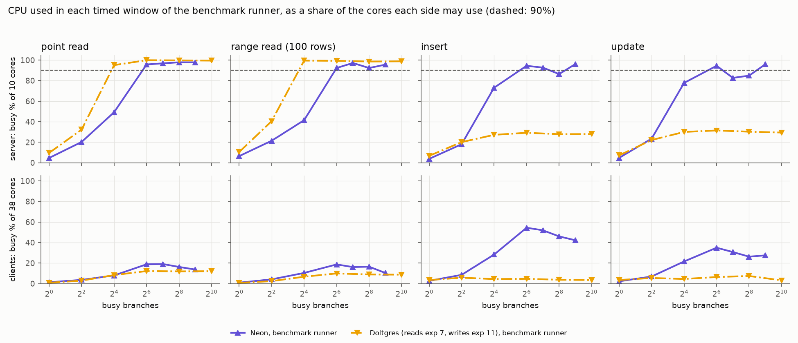
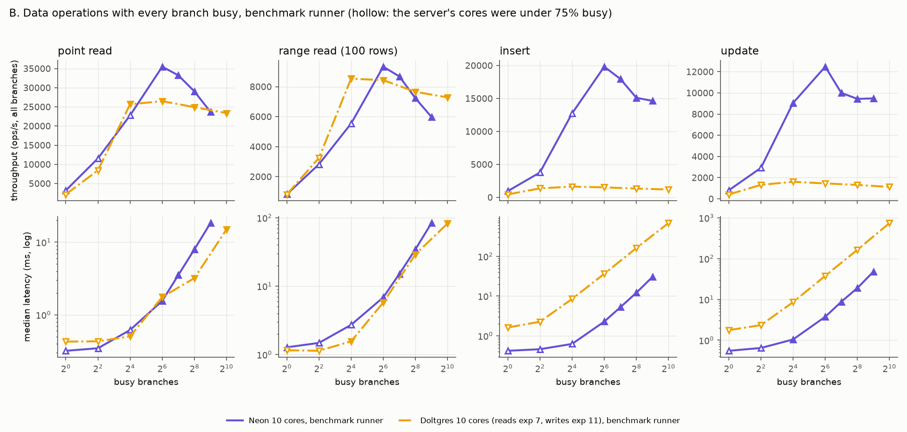
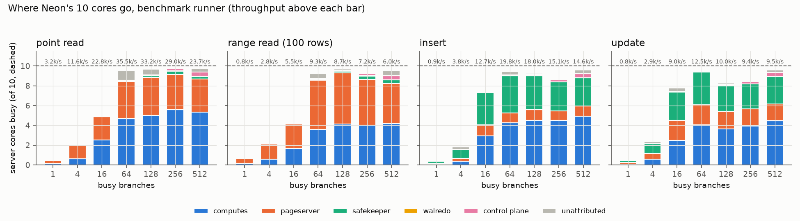
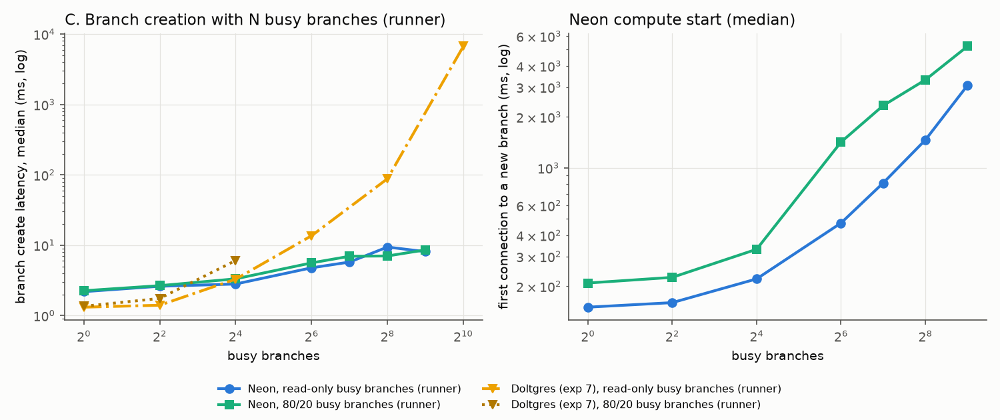
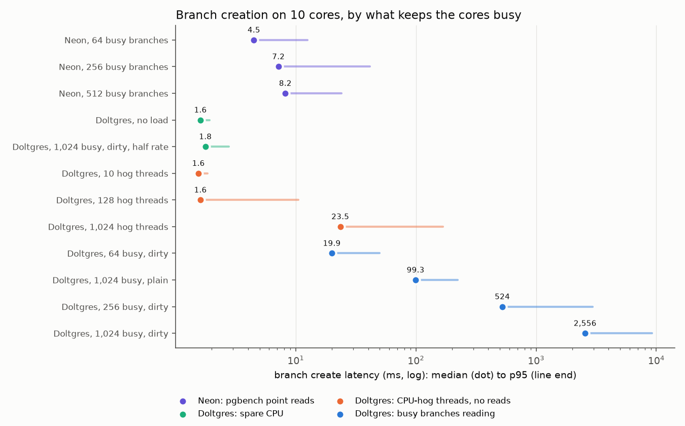
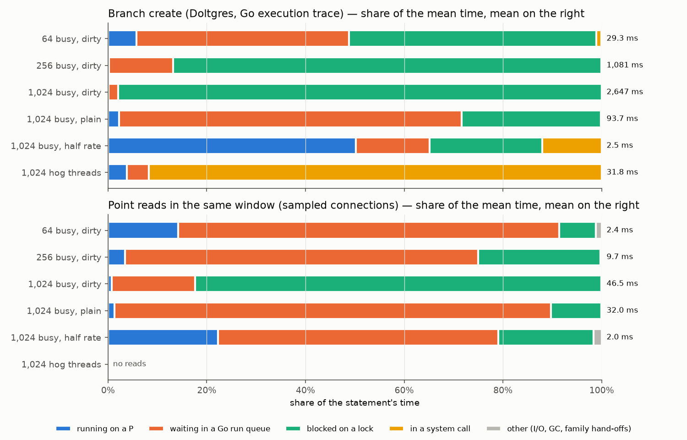
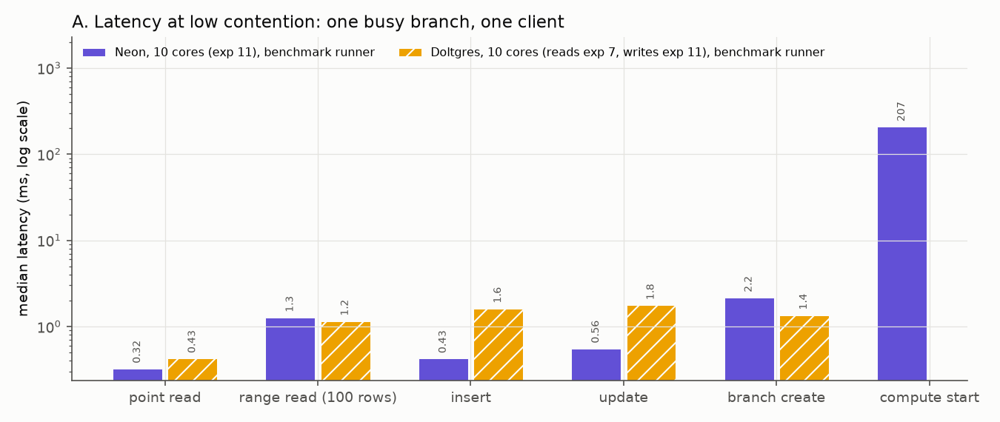

# Experiment 11 report: Neon on Doltgres's 10 cores

Experiment 10 gave local Neon all 24 cores of NUMA node 2; experiment 7 gave Doltgres 10. This experiment reruns
experiment 10 (every Neon connection on a Unix socket) on experiment 7's placement and dataset, so that the two
single-machine branchable databases are compared on the same hardware. For every point it records the CPU of the
server cores and of the client cores to say which side limits throughput, as experiment 7 did.

**Addendum, 27 Oct 2026.** Two additions with experiment 7's Doltgres setup: Doltgres inserts and updates for A and B
(experiment 7 ran reads only), and section D, which finds and verifies why Doltgres's branch creation degrades so
much more than Neon's under read-only busy branches (summary items 8 and 9).

## Summary

1. **Both systems are server-CPU-bound, and on 10 cores Neon gets more out of them.** Point reads peak at 35.0k/s
   (pgbench) / 35.5k/s (benchmark runner) at 64 busy branches with 9.6-9.7 of 10 server cores busy, against
   Doltgres's 26.5k/s (runner) / 28.4k/s (minimal client). A Neon point read costs 277 µs of server CPU at the peak,
   a Doltgres read 377 µs. Range reads peak at 9.2-9.3k/s (Doltgres 8.5k/s). The clients never limit: at most 5.6 of
   38 client cores for reads.
2. **Past the peak Neon loses more than Doltgres.** From the peak to 512 busy branches Neon's point reads fall 36%
   (35.0k to 22.5k/s) and range reads 33%, because the server CPU per read rises 57% (277 to 435 µs): 512 Postgres
   instances, each with its own processes, plus per-branch work in the safekeeper and control plane (1.2 of the 10
   cores at N = 512). Doltgres falls 12-15% from its peak at 1,024 sessions, with its CPU per read up 13%. At N = 512
   Neon and Doltgres (at N = 1,024) are about equal.
3. **Neon saturates later (N = 64, Doltgres N = 16), and below saturation 10 cores cost it more than 10/24 of its
   throughput.** With 16 branches Neon reaches 21.7k reads/s on 10 cores but 56.7k on 24 cores (same dataset, same
   CPU per read). A scheduler probe shows why: on 10 cores Neon's threads already wait 2.2 cores' worth on run queues
   at N = 16 (87 µs per read), and the pageserver serves all GetPage requests on 10 worker threads (as many as its
   CPUs). On 24 cores the same load waits 1 µs per read.
4. **Writes are server-CPU-bound on 10 cores, updates included.** Inserts peak at 20k/s from N = 16, updates at
   11.0-12.5k/s at N = 64, both with 9.4-9.7 server cores busy; the safekeeper's commit path takes about 3 of the 10
   cores. On 24 cores (experiment 10) updates were limited by synchronous disk writes instead.
5. **Branch creation slows 3-4x when Neon's CPU is full; Doltgres's slows 10-5,000x.** With the server cores 97-98%
   busy (pgbench point reads), Neon's create median goes from 2.1 ms (1 busy branch) to 4.1 / 7.0 / 8.1 ms at
   64 / 256 / 512, p95 up to 215 ms. Doltgres at the same CPU took 13.6 ms (64), 88 ms (256) and 6.7 s (1,024).
   So creation does suffer CPU contention in Neon too, only much less. Section D explains the difference.
6. **Neon's real branch cost under contention is starting the branch's compute.** The first connection to a new
   branch (starting its Postgres) takes 0.15 s at 1 busy branch and 1.0-5.2 s at 512 (runner 80/20 background: 5.2 s).
   Doltgres has no such step (a new branch is used with a new session; experiment 7 did not time it separately). At
   256 busy branches a new Neon branch is usable after about 1.5 s, a Doltgres branch after about 0.1 s.
7. **Memory caps Neon at 512 busy branches on node 2**: 43 MB per running compute at 11 MB shared buffers; 1,024
   computes would need 44 GB of the 46 GB free, under the 4 GB margin the plan set, so N = 1,024 was not run.
8. **Doltgres writes are limited by a lock, not by CPU (addendum).** With experiment 7's setup, one Doltgres insert
   or update takes 1.6-1.8 ms at one busy branch (Neon 0.4-0.6 ms). Throughput peaks at 1.6k/s at 16 busy branches
   and falls to 1.1-1.2k/s at 1,024, with the server on only 2.7-3.2 of its 10 cores; Neon reaches 20k inserts/s and
   11-12.5k updates/s. A Go execution trace shows an update at 64 busy branches spending 49 of its 52 ms waiting for
   the database's chunk-store lock (`NomsBlockStore.mu`), which every chunk written takes exclusively. The journal
   fsync costs 0.14 ms.
9. **Why Doltgres's creation degrades so much more (addendum, section D).** A Doltgres create needs only 1.2-2.6 ms
   of CPU at every load. It is slow because it runs inside the server process behind two queues that the read load
   fills. **Go's run queues** have no priority, and a create goes back into them 23-52 times, a read about twice.
   With plain branches that alone gives 99 ms at 1,024 busy branches. **The chunk-store lock** is taken exclusively
   10-24 times per create, and also by reads that miss the node cache. With dirty branches (100 uncommitted updates
   each, as in the benchmark) these exclusive takers form a convoy whose holders progress only when the saturated
   scheduler runs them. Lock waits then make up 50% of a create at 64 busy branches and 87-98% at 256-1,024: 0.5 s
   and 2.6 s medians. Spare CPU removes both queues (1.8 ms with 1,024 busy branches at half rate). Filling the
   cores with spinning threads instead of reads leaves creates at 1.6 ms (10 or 128 threads) to 16-23 ms (1,024).
   That is kernel-level contention, the same order as Neon's. Neon's create runs in separate processes that sleep
   between requests, and its storage controller waits only 1-4 ms per create on the kernel's run queue.
   Deprioritizing it (nice +19) changes the median by at most 1.6 ms.

## What was run

| | |
|---|---|
| Machine | `dassl-serv-01`, 4x Xeon Gold 6418H, NUMA node = socket of 24 cores, no SMT |
| Neon | CPUs 2,6,...,38 (10 cores of node 2), memory node 2, every service and every compute in that one CPU set |
| Neon IPC | Unix domain sockets for every connection (experiment 10's fork); no Neon process listens on TCP. Details below the table |
| Clients | the other 14 cores of node 2 and all 24 of node 3 (38 cores), memory nodes 2 and 3 |
| Dataset | CH-benCHmark W=1 (experiment 7's): `stock` 33.3 MiB + `stock_pkey` 2.2 MiB |
| Compute | shared_buffers 11 MB (30% of stock + key), no local file cache, prewarmed |
| A | one busy branch, one client: 40,000 point reads, 10,000 range reads, 6,000 inserts, 6,000 updates; 100 creates |
| B | N = 1-512 busy branches, one client each: benchmark runner (experiment 7's op counts, up to 38 processes) and pgbench ceiling (one `pgbench -c 1` per branch, 30 s; updates 3x) |
| C | 100 creates (every 5th connected) with N = 1-512 busy branches, read-only (experiment 7) and 80/20 (experiments 2/5/10) backgrounds |
| C' | the same creates while N = 1-512 pgbench clients saturate Neon with point reads or updates |
| Probes | ceiling at N = 4, 16, 64 with Neon on all 24 cores of node 2 (same dataset); run-queue wait of Neon's threads at N = 16, 64 on 10 and 24 cores |
| Addendum: Doltgres writes | experiment 7's Doltgres 1.4.0 setup on the same cores: INSERT and UPDATE at N = 1, 4, 16, 64, 256, 1,024 (benchmark runner) |
| Addendum: D (creation analysis) | T: Doltgres creates under back-to-back reads (64/256/1,024 dirty branches, 1,024 plain, 1,024 at half rate) and updates (64), each untraced and with a Go execution trace; H: Doltgres creates with 10/128/1,024 spinning threads on the server cores and no reads; N: Neon creates under pgbench reads (64/256/512) with per-create kernel scheduling, and at 256 with the storage controller (and pageserver) at nice +19 |

**Neon's IPC.** This Neon is experiment 10's fork: upstream commit `4187e2da7` plus the uncommitted `local-uds`
changes in [code/neon_fork.patch](code/neon_fork.patch). Every listener that took `host:port` takes a Unix socket
path instead. Every connection between the services, the computes and the clients therefore runs over a Unix domain
socket under `/mydata/jiyu/neon-exp11/run/`, each with the protocol it uses upstream:

| connection | protocol |
|---|---|
| compute backends to pageserver (GetPage); compute_ctl to pageserver (basebackup) | libpq |
| walproposer to safekeeper (WAL); pageserver to safekeeper (WAL pull) | libpq |
| safekeeper and pageserver to storage broker | gRPC |
| storage controller to pageserver and safekeeper (including branch creation); pageserver to storage controller | HTTP |
| storage controller to its Postgres | libpq |
| clients (benchmark runner, pgbench, creation drivers) to the computes | libpq |
| compute_ctl's HTTP APIs; the experiment's compute agent (starts and stops computes) | HTTP |

- **Already local upstream:** WAL redo (pipes to a child process) and remote storage (`local_path` files).
- **Checked:** `neon_services.sh status` reported no TCP listener of any Neon process and 9 sockets in the run
  directory.
- **The one TCP connection:** the CPU sampler's, on node 3, polled once a second and never on a timed path.
- **Doltgres** serves its clients on loopback TCP (port 5433), as in experiment 7.

*What a Unix domain socket is.* It is a socket between two processes on the same machine. A program uses it through
the same calls as TCP (`connect`, `accept`, `read`, `write`), but the socket is named by a filesystem path instead of
`host:port`, and the data never enters the network stack. Loopback TCP still builds segments with sequence numbers,
acknowledgements and checksums and passes them through IP. A Unix socket's write is a kernel copy into the peer's
receive buffer and a wake-up of the reader. Access is controlled by the socket file's permissions, and only processes
on this machine can connect. Postgres clients reach a server's `<dir>/.s.PGSQL.<port>` with `host=<dir>`, so libpq
users needed only configuration; HTTP and gRPC clients needed the fork's `http+unix://` connector. Experiment 10
measured a raw round trip on node 2 at 6 µs over a Unix socket against 18 µs over loopback TCP. For Neon, which spends
0.2-1.3 ms of CPU per statement, that saved 13-47 µs per statement and 4-7% of throughput where the CPU is the limit.

The CPU numbers below are per-core busy time of the 10 server cores and of the 38 client cores from `/proc/stat`
over each timed window (experiment 7's method), with the server's split per Neon process group. Whether the client
side limits is judged from the benchmark processes' own CPU (`client own`), because the client cores also run the
CPU sampler and other users' light load. Every run passed its checks (no failed operation, intended processes,
node-2 memory above 4 GB); the pgbench and creation runs report 0 failed transactions.

## Which side limits: server cores and client cores per point

The rule is experiment 7's: server CPU if the 10 server cores are at least 90% busy; client CPU if the benchmark
processes use at least 85% of the cores they can use; otherwise neither. "pgbench" is the ceiling run (one pgbench
process per branch, cheap), "runner" the Python benchmark runner (about 0.3-0.9 ms of client CPU per statement).

| op | N | pgbench ops/s | server cores | client own cores | runner ops/s | server cores | client own cores | verdict (runner) |
|---|---:|---:|---:|---:|---:|---:|---:|---|
| point | 1 | 4.8k | 0.7 | 0.06 | 3.2k | 0.5 | 0.4 of 1 | neither |
| point | 4 | 13.1k | 2.5 | 0.15 | 11.6k | 2.0 | 1.3 of 4 | neither |
| point | 16 | 21.7k | 4.3 | 0.27 | 22.8k | 4.9 | 2.6 of 16 | neither (run-queue wait, see below) |
| point | 64 | 35.0k | 9.7 | 0.46 | 35.5k | 9.6 | 5.3 of 38 | server CPU |
| point | 128 | 34.2k | 9.8 | 0.49 | 33.2k | 9.7 | 5.6 of 38 | server CPU |
| point | 256 | 31.4k | 9.8 | 0.49 | 29.0k | 9.8 | 5.3 of 38 | server CPU |
| point | 512 | 22.5k | 9.8 | 0.44 | 23.7k | 9.8 | 4.6 of 38 | server CPU |
| range | 16 | 5.1k | 4.1 | 0.37 | 5.5k | 4.1 | 1.8 of 16 | neither |
| range | 64 | 9.2k | 9.4 | 0.71 | 9.3k | 9.2 | 3.7 of 38 | server CPU |
| range | 512 | 6.2k | 9.8 | 0.58 | 6.0k | 9.6 | 2.8 of 38 | server CPU |
| insert | 1 | 5.1k | 2.2 | 0.05 | 0.9k | 0.4 | 0.8 of 1 | neither (the runner's process: 83% busy) |
| insert | 16 | 20.0k | 9.5 | 0.22 | 12.7k | 7.3 | 10.5 of 16 | neither (runner 65% busy) |
| insert | 64 | 19.7k | 9.7 | 0.24 | 19.8k | 9.4 | 18.9 of 38 | server CPU |
| insert | 512 | 15.0k | 9.4 | 0.30 | 14.6k | 9.6 | 15.1 of 38 | server CPU |
| update | 16 | 8.2k | 7.5 | 0.09 | 9.0k | 7.8 | 7.6 of 16 | neither (commit latency) |
| update | 64 | 11.0k | 9.4 | 0.15 | 12.5k | 9.4 | 11.8 of 38 | server CPU |
| update | 128-256 | 8.7-8.8k | 9.1-9.5 | 0.13-0.17 | 9.4-10.0k | 8.3-8.5 | 9.6-9.9 of 38 | neither by the 90% rule (83-85% busy) |
| update | 512 | 7.4k | 9.4 | 0.18 | 9.5k | 9.6 | 9.6 of 38 | server CPU |

The full table, with Doltgres's rows, is [figures/cpu_sides.md](figures/cpu_sides.md).

- **From N = 64 the server's 10 cores are the bottleneck for every operation**, in both clients. pgbench and the
  runner reach the same throughput (within the run-to-run noise of about 10-15%, see data quality), and pgbench's
  processes use under 0.8 cores in all, so a faster client would not raise the ceiling.
- **The clients never limit Neon's reads.** The runner's own processes use at most 5.6 of 38 cores (15%); the client
  cores are at most 19% busy including the sampler and other users' processes.
- **For writes at small N the runner itself is the limit**, as in experiment 10: one insert costs the runner about
  0.9 ms of CPU, so one client process makes 0.9k inserts/s against pgbench's 5.1k. From N = 64 the runner has 38
  processes at about 50% busy and the server is full.
- **Below N = 64 the per-core busy time understates how close Neon is to CPU-bound** (next section).

## B. Data operations with every branch busy

The plots in this report show the benchmark runner only, for Neon here and for Doltgres in experiment 7, so both
systems are measured by the same client. The pgbench ceiling, Doltgres's minimal client and experiment 10 (24 cores,
W=4) are in the tables: [figures/data_ops.md](figures/data_ops.md), [figures/ceiling.md](figures/ceiling.md).

### Neon against Doltgres on the same 10 cores

| | Neon, 10 cores | Doltgres, 10 cores (experiment 7) |
|---|---|---|
| point reads, peak | 35.0k/s (pgbench), 35.5k/s (runner) at N = 64 | 26.5k/s (runner), 28.4k/s (minimal client) at N = 64 |
| point reads, largest N | 22.5k/s (pgbench), 23.7k/s (runner) at N = 512 | 23.4k/s (runner), 23.9k/s (minimal) at N = 1,024 |
| server CPU per point read | 277 µs at N = 64, 435 µs at N = 512 | 377 µs at N = 64, 425 µs at N = 1,024 |
| range reads, peak / largest N | 9.3k/s at 64 / 6.0-6.2k/s at 512 | 8.5k/s at 16 / 7.3k/s at 1,024 |
| first N with the server at least 90% busy | 64 (inserts 16) | 16 |
| point read p50, N = 1 / 64 / 512 | 0.25 / 1.3 / 11.2 ms (pgbench) | 0.43 / 1.8 / 15.1 ms (runner, at 1,024) |
| inserts, updates (peak) | 20.0k/s, 11.0-12.5k/s | 1.6k/s, 1.6k/s at N = 16 (addendum, runner) |
| server cores busy at the write peak | 9.4-9.7 | 2.7-3.0 |

Neon's peak is higher because its read path is cheaper per operation on a hot cache, and every busy branch is a
separate Postgres whose backend does most of the work (computes: 5.2 of 9.7 cores at the point-read peak, pageserver
4.3). Doltgres runs all sessions in one Go process and saturates already at N = 16.

### Why Neon falls off past the peak

*The figure is the benchmark runner's scaling runs ([figures/scaling_cpu_runner.md](figures/scaling_cpu_runner.md)); the
table below uses the pgbench ceiling run ([figures/scaling_cpu.md](figures/scaling_cpu.md)). The two split the server's
CPU between computes and pageserver in the same proportions.*

| point reads | N = 64 | N = 512 | change |
|---|---:|---:|---:|
| throughput (pgbench) | 35.0k/s | 22.5k/s | -36% |
| server CPU per read | 277 µs | 435 µs | +57% |
| computes, µs per read | 148 | 225 | +52% |
| pageserver, µs per read | 122 | 144 | +18% |
| safekeeper + control plane (cores) | 0.14 | 1.16 | +1.0 core |

The extra CPU per read is overhead of having many branches running, not more work per read: 512 Postgres instances
each with their own backend, background processes and walproposer, which the kernel switches between (the probe at
N = 64 already counts 15k involuntary context switches per second in the pageserver alone), plus about one core of
safekeeper and control-plane work for 512 timelines even though the workload only reads. Doltgres has one process,
and its CPU per read grows only 13% from 64 to 1,024 sessions.

### Why 10 cores cost Neon more than 10/24 below saturation

| point reads, N = 16 | 10 cores (full run) | 10 cores (probe) | 24 cores (probe) |
|---|---:|---:|---:|
| throughput | 21.7k/s | 25.4k/s | 56.5-56.7k/s |
| p50 latency | 0.56 ms | 0.58 ms | 0.32 ms |
| server CPU per read (per-process) | 256 µs | 231 µs (thread run time) | 207-208 µs |
| Neon threads runnable but waiting, in cores | | 2.2 | 0.06 |
| run-queue wait per read | | 87 µs | 1 µs |
| pageserver threads / time per timeslice | | 49 / 237 µs | 132 / 66 µs |

Full tables: [figures/probe_24cores.md](figures/probe_24cores.md) and [figures/probe_sched.md](figures/probe_sched.md).

With the same dataset, Neon on 24 cores makes 56.7k point reads/s at N = 16 and 69.5k at N = 64, so its throughput
on 10 cores (21.7k and 35.0k) is not limited by the dataset or the cache. The CPU per read is about the same
(207 against 231-256 µs). The difference is waiting. At N = 16 on 10 cores Neon's threads (read from
`/proc/<pid>/task/*/schedstat`) ran 5.9 cores and, on average, another 2.2 threads were runnable but waiting for a
core, so every read waited 87 µs on run queues. Each read is a chain of hand-offs between processes (pgbench to the
backend, the backend to a pageserver worker and back), and each hand-off can wait for a core. The pageserver's
GetPage runtime has one worker thread per CPU it may use: 10 here, 24 in experiment 10. On 10 cores each worker runs
237 µs per timeslice, serving several requests in turn, and a ready request also waits for a free worker. That wait
happens inside the pageserver, so schedstat does not see it; it is the likely remainder of the 630 µs per read in the
closed loop (not measured directly).

The per-core busy time in the table above (4.3 cores at N = 16) undercounts. The thread run times add up to 5.9
cores. `/proc/stat` samples user and system time at timer ticks, and the ticks stop on idle cores, so many
sub-tick bursts are partly missed. At saturation (no idle cores) both agree (9.69 against 9.70 at N = 64), so the
verdicts from N = 64 on are unaffected. Experiment 7's Doltgres numbers come from the same `/proc/stat` method.

At N = 64 on 10 cores the wait reaches 16 cores' worth (405 µs per read), against 140 µs on 24 cores.

### The write path

| | inserts | updates |
|---|---|---|
| peak (pgbench) | 20.0k/s at N = 16-128 | 11.0k/s at N = 64 (median of 3; runner 12.5k/s) |
| server cores at peak | 9.5-9.7: computes 3.9-4.5, safekeeper 3.3-3.9, pageserver 1.2-1.7 | 9.4: computes 3.8, safekeeper 2.8, pageserver 2.6 |
| at N = 512 | 15.0k/s | 7.4k/s (reps 5.6-7.9k) |

One commit is one safekeeper WAL flush (one timeline per branch, so no group commit across branches). The mean
flush time rises from 0.05-0.08 ms at N = 1 to 2.4 ms (inserts) and 5.3 ms (updates) at N = 512 ([write
path](figures/write_path.md)), most of it waiting for CPU: the safekeeper is one of the processes sharing the 10
cores. Experiment 10 found updates limited by the disk's synchronous writes with 24 cores; on 10 cores the CPU limit
comes first. At N = 16 updates are the one point where neither side is full (7.5 cores): per-commit latency limits
the 16 closed-loop clients.

### Doltgres writes (addendum, 27 Oct 2026)

Experiment 7's setup exactly: the server on the same 10 cores, the clients on the same 38, `ch_w1_seed` (W=1),
branches made with 100 updates each, the benchmark runner with one client per branch and at most 38 processes.
Write counts are 5x experiment 2's (30,000 per run, 20 to 6,000 per client), as experiment 7 took 5x experiment 2's
reads. The N = 1 run (6,000 operations) is the low-contention point, as experiment 7's N = 1 is for reads. Data:
`data/dolt/data_ops/{INSERT,UPDATE}`, CPU samples in `data/dolt/cpu/`.

| Doltgres, benchmark runner | N = 1 | 4 | 16 | 64 | 256 | 1,024 |
|---|---:|---:|---:|---:|---:|---:|
| inserts/s | 442 | 1,364 | 1,635 | 1,515 | 1,333 | 1,190 |
| insert p50 (ms) | 1.62 | 2.25 | 8.5 | 36 | 162 | 688 |
| updates/s | 417 | 1,320 | 1,610 | 1,458 | 1,316 | 1,127 |
| update p50 (ms) | 1.76 | 2.34 | 8.6 | 38 | 164 | 741 |
| server cores busy (inserts / updates) | 0.7 / 0.7 | 2.0 / 2.2 | 2.7 / 3.0 | 2.9 / 3.2 | 2.8 / 3.0 | 2.8 / 2.9 |
| client processes' own cores | 0.4 of 1 | 1.2 of 4 | 1.4 of 16 | 1.4 of 38 | 1.3 of 38 | 1.2 of 38 |

- **Neither side's CPU limits Doltgres's writes.** The server uses at most 3.2 of its 10 cores and the runner at
  most 1.4 cores, at every N. Throughput stops growing at 16 busy branches and declines slowly after that. Latency
  grows in proportion to N, the signature of one serialized resource (Little's law: 1,024 clients / 1,190 per
  second = 0.86 s, measured mean 0.80 s).
- **The serialized resource is a lock** (traced run U64: 64 branches updating back to back, 1,230 updates/s,
  [figures/update_breakdown.md](figures/update_breakdown.md), [figures/update_sites.md](figures/update_sites.md)).
  - An update averages 52 ms. It runs 1.8 ms and waits 1.0 ms in Go's run queues.
  - It spends **49 ms blocked on the database's chunk-store lock** `NomsBlockStore.mu`. Almost all of that (44 ms)
    is the RWMutex's writer queue in `addChunk`, which every chunk written takes exclusively, about 11 times per
    update.
  - The journal fsync costs 0.14 ms per update (one per commit).
  - So all writers in the database pass through one exclusive section per chunk. Experiment 2 called this "the
    serialized commit path". It is the same lock that slows branch creation (section D).
- **Against Neon on the same cores:** 12x more inserts and 7-8x more updates at the peak. Neon's commits are
  separate per branch (one safekeeper timeline each) and are limited by CPU.
- **Against experiment 2** (CloudLab, 20 hardware threads, SATA SSD): Doltgres made about 650 writes/s at the plateau
  with 4.2 ms per update at N = 1. This machine is 2.5x faster at both, with the same shape.

## C. Branch creation with busy branches

| create median (p95), ms | N = 1 | 16 | 64 | 256 | 512 | 1,024 |
|---|---:|---:|---:|---:|---:|---:|
| Neon, read-only runner background | 2.2 (2.9) | 2.8 (3.7) | 4.8 (10.7) | 9.4 (237) | 8.1 (19) | |
| Neon, 80/20 runner background | 2.3 (3.1) | 3.3 (4.3) | 5.6 (22) | 7.0 (187) | 8.6 (82) | |
| Neon, pgbench point reads (saturating) | 2.1 (3.0) | 2.6 (3.7) | 4.1 (14) | 7.0 (23) | 8.1 (215) | |
| Neon, pgbench updates | 2.4 (3.1) | 3.6 (5.4) | 4.8 (10) | 5.8 (11) | 6.3 (11) | |
| Doltgres, read-only background (experiment 7) | 1.3 (1.4) | 3.3 (6.3) | 13.6 (27) | 88 (643) | | 6,730 (18,460) |
| Neon 24 cores, 80/20 (experiment 10) | 1.9 (3.1) | 2.9 (3.8) | 3.1 (6.6) | 3.1 (4.5) | 3.3 (6.2) | |

| server cores busy during the creates | N = 1 | 16 | 64 | 256 | 512 |
|---|---:|---:|---:|---:|---:|
| Neon, read-only runner | 4.5 | 6.5 | 9.7 | 9.8 | 9.8 |
| Neon, pgbench point reads | 1.0 | 4.8 | 9.7 | 9.8 | 9.8 |
| Doltgres, read-only (N = 1,024 in the last column) | 0.6 | 6.5 | 9.9 | 10.0 | 10.0 |

- **Neon's creation does suffer CPU contention.** On 24 cores (experiment 10, never more than 14 cores busy) the
  median stayed at 1.9-3.3 ms. On 10 cores, once the cores are full (N >= 64), it rises 2-4x and its tail grows to
  0.1-0.24 s in some runs. So experiment 10's "flat" creation reflected unused cores, not immunity.
- **Under the same saturation Doltgres's creation degrades by orders of magnitude more.** At N = 256 Neon creates in
  6-9 ms, Doltgres in 88 ms; at full CPU Doltgres reached 6.7 s at N = 1,024. Experiment 7 showed that this is CPU
  contention too (the same load on 20 cores: 1.8 ms). Why, measured in section D (addendum): a Doltgres create runs
  inside the busy server, behind Go's run queues and a chunk-store lock that the reads also take. A Neon create runs
  in separate processes that the kernel schedules soon after they wake. (This bullet first gave that explanation
  as a guess.)
- **Saturating with updates hurts creation less than with reads** (6.3 against 8.1 ms at N = 512), because update
  load leaves the server 91% busy against 98% (part of its time is spent waiting on flushes).

### The compute start: making a new branch usable

| first connection to a new branch, median | N = 1 | 16 | 64 | 256 | 512 |
|---|---:|---:|---:|---:|---:|
| read-only runner background | 0.15 s | 0.22 s | 0.47 s | 1.46 s | 3.07 s |
| 80/20 runner background | 0.21 s | 0.33 s | 1.42 s | 3.31 s | 5.23 s |
| pgbench point reads | 0.15 s | 0.22 s | 0.44 s | 1.20 s | 1.84 s |
| pgbench updates | 0.15 s | 0.23 s | 0.51 s | 0.83 s | 1.04 s |
| Neon 24 cores, 80/20 (experiment 10) | 0.22 s | 0.27 s | 0.19 s | 0.18 s | 0.19 s |

A Neon branch has no compute until something connects; starting one launches a Postgres (compute_ctl, basebackup
from the pageserver, about ten processes, the walproposer's connection to the safekeeper). That is about 0.15 s of
mostly CPU work, and under saturation each new process competes with the busy branches' hundreds of processes:
it grows 7-25x by N = 512. On 24 cores with spare CPU it stayed at 0.2 s. The runner backgrounds slow the start
more than pgbench at the same CPU use; the cause was not measured. Doltgres needs no comparable start, so the time
until a new branch answers its first query is several times longer on Neon from N = 64 on (0.5-1.4 s against
Doltgres's 14 ms create at N = 64), until Doltgres's own creation slows past it at N = 1,024.

## D. Why Doltgres's branch creation degrades more than Neon's (addendum, 27 Oct 2026)

With the 10 server cores full of read load, Neon's create slows 3-4x and Doltgres's 10-5,000x (section C).
Experiment 7 showed the Doltgres slowdown needs a full CPU: the same reads with spare cores leave creates at 1.8 ms.
It did not find why a full CPU hurts a create so much more than a read. This section finds the mechanism in the
source and verifies it with three experiments:
- **T:** a Go execution trace of the Doltgres server while it creates branches;
- **H:** a control that fills the cores with spinning threads instead of reads;
- **N:** the kernel's scheduling of Neon's create path, with and without deprioritizing it.

*Create latency (dot: median, line end: p95) with the 10 server cores at least 97% busy, except the two green
points. Data: [figures/create_points.md](figures/create_points.md) and [figures/create_neon.md](figures/create_neon.md).*

### What a create does (source)

**Doltgres 1.4.0** (Dolt `8689322abc2b`, go-mysql-server `0b7903b32e6c`; [code/doltgres_sources.txt](code/doltgres_sources.txt)):
- **Goroutines.** Every connection is one goroutine, with no worker pool (`server/listener.go:89`). A statement such
  as `SELECT dolt_branch(...)` runs in three more goroutines that hand rows to each other over channels
  (`server/doltgres_handler.go:682-760`). All of them share the server's 10 Go processors with every session's
  goroutines. The Go scheduler has no priorities: a goroutine that wakes up joins a run queue.
- **Commits under the lock.** The create makes two optimistic commits to the database's chunk store: the branch head,
  then its working set (`doltdb.go:1636-1685`, `datas/database_common.go:841`). Each chunk written takes the
  per-database `NomsBlockStore.mu` (an RWMutex) **exclusively** (`nbs/store.go:1056`). Each commit holds it while it
  appends to the chunk journal and fsyncs (`nbs/store.go:1611-1760`, `journal_writer.go:532`).
- **What the reads take.** Every transaction start takes the same lock **shared** (`NomsBlockStore.Root`). A read
  that misses the node cache takes it **exclusively** (`nbs/store.go:1146`, `Get` and `handleUnlockedRead`).
  Branches with uncommitted changes have their own tree nodes; plain branches share main's. So reads on dirty
  branches miss the cache much more often.
- **Scans and branch control.** The create's one O(branches) step, a scan of all datasets for a case conflict
  (`doltdb.go:1586`), and its branch-control update turned out to cost little: a create's own CPU time is 1.2-2.6
  ms at every load (below).

**Neon.** The client's create goes to the storage controller over HTTP on a Unix socket, and the storage controller
forwards it to the pageserver the same way.
- Both services are separate processes. Each was started with `setsid`, so with `sched_autogroup_enabled = 1` each
  is its own kernel scheduling group, and so is each compute.
- The read path (compute to pageserver GetPage) never touches the storage controller. Neon's source was not read
  for shared locks; N measures the scheduling directly.

### How it was measured

- **T (Doltgres, Go execution trace).**
  - Driver: `scripts/dolt/create_under_reads.py`, experiment 7's follow-up driver. N connections, one per branch,
    each read back to back with one statement in flight; one more connection times the creates.
  - Branch sets: experiment 7's two kinds, each set up alone (1,024 branches). **Dirty** branches have 100
    uncommitted updates each, as the benchmark makes them; **plain** branches have none.
  - Runs: each point once untraced and once with the server's Go execution tracer on (`doltgres --prof trace`).
    `GODEBUG=schedtrace=1000,gctrace=1` was on in both, giving Go's run-queue lengths and GC cycles.
  - Analysis: `scripts/dolt/gotrace/` follows each create's goroutines through the trace. It splits the create's
    time into running, waiting in a Go run queue, blocked on a lock (named by its stack), in a system call, and
    other.
  - Coverage: the split accounts for 98-100% of the client-measured create time for the dirty points, 80% for C1024
    and 85% for H1024s. The rest is before the request reaches the server's goroutine (network and wake-up delay)
    or on the client.
  - Tracing overhead: it raised the create median 30% at 64 busy branches, 1.8x at 256, and under 10% at 1,024 and
    for plain branches. It cut reads by 4-7%. The tables quote untraced medians; the breakdowns come from the traced
    runs.
- **H (Doltgres, CPU hogs).**
  - Load: no busy branch and no reads. The same 1,024 dirty branches exist, so the create does the same work.
  - Hogs: `scripts/dolt/cpu_hog.c` runs T spinning threads (T = 10, 128 or 1,024) on the 10 server cores. They run
    either in the server's own session (`s`, its kernel autogroup) or in a separate session (`o`).
  - Measurement: 100 creates per point. The server threads' kernel run-queue wait comes from `schedstat`.
- **N (Neon).**
  - Runs: `create_under_pgbench.py --sched`, the C' setup with pgbench point reads saturating Neon at N = 64, 256
    and 512, 100 timed creates each.
  - Per-create scheduling: around each create, the storage controller's and pageserver's thread run time and
    run-queue wait (`schedstat`).
  - Per-create spans: from the services' logs (`neon_create_spans.py`).
  - Intervention: N = 256 repeated with the storage controller's autogroup at nice +19, then with the pageserver's
    too.

### Results

**Where a Doltgres create's time goes** (traced runs, mean per create; [figures/create_breakdown.md](figures/create_breakdown.md)):

| point | reads | server cores | Go run queue | create p50, untraced | create mean, traced | running | Go run queue: entries × wait | lock waits: total (count) | syscalls |
|---|---|---:|---:|---:|---:|---:|---:|---:|---:|
| D64 | 64 dirty branches | 9.8 | 40 | 20 ms | 29 ms | 1.7 ms | 12.6 ms (34 × 0.37) | 14.7 ms (11) | 0.3 ms |
| D256 | 256 dirty | 10.0 | 171 | 524 ms | 1,081 ms | 2.6 ms | 140 ms (52 × 2.7) | 938 ms (24) | 0.4 ms |
| D1024 | 1,024 dirty | 10.0 | 182 | 2,556 ms | 2,647 ms | 2.1 ms | 54 ms (33 × 1.6) | 2,591 ms (10) | 0.2 ms |
| C1024 | 1,024 plain | 9.9 | 478 | 99 ms | 94 ms | 2.1 ms | 65 ms (26 × 2.5) | 26 ms (4.6) | 0.2 ms |
| D1024half | 1,024 dirty, half rate (11.7k/s) | 7.7 | 0 | 1.8 ms | 2.5 ms | 1.3 ms | 0.4 ms (23 × 0.017) | 0.6 ms (1.9) | 0.3 ms |
| H1024s | none; 1,024 hog threads | 10.0 | 0 | 23.5 ms | 32 ms | 1.2 ms | 1.4 ms (22 × 0.065) | 0 | 29 ms |

*Share of each state in a create (top) and in a point read in the same window (bottom), from the traces. "Go run
queue" is runnable but not running. In the hog run, "in a system call" includes the time the kernel takes to give
the returning thread a core.*

| point read, same runs (traced, mean) | D64 | D256 | D1024 | C1024 | D1024half |
|---|---:|---:|---:|---:|---:|
| total | 2.4 ms | 9.7 ms | 46.5 ms | 32.0 ms | 2.0 ms |
| running | 0.34 | 0.34 | 0.35 | 0.43 | 0.45 |
| Go run queue (about 2 entries per read) | 1.9 | 7.0 | 7.9 | 28.3 | 1.1 |
| lock waits | 0.2 | 2.4 | 38.2 | 3.3 | 0.4 |

What this shows:

1. **The create does not need more CPU under load.** It runs 1.2-2.6 ms at every point, against 1.6 ms unloaded.
   Its O(branches) scan, branch control and GC do not explain anything; the trace shows no GC assist time.
2. **Spare CPU removes the slowdown** (D1024half: the same 1,024 dirty sessions at half the read rate, 7.7 cores
   busy, 1.8 ms). The kernel run-queue wait of the server's threads is at most 0.13 cores at every read point.
   `schedtrace` shows no idle Go processor at the saturated, untraced points. So the waiting happens inside the Go
   process.
3. **First in-process queue: Go's run queues.**
   - A create re-enters a run queue 23-52 times (hand-offs between its goroutines, lock wake-ups, system calls); a
     read does so about twice.
   - Each entry waits as long as the queue in front of it: 0.37 ms with about 40 runnable goroutines (D64), 2.5 ms
     with about 500 (C1024).
   - So a create pays 10-25 times the queueing a read pays. With plain branches this is most of the story: C1024's
     create takes 99 ms, two thirds of it in run queues.
4. **Second in-process queue: the chunk-store lock, which makes dirty branches slow.**
   - Every create takes `NomsBlockStore.mu` exclusively 10-24 times, and every wait for it lasts as long as the
     goroutines ahead of it need.
   - D64: the goroutine that released the lock was, in 52% of the wait, itself runnable but not running. It was a
     reader leaving `Root` that held the lock while queued behind other goroutines.
   - D256 and D1024: the releasers were themselves blocked 95-100% of the wait. They were mostly reads in the
     cache-miss path (`Get`, `handleUnlockedRead`) that take the lock exclusively. This is a **convoy**: every
     exclusive taker waits for the ones ahead of it (Go's RWMutex lets one writer through at a time) and for the
     shared holders, and each of them moves only when the saturated scheduler runs it.
   - Lock waits are 50% of a create at 64 busy branches and 87-98% at 256 and 1,024. The reads suffer too: 38 of a
     46 ms read at D1024 is lock waiting. Only about 180 goroutines are in run queues there (500 with plain
     branches), because the rest are parked in the convoy.
   - Plain branches miss the cache less, so fewer reads join the convoy. That is why C1024 is 26x faster than
     D1024 with the same 1,024 sessions, the same CPU and the same create work. (The cache-miss rate itself was
     not counted; it is inferred from the source and from who releases the lock.)
5. **Full cores alone hurt a Doltgres create only as much as they hurt Neon's** (H).
   - With 10 or 128 spinning threads keeping the 10 cores 99-100% busy, the median stays at 1.6 ms (p95 up to 13
     ms).
   - With 1,024 threads it rises to 16-23 ms. Most of that is the kernel giving a returning thread a core (29 of 32
     ms in the trace; server threads wait 1.8-2.0 cores' worth on kernel run queues).
   - Running the hog inside the server's autogroup or in its own made little difference (23.5 against 16.0 ms
     median; p95 168 against 368 ms).
   - Without the in-process queues, then, a full CPU costs a Doltgres create 1-15x, the same order as Neon's 2-4x.
6. **Neon's create path stays out of any queue the reads fill** (N, [figures/create_neon.md](figures/create_neon.md)):

| Neon, pgbench point reads | N = 64 | 256 | 512 | 256, storcon nice +19 | 256, storcon + pageserver nice +19 |
|---|---:|---:|---:|---:|---:|
| create p50 / p95 | 4.5 / 12.5 ms | 7.2 / 41 ms | 8.2 / 24 ms | 8.8 / 170 ms | 6.9 / 33 ms |
| storage controller span (log), mean | 5.2 ms | 18.3 ms | 9.9 ms | 23.9 ms | 15.9 ms |
| of which pageserver span, mean | 3.3 ms | 15.0 ms | 6.2 ms | 20.4 ms | 12.5 ms |
| storage controller: CPU / kernel run-queue wait per create | 0.8 / 1.2 ms | 1.0 / 2.9 ms | 1.0 / 3.8 ms | 1.1 / 3.9 ms | 1.0 / 3.5 ms |
| background reads/s, server cores busy | 38.1k, 9.7 | 32.0k, 9.8 | 26.0k, 9.8 | 31.8k, 9.8 | 31.9k, 9.8 |

   - Neon's medians reproduce section C's C' runs (4.1 / 7.0 / 8.1 ms). The storage controller, a process that
     sleeps between requests, needs about 1 ms of CPU per create and waits 1-4 ms for a core.
   - The means are dominated by a tail in the pageserver part, which schedstat cannot split from the pageserver's
     GetPage threads.
   - Nicing the storage controller's autogroup to +19 (weight 15 instead of 1,024) moves the median by 1.6 ms.
     Nicing the pageserver's too moves it by -0.3 ms and leaves the reads unchanged.
   - So Neon's protection is not priority. It comes from the kernel giving a waking, mostly idle process a core
     within its scheduling latency, which Linux's CFS does whatever the weight.
   - No lock is shared with the read load: the storage controller does not take part in reads at all.

**Verdict.** Doltgres's branch creation degrades more than Neon's because it runs inside the process that serves
the load. There it waits behind two queues the load fills: Go's run queues, which it re-enters 20-50 times per
create without priority, and the per-database chunk-store lock, which it takes exclusively 10-24 times and which
cache-missing reads also take exclusively. Under a full CPU every holder of that lock progresses only when the
scheduler runs it, so the lock waits grow into a convoy: 87-98% of a 0.5-2.6 s create with dirty branches. A full
CPU without these queues (hog threads) costs a Doltgres create no more than it costs Neon's. Neon's create runs
in separate, mostly idle processes that share no lock with the reads, and the kernel schedules them within a few
milliseconds regardless of priority.

This refines experiment 7's conclusion that the slowdown is "CPU contention, not locks". It does need a full CPU.
But at 256 busy branches and above, most of the time is spent waiting on a database lock whose holders are slowed
by that CPU contention.

Not shown: Neon's source was not read for locks; the node-cache miss rate of the reads was not counted.

## A. Latency at low contention

| median, one busy branch | Neon 10 cores | Neon 24 cores (exp 10, W=4) | Doltgres 10 cores (exp 7) |
|---|---:|---:|---:|
| point read | 0.33 ms | 0.34 ms | 0.43 ms |
| range read (100 rows) | 1.27 ms | 1.34 ms | 1.15 ms |
| insert | 0.43 ms | 0.42 ms | 1.62 ms (addendum) |
| update | 0.56 ms | 0.54 ms | 1.76 ms (addendum) |
| branch create | 2.2 ms | 1.8 ms | 1.4 ms |
| compute start | 0.21 s | 0.21 s | |

With one busy branch the core count does not matter; Neon's point reads are 0.1 ms faster than Doltgres's, range
reads 0.1 ms slower, and a Neon create is 0.8 ms slower. A Doltgres write takes 3-4x as long as a Neon write. With
one client the lock it serializes on (section B) is uncontended, so this is the commit's own work: about 0.7
server cores busy for 420-440 writes/s, so roughly 1.6 ms of server CPU per write.

## Memory

| running computes | 1 | 16 | 64 | 128 | 256 | 512 |
|---|---:|---:|---:|---:|---:|---:|
| PSS per compute (MB) | 63 | 38 | 43 | 43 | 44 | 43 |
| node 2 MemFree (GB) | 46.4 | 43.7 | 36.5 | 23.1 | 1.1 | 7.2 |

At 11 MB shared buffers a running compute costs 43 MB (77 MB at 45 MB in experiment 10). MemFree falls further at
N = 256 than at 512 because the page cache (file pages 51 GB, reclaimable) grew during that run; the runs' guard
uses available memory, which never went below 4 GB. 1,024 computes would need about 44 GB of the 46 GB free at the
start, inside the plan's 4 GB margin, so N = 1,024 was not run: on this machine Neon can keep at most 512 branches
running, Doltgres served 1,024 sessions on 1,024 branches in one process.

## Deviations from the plan

- **io_uring patch.** On kernel 5.15 the pageserver's io_uring worker threads (`iou-wrk-*`) take their NUMA node's
  CPU mask, not the process's affinity, and cannot be re-pinned; unpatched, about 1.3 cores of pageserver work ran on
  the client cores of node 2. The fork now vendors `tokio-epoll-uring` with a patch that registers each submitting
  thread's affinity with `IORING_REGISTER_IOWQ_AFF` ([code/tokio_epoll_uring.patch](code/tokio_epoll_uring.patch)).
  All worker threads stayed on the 10 cores during the runs. The pre-patch smoke data is in
  `data/superseded/before_iowq_pin` (point reads at N = 16: 25.0k/s before, 20.9-25.4k/s after, within the noise).
- **Services bound with `taskset`, not `numactl --physcpubind`** (numactl rejects CPUs outside its caller's
  affinity, and the drivers restart the services from the client CPUs).
- **N = 1,024 not run** (memory, above).
- **Two probes added after the main runs** (24 cores with this dataset; scheduler run-queue wait), to explain the
  N = 16 gap. The 24-core probe used experiment 10's placement (Neon on all of node 2, clients on node 3) through
  `EXP11_PROBE_24=1` in `scripts/env.sh`. Neon was restarted on its 10 cores afterwards.

Addendum (27 Oct 2026; plan in [plan.md](plan.md), "Addendum"):

- **Write counts:** 5x experiment 2's, as described in section B.
- **The Doltgres server is started with `taskset -c` plus `numactl --membind=2`.** The first trace smoke run failed
  because `numactl --physcpubind` rejects CPUs outside its caller's affinity, the pitfall above.
- **Experiment 7's follow-up driver was used for T and H, not the benchmark runner.** It needs server restarts
  around each point for the trace. It keeps every busy connection's statement in flight, so its medians differ from
  experiment 7's benchmark: 20 ms against 13.6 ms at 64 dirty branches, 524 ms against 88 ms at 256, and 2.6 s
  against 6.7 s at 1,024. They agree with experiment 7's own follow-up runs (D0 2.4 s, C0 165 ms against 2.6 s and
  99 ms here). The comparisons in section D are within one driver.
- **Planned "within 20%" trace-overhead check:** met at 1,024 busy branches and for plain branches, not at 64 (+30%)
  or 256 (1.8x median, 1.17x mean). The breakdown shares are used, not the traced medians.
- **Autogroup nice values cannot be lowered again without privileges, and the kernel allows one change per 100 ms**
  (EAGAIN). The run with both services niced failed on the second write. It was rerun after a retry was added, with
  the same commands as `scripts/run_create_sched.sh`. The services were restarted after each niced run and stopped at
  the end.
- **The planned `create_vs_runqueue` figure was replaced by `create_contention.png`.** Go's run-queue length does
  not order the dirty points: at 256 and 1,024 busy branches most sessions are parked on the lock, not runnable.

## Data quality

- **Run-to-run noise about 10-15%.** Point reads at N = 16 / 64 on 10 cores: 21.7k / 35.0k (full run), 25.4k /
  39.4k (probe), 20.9-25.0k at N = 16 (smoke tests). Updates vary by up to 1.4x between the three repetitions at the
  same N (5.6-7.9k at 512). The Neon-Doltgres differences in the summary are larger than this; the drop from the
  peak to N = 512 is too (36%).
- **Shared machine.** Other users' processes (root Hadoop JVMs and others) may run on any CPU, including the 10
  server cores. A per-thread sample during the runs showed no Neon thread outside the 10 cores, and at saturation
  the server cores' busy time not attributed to a Neon process group (foreign processes, compute_ctl, the agent,
  kernel work) is at most 0.3 cores. The load average from other users' work on nodes 0-1 reached 36 at times; it shares the
  memory bus and the NVMe with these runs.
- **Disk counters are not usable for attribution:** the NVMe is shared, and its utilization reads 100% throughout.
- **Per-core busy time below saturation** undercounts (above); verdicts at saturation are unaffected.
- **Experiment 10 comparison** is across datasets (W=4 there); the 24-core probe removes that difference for point
  and range reads at N = 4, 16, 64.
- **`scripts/sched_probe.py` (probe_sched) counted the storage controller under "computes", not "control".** Its
  process name is truncated by the kernel to `storage_control`, and the probe matched `storage_contro`. The
  storage controller is idle under pgbench reads, so the group totals hardly change; the addendum uses pid files
  instead.
- **Addendum, trace analysis.**
  - The Go trace attributes each create's time exactly, but the run-queue means from `schedtrace` for the short
    windows (D64, C1024) come from 3-4 one-second samples, and the server's start time behind them is known to
    one second.
  - The traced runs keep only 64 reader connections' statements; reads are sampled.
  - Raw traces (0.1-0.9 GB each) are outside the repo, listed in each point's `trace_file.txt` with size and
    sha256.

## What would move each limit

| limit | where | what would move it |
|---|---|---|
| server CPU, reads | N >= 64 | more cores (24 cores: 69.5k/s at N = 64); fewer processes per branch |
| per-branch overhead | N = 128-512 | fewer running computes (suspend idle ones), cheaper per-timeline safekeeper work |
| run-queue wait, small N | N = 16 | more cores, or a pageserver with more GetPage workers than cores (not tried) |
| commit path | updates, inserts | group commit across timelines, cheaper safekeeper flush |
| memory | N = 512 | smaller computes, or computes suspended when idle |
| compute start | new branches under load | pre-started computes, CPU reserved for starting them |
| Doltgres writes | all N (about 1.6k/s) | a chunk store that does not take one per-database lock exclusively for every chunk written (DoltHub plans row-level locking for 2027, experiment 2) |
| Doltgres creates under load | full CPU, many sessions | the same lock; fewer goroutine hand-offs per statement; or a create path outside the serving process |
