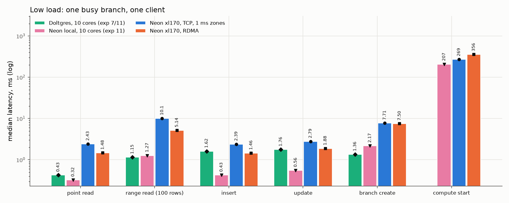
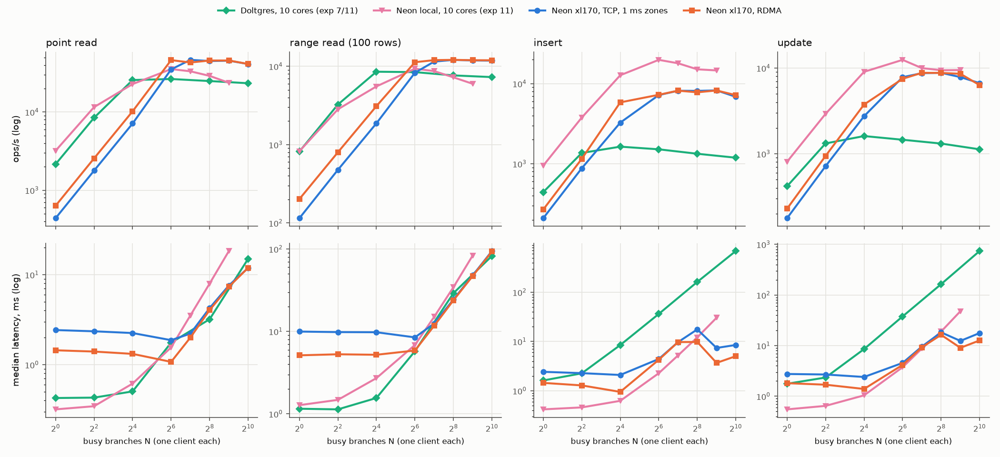
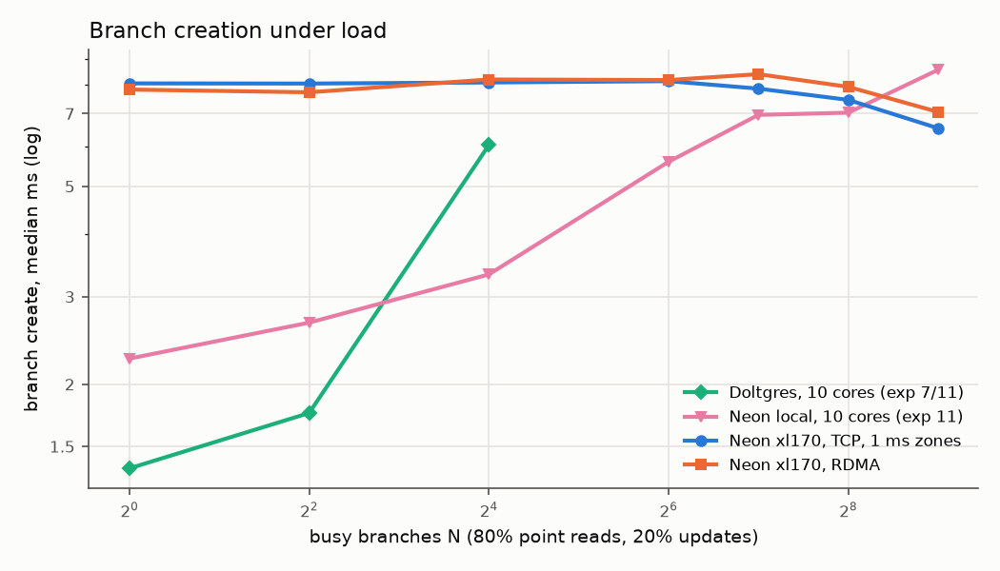
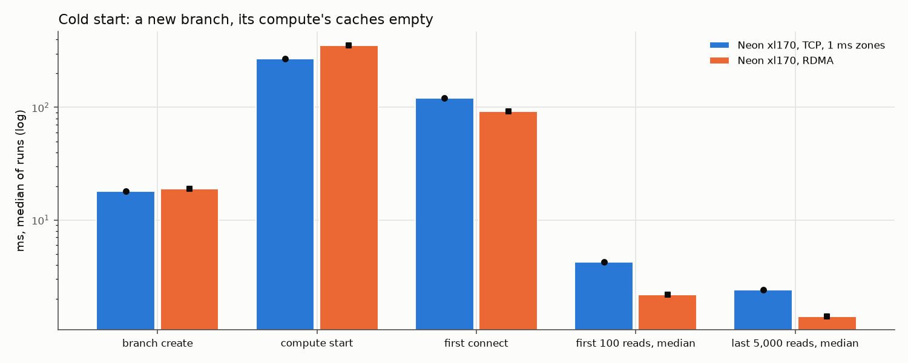
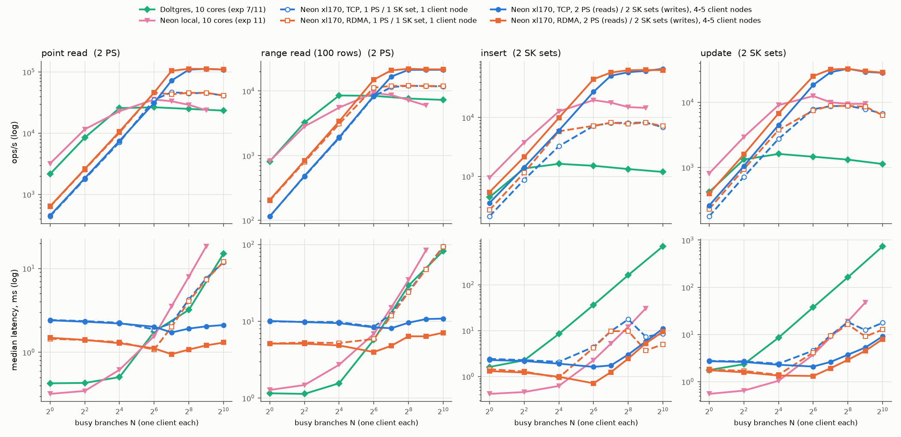

# Experiment 12 report: Neon across 1 ms zones over TCP and over RDMA, against the 10-core single-machine systems

3 Nov 2026, 16-node xl170 cluster at CloudLab Utah. Setup, placement and code are in `README.md`; commands in
`REPRODUCE.md`. Every number is one run per point (the workloads' own windows); medians unless noted.

## Systems compared

| System | Where | Transport between Neon services | Dataset | Source |
|---|---|---|---|---|
| Doltgres, 10 cores | one machine (dassl-serv-01), server on 10 cores, clients on 38 others | (one process) | CH-benCHmark W=1 | experiment 7 (reads) and 11 (writes, branch creation) |
| Neon local, 10 cores | one machine (dassl-serv-01), all Neon services and computes on 10 cores | Unix sockets | W=1 | experiment 11 |
| Neon xl170, TCP, 1 ms zones | 16 xl170 nodes: storage in zone a, computes and client in zone b | TCP, cross-zone traffic delayed to 1.01 ms RTT (netem) | W=3, 28% LFC | this experiment, `data/tcp/lfc` (46 runs) |
| Neon xl170, RDMA | the same nodes and placement | RDMA byte stream (RoCE v2), native cross-zone RTT 16 µs | W=3, 28% LFC | this experiment, `data/rdma/lfc` (46 runs) |

The benchmark client is the same Python runner in all four (experiment 11's "benchmark runner" series). On the xl170
cluster its connections (to computes in zone b; HTTP to the storage controller and pageservers in zone a) are TCP in
both arms. Netem stayed on during the RDMA arm, so the client's cross-zone HTTP is delayed identically in both.

The single-machine and cluster systems differ in more than transport: hardware (dassl-serv-01 vs xl170), dataset
(W=1, 35 MB of `stock`, vs W=3 with a 28% cache), client placement (other cores of the same host vs another node), and
server cores. On the cluster the Neon services spread over 8 nodes; the pageserver alone used 10-10.6 cores at the
peak. Compare latencies and the shape of the curves directly; compare peak throughputs only with that in mind.

## Summary

- **Single-op latency.** Neon over RDMA is 1.5-1.9 ms per point read, insert or update at low load, against 2.4-2.8
  ms over TCP across 1 ms zones. Neon local takes 0.3-0.6 ms and Doltgres 0.4 ms (reads) and 1.6-1.8 ms (writes).
  RDMA removes the 1 ms zone penalty: a netem-off TCP control lands within 5% of RDMA. It does not reach the
  single-machine latency. The rest is the cluster's other costs: client to compute over the LAN, and about 0.9 ms
  more per LFC miss than per hit. That is not transport, since the RDMA GetPage round trip is 16 µs.
- **Below saturation, throughput follows latency.** From N = 1 to 16 Neon local leads, then Doltgres on reads, then
  RDMA, then TCP. Doltgres's writes fall behind both cluster arms from N = 16. RDMA gives 1.3-1.8x TCP.
- **At saturation the xl170 ceilings are the benchmark client's, not Neon's, so RDMA cannot move them.** Both
  xl170 arms reach about 46k point reads/s, 12k range reads, 8.2k inserts and 8.8k updates. Neon local peaks at 35k /
  9.3k / 19.8k / 12.5k and Doltgres at 26k / 8.5k / 1.6k / 1.6k, both on their 10 cores. The cluster's client is one
  xl170 node (b0: 10 cores / 20 threads, at most 20 runner processes). It costs about 1,900-2,000 µs of client CPU
  per insert or update and 300-390 µs per point read, flat over N. At 16-17 busy threads that caps writes at about
  8.2-8.8k/s, which is where both arms stop. Meanwhile the Neon side has headroom: pageserver 2.6-5.8 of 10 cores,
  each safekeeper 2-5, computes 1-2 per node. Experiment 11's client had 38 cores (up to 38 processes) and a cheaper
  op (about 1,040 µs per insert at the peak). So Neon local's 2.4x insert lead is a client-capacity difference, not
  a Neon one. With a light client (ceiling check) the cluster reaches 34k inserts/s and 62k point reads/s, against
  Neon local's 20k and 35k with pgbench. Doltgres's writes stay limited by its lock (experiment 11).
- **With the client limit removed and the stressed storage component doubled, the cluster's ceilings double**
  (section "Lifting the storage limits"). Two pageservers: 112k point reads/s and 22k range reads/s, both arms.
  Two safekeeper sets: 64-68k inserts/s and 33k updates/s. TCP and RDMA meet at every ceiling; RDMA stays faster
  below it. That is 3.2x Neon local's point reads and 3.4x its inserts, on 8 storage and 3-4 compute nodes.
- **At the largest N the cluster has the lowest latency.** At N = 512, point-read p50 is 7.4 ms (RDMA) and 7.6 ms (TCP),
  against 18.4 ms for Neon local. Doltgres is at 15 ms at N = 1,024, the cluster arms at 11.9 ms. Writes at N = 1,024:
  RDMA 5.0 / 12.7 ms (insert / update), TCP 8.5 / 17.7 ms, Doltgres 688 / 741 ms.
- **Branch creation.** The cluster arms take 7-8 ms flat from N = 1 to 512. Neon local starts at 2.3 ms and grows to
  8.6 ms at N = 512. Doltgres starts lowest (1.4 ms) and climbs fastest: 6.1 ms at N = 16, and in experiment 11's
  read-only background 88 ms at 256 and 6.7 s at 1,024. RDMA does not change creation, because its cross-zone hop
  is the client's HTTP call on TCP.
- **Compute start.** Neon local 207 ms, TCP 269 ms, RDMA 356 ms. RDMA is slower because each new RDMA connection
  costs a few ms of setup, and a start opens several. Doltgres has no compute.
- **Cache variant.** The cluster arms use experiment 8's 28% cache (W = 3, 36 MB LFC prewarmed). 28.4% (TCP) and
  28.9% (RDMA) of low-load point reads are cache hits (under 1 ms).

## Low load: one busy branch, one client

| Median ms | Doltgres, 10 cores | Neon local, 10 cores | Neon xl170, TCP 1 ms | Neon xl170, RDMA |
|---|---|---|---|---|
| point read | 0.43 | 0.32 | 2.43 | 1.48 |
| range read (100 rows) | 1.15 | 1.27 | 10.08 | 5.14 |
| insert | 1.62 | 0.43 | 2.39 | 1.46 |
| update | 1.76 | 0.56 | 2.79 | 1.88 |
| branch create | 1.36 | 2.17 | 7.71 | 7.50 |
| compute start | (no compute) | 207 | 269 | 356 |

Means are in `figures/low_load.csv` (not available for Doltgres in experiment 11's table).

On the cluster, point reads split cleanly into cache hits and misses (threshold 1 ms):

| Point reads, low load | hit share | hit p50 | miss p50 | miss p90 |
|---|---|---|---|---|
| Neon xl170, TCP 1 ms | 28.4% | 0.69 ms | 2.56 ms | 2.75 ms |
| Neon xl170, RDMA | 28.9% | 0.70 ms | 1.61 ms | 1.78 ms |

A hit (0.69 ms) is the client's own path: Python runner, libpq over the zone-b LAN, Postgres executor. That is
already twice Neon local's whole point read. A miss adds 1.88 ms over TCP and 0.91 ms over RDMA. Of the 0.97 ms
difference, about one cross-zone round trip (1.01 ms) is the emulated delay. The remaining ~0.9 ms per miss is the
compute's miss handling and the pageserver's GetPage work, which this experiment does not break down further.

## Scaling: N busy branches, one client each

| ops/s | N = 1 | N = 16 | N = 64 | peak (N) | largest N |
|---|---|---|---|---|---|
| point read, Doltgres | 2,150 | 25,684 | 26,487 | 26,487 (64) | 23,377 (1,024) |
| point read, Neon local | 3,195 | 22,801 | 35,496 | 35,496 (64) | 23,679 (512) |
| point read, xl170 TCP | 437 | 7,132 | 35,158 | 46,568 (128) | 41,173 (1,024) |
| point read, xl170 RDMA | 631 | 10,225 | 46,207 | 46,207 (64) | 41,247 (1,024) |
| range read, Doltgres | 817 | 8,534 | 8,432 | 8,534 (16) | 7,286 (1,024) |
| range read, Neon local | 824 | 5,541 | 9,332 | 9,332 (64) | 5,980 (512) |
| range read, xl170 TCP | 115 | 1,872 | 8,283 | 12,082 (256) | 11,810 (1,024) |
| range read, xl170 RDMA | 202 | 3,104 | 11,288 | 12,092 (256) | 11,942 (1,024) |
| insert, Doltgres | 442 | 1,635 | 1,515 | 1,635 (16) | 1,190 (1,024) |
| insert, Neon local | 947 | 12,736 | 19,825 | 19,825 (64) | 14,639 (512) |
| insert, xl170 TCP | 209 | 3,261 | 7,204 | 8,240 (512) | 6,855 (1,024) |
| insert, xl170 RDMA | 268 | 5,838 | 7,264 | 8,225 (512) | 7,189 (1,024) |
| update, Doltgres | 417 | 1,610 | 1,458 | 1,610 (16) | 1,127 (1,024) |
| update, Neon local | 807 | 9,050 | 12,477 | 12,477 (64) | 9,484 (512) |
| update, xl170 TCP | 177 | 2,744 | 7,830 | 8,808 (256) | 6,670 (1,024) |
| update, xl170 RDMA | 228 | 3,757 | 7,502 | 8,806 (128) | 6,325 (1,024) |

- **Below saturation:** each client issues one operation at a time, so throughput is N / latency. The
  single-machine systems lead by their 3-9x lower latency, except Doltgres's writes: those are on par with the
  cluster arms up to N = 4 and fall behind from N = 16 (lock-bound). RDMA leads TCP by 1.3-1.8x.
- **Saturation points:** Doltgres saturates at N = 16, Neon local at 64, and the cluster arms at 64-128 for reads.
  Past their peaks the single-machine systems lose 12-36% (their 10 cores are shared by everything). From peak to
  N = 1,024 the cluster arms lose 11-12% on reads and 13-28% on writes.
- **What bounds the cluster: the client node.** Client CPU per operation on b0, from each run's `client_cpu` and
  throughput, is flat over N and the same in both arms:

  | client µs of CPU per op (N = 64-512) | xl170 TCP | xl170 RDMA | Neon local (exp 11, peak) |
  |---|---|---|---|
  | point read | 289-382 | 312-381 | 201 |
  | insert | 1,975-2,052 | 1,958-2,070 | 1,043 |
  | update | 1,830-1,917 | 1,857-1,918 | 1,065 |

  b0 runs 16-17.4 of its 20 hardware threads busy at every write peak (SMT: 10 physical cores), and throughput
  plateaus at busy threads / µs per op: about 8.2k inserts/s. Per op the xl170 client costs about 1.9x
  experiment 11's: slower cores (E5-2640 v4, 2.4 GHz) and hyper-threads counted as cores. Experiment 11's client
  also had 38 cores instead of 20 threads. The server side is far from full during writes: pageserver (a4)
  2.6-5.8 cores, each safekeeper (a1-a3) 2-5, computes 1-2 per node. Reads are near both limits at once: the
  client at 16-17 threads, the pageserver at 10-10.6 cores (its 10 physical cores) at N = 1,024. The transport
  binds neither, which is why RDMA and TCP meet at every peak. RDMA still keeps write latency 30-40% lower at
  N = 1,024 (p50 insert 5.0 vs 8.5 ms, update 12.7 vs 17.7 ms); with throughput client-bound, that shows up as
  latency only.
- **The server-side ceilings, with a light client.** After each sweep, `scaling_data --ceiling` drove the same load
  shape from experiment 5's minimal asyncio client (one connection per busy branch, N = 128-1,024, 30 s). It costs
  2-4.4 client cores instead of 16. Experiment 11 measured its ceilings with pgbench (`figures/ceiling.csv` there),
  with Neon's 10 server cores at 94-97% busy:

  | peak ops/s, light client | xl170 TCP | xl170 RDMA | Neon local, 10 cores (pgbench) |
  |---|---|---|---|
  | point read | 61,467 | 62,229 | 34,961 |
  | range read | 11,849 | 11,867 | 9,243 |
  | insert | 34,163 | 34,151 | 20,178 |
  | update | 11,749 | 12,090 | 10,985 |

  Without the runner's client limit the cluster exceeds Neon local on every operation, inserts by 1.7x. Updates are
  about equal; their cost sits in each compute and the pageserver, not the transport. RDMA and TCP are again equal
  at the ceiling. The benchmark-runner curves in the figure therefore show the cluster's client capacity for
  writes, not Neon's.

The ceiling checks are in `data/<arm>/lfc/neon/scaling_data/ceiling_check.csv` (not plotted).

## Branch creation under load

Median create time with N busy branches running 80% point reads and 20% updates:

| n | Doltgres | Neon local | xl170 TCP | xl170 RDMA |
|---|---|---|---|---|
| 1 | 1.36 | 2.25 | 8.05 | 7.82 |
| 4 | 1.75 | 2.66 | 8.04 | 7.73 |
| 16 | 6.05 | 3.33 | 8.09 | 8.20 |
| 64 | | 5.60 | 8.14 | 8.18 |
| 256 | | 7.03 | 7.46 | 7.92 |
| 512 | | 8.57 | 6.54 | 7.05 |

Experiment 11's Doltgres series with this background stops at N = 16; with read-only busy branches it reached 13.6 ms
(64), 88 ms (256) and 6.7 s (1,024) (experiment 11, lock contention in Doltgres's block store).

The cluster arms do not change with load because creation runs on separate machines from the busy computes. Its
cost is a client HTTP call to the storage controller (cross zone, TCP, delayed in both arms), then storage
controller to pageserver calls inside zone a. RDMA carries those, but the LAN round trip was never the cost.
Removing the delay (the netem-off control) brings N = 1 to 5.9 ms, so the client's delayed hop costs about 1.8 ms.
On the single machine the busy computes share the cores with the storage controller and pageserver, and creation
slows with N.

## Cold start: a new branch, its compute's caches empty (cluster arms only)

| ms | branch create | compute start | first connect | first 100 reads (p50) | last 5,000 reads (p50) |
|---|---|---|---|---|---|
| xl170 TCP | 18.0 | 269 | 121 | 4.25 | 2.39 |
| xl170 RDMA | 18.9 | 356 | 92 | 2.18 | 1.39 |

Experiment 11 has no cold-start runs, and Doltgres has no compute to start. With an empty cache every read misses
until the working set is in. RDMA halves the first reads, and the steady state stays 1 ms lower. Compute start is
the one step where RDMA loses. Phase medians from the agents' `starts.jsonl` over all starts of each run (about 10k
starts per arm):

| ms, median | TCP | RDMA |
|---|---|---|
| safekeeper sync check (connect to 3 safekeepers) | 3 | 30 |
| sync-safekeepers | 33 | 64 |
| pageserver connect | 2.2 | 5.5 |
| basebackup | 76 | 87 |
| start Postgres | 36 | 36 |
| whole start, agent's view | 278 | 302 |

Every phase that opens connections grows. An RDMA connection resolves address and route through rdma_cm, creates a
PD, CQs and a QP, and registers its slot buffers. That costs milliseconds, against TCP's one handshake round trip,
and the compute-side code opens one per safekeeper per step. A connection cache or a shared per-process device
context would recover most of it; it was not attempted.

## Lifting the storage limits: 2 pageservers for reads, 2 safekeeper sets for writes (3 Nov 2026)

The single-pageserver runs above stop at the benchmark client (one xl170 node). This round removes the client limit
and doubles the storage component that each workload stresses, one at a time, on the same 16 nodes and the same 8/8
zones:

| Phase | Zone a (storage) | Zone b | Operations |
|---|---|---|---|
| read (`*_read2ps.toml`) | a0 control plane; a1-a3 safekeepers; a4, a5 pageservers, tenant split into 2 shards (stripe 256 pages) | b0-b3 clients, b4-b7 computes | READ, RANGE_READ |
| write (`*_write2sk.toml`) | a0 control plane; a4 pageserver; safekeeper set A a1-a3, set B a5-a7 (each branch's WAL goes to one set) | b0-b4 clients, b5-b7 computes | INSERT, UPDATE |

Both arms (TCP with the 1 ms delay, RDMA) ran both phases: N = 1-1,024, 64 points, all passed. Same runner and
operation counts as the scaling runs, with three client-side changes (none inside the latency timer):
`microbench/fast_client` (runner CPU per write down from ~1,950 to ~450-650 µs: Faker values from a per-process pool,
a comment-stripping fast path, set-based key tracking), the branches of a point split over the client nodes
(`scripts/workloads/multi_client`), and every node's timed window started by one shared GO.

Solid lines: this round. Dashed: the single-pageserver, single-client runs above (for writes still with the slower
runner, so the dashed write curves are the client's limit). Reference for one safekeeper set with the fast client on
one node (RDMA, check runs of 3 Nov): 31.6k inserts/s and 18.1k updates/s at N = 256.

| peak ops/s (N) | TCP, 1 ms zones | RDMA | one PS / one SK set | Neon local, 10 cores | Doltgres, 10 cores |
|---|---|---|---|---|---|
| point read (2 PS) | 112,404 (512) | 112,796 (256) | 46,568 (TCP), 46,207 (RDMA) | 35,496 | 26,487 |
| range read (2 PS) | 21,347 (1,024) | 22,103 (256) | 12,082 / 12,092 | 9,332 | 8,534 |
| insert (2 SK sets) | 67,653 (1,024) | 64,463 (512) | 31.6k (fast client, RDMA) | 19,825 | 1,635 |
| update (2 SK sets) | 32,722 (256) | 32,630 (256) | 18.1k (fast client, RDMA) | 12,477 | 1,610 |

- **Two pageservers double the read ceiling, and the client is no longer the limit.** Point reads 2.4x, range reads
  1.8x the single pageserver. At the peak the four client nodes run 9-10 of 20 threads each; the shard-1 pageserver
  (a5) runs 13-14 threads (saturated, like the single pageserver at 10.6-13.5), shard 0 (a4) 10-11. The shards are
  not equally loaded, so the read ceiling is a5's.
- **Two safekeeper sets double inserts.** 64-68k/s from N = 256 on, against 31.6k with one set. At N = 1,024 nothing
  stands out as the single limit: the three compute nodes run 11-14 threads (TCP 12.5-14: close to full), the
  safekeepers 7-11 each, the pageserver about 9. The compute nodes are the next limit for inserts.
- **Updates reach 32.7k/s (1.8x) and then fall slightly.** The one pageserver (8.3-9.7 threads) serves every update's
  page reads and ingests both sets' WAL; safekeepers stay at 4-8. Updates would need the second pageserver too.
- **TCP and RDMA meet at every ceiling again; RDMA keeps its latency lead below it.** Point reads at N = 64: 46.1k
  (RDMA) vs 31.2k/s (TCP); p50 1.1 vs 2.0 ms. At the ceilings both arms are bound by the same servers.
- **Latency at high N is lower than in the single-client runs.** Point-read p50 stays at 1.1-1.3 ms (RDMA) and
  1.7-2.1 ms (TCP) up to N = 1,024, where the single-client runs showed 12 ms: much of that was the saturated client
  (the runner's timer runs in Python, so waiting for the GIL counted as latency). Means still grow with N (8.8 ms at
  N = 1,024): requests queue at the saturated pageserver.

Three problems had to be fixed on the way (all recorded in README):
1. **Each runner's setup purged the whole tenant** (`dblib/neon_local.setup_run`), deleting the other client nodes'
   branches: in multi-client mode the purge is skipped and the orchestrator purges once per point.
2. **A Neon bug in the compute's shard routing** (`pgxn/neon/communicator.c`, `prefetch_register_bufferv`): every
   block of a vectored read was assigned the shard of the vector's first block, so a read crossing a stripe
   boundary sent pages to the wrong pageserver ("routed to wrong shard", reconnect, query error). Postgres 17 reads
   up to 16 blocks per vector (`io_combine_limit`), so the prewarm failed on every sharded compute. Fixed in both
   builds (one line; `code/neon_fork_tcp_shardfix.patch`, `code/neon_fork_rdma.patch`).
3. **The child shards had no image layers after the split** (the parent's 3 image layers were not in their layer
   maps; every read rebuilt pages by WAL redo, at about twice the pageserver CPU per read): `shard-split` now
   compacts every shard with forced image creation and moves the branch point above the new images
   (`neon_ctl.py compact-shards`). Before this, two pageservers gave 49k point reads/s, no more than one.

Experiments 5 and 8 used the same split procedure and Neon code for their 2-shard runs, so they likely ran with
problems 2 and 3; their sharded results should be read with that in mind.

## Validity

- **Delay asymmetry, and the control that resolves it.** The RDMA arm runs at native RoCE latency because netem
  cannot delay RoCE. "RDMA vs TCP, 1 ms" therefore mixes the transport with the removed delay. A TCP control with
  netem removed (`data/tcp/lfc_nonetem`: low contention, READ/UPDATE at N = 1, 64, 256; not plotted) lands within 5%
  of RDMA at every point it has. Low-load p50: point read 1.54 ms, range read 5.39, insert 1.54, update 1.95.
  Point read at N = 1, 64, 256: 608, 44,856 and 45,511 ops/s. So almost all of RDMA's gain is the removed delay; the
  transport itself adds a few %.
- **Reference systems are summary tables.** Neon local and Doltgres come from experiment 11's `figures/*.csv` (their
  raw data is on dassl-serv-01, not here): `scripts/refs.py` names the exact series.
- **Same cache variant in both cluster arms.** Each arm was seeded separately at W = 3 (192 s and 195 s). The 28% hit
  share matches experiment 8.
- **Correctness of the RDMA arm.** 46 of 46 runs passed the same driver checks as TCP. The safekeepers logged 3
  "remote operation error" disconnects in 1.5 h, each where a killed compute's connection ended; over TCP the same
  kills produce about 5,000 "connection reset" lines per safekeeper. One bug was found and fixed on the cluster
  before the run (README, "Fix found on the cluster"). The precheck that found it is in
  `data/rdma/superseded/precheck`.
- **Same memory starting point.** About 3.8 GB of stale Postgres shared memory per compute node, left by the TCP
  arm's killed computes, was removed before the RDMA arm.
- **Placement.** b0, the client, is in zone b but physically on the a-side switch. This only matters for the
  client's own TCP paths, which are identical in both arms.
- **2 PS / 2 SK phases.** Timed windows are short at mid N (3-10 s for reads at N = 64-512: the per-client op counts
  of the single-client runs, now spread over 4-5 nodes); the clock offsets between client nodes (< 1 ms) are small
  against them. Each phase was seeded fresh (W = 3), the same cache variant. Point-read N = 1 numbers match the
  single-pageserver runs (639 vs 631/s RDMA, 450 vs 437/s TCP), so the shard split costs nothing at low load.
- **One run per point.** The cluster-arm differences reported above (30% or more below saturation) are far outside
  the run-to-run noise seen between neighbouring N; differences at saturation (a few %) are not.

## Files

- `figures/`: `low_load`, `scaling`, `scaling_2x2`, `branch_create`, `cold_start` (`.png` and the plotted numbers as `.csv`), by
  `scripts/plot.py` with `scripts/refs.py`.
- `data/` (-> `/mnt/ssd/exp12`): `tcp/{lfc,lfc_nonetem,read2ps,write2sk}`, `rdma/{lfc,read2ps,write2sk}`, each `neon/<workload>/` with `progress.log`,
  parquet runs, metrics; `<arm>/archive/<node>/` the agents' samples and compute starts; `<arm>/superseded/`.
- `logs/`: setup, builds, netem status before and after every arm (16 nodes with 420 µs each time).
- `code/`: fork provenance for both arms, `neon_fork_rdma.patch`, `rdma_env/`.
