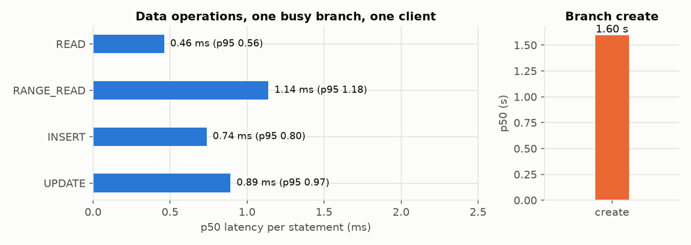
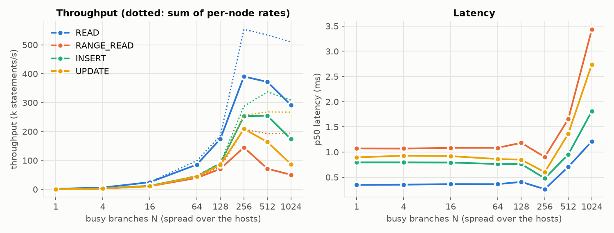
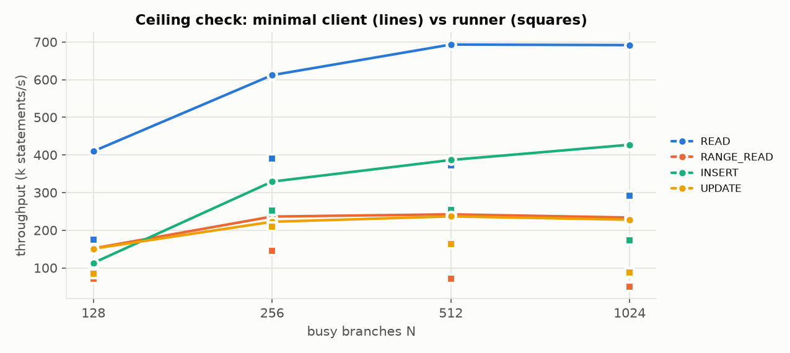
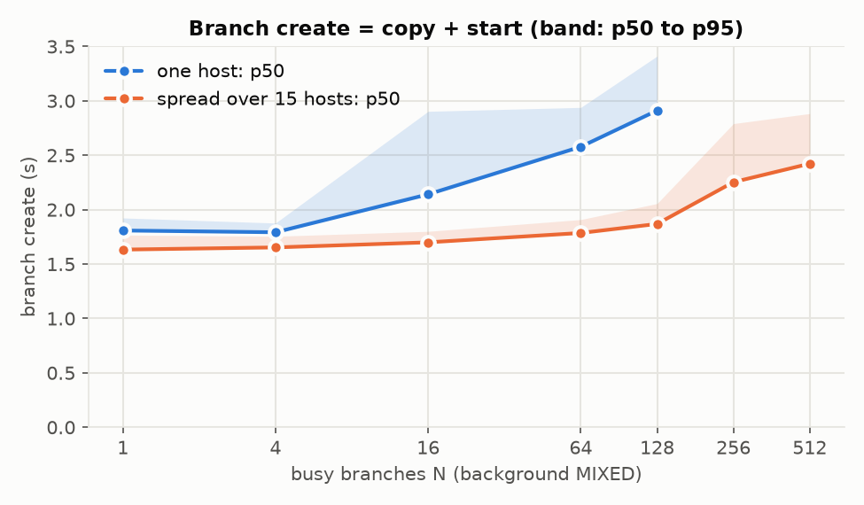
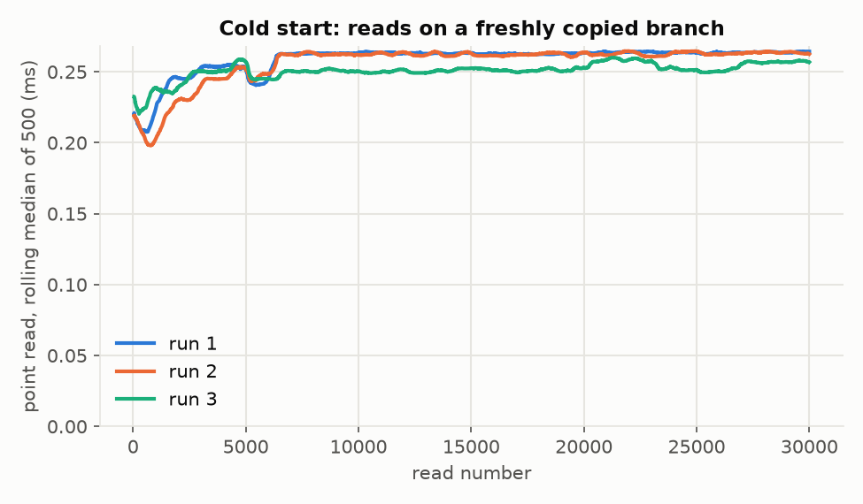
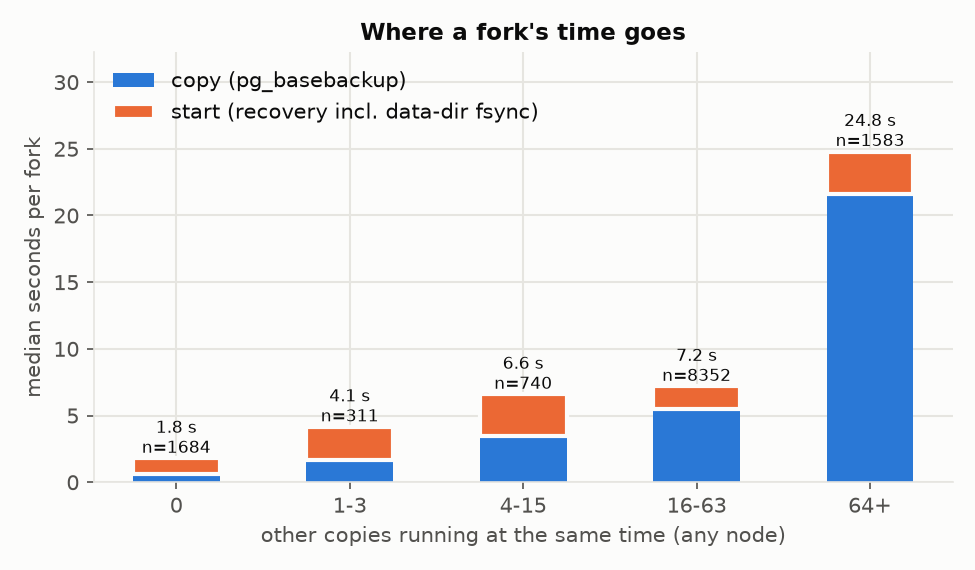

# Experiment 13 report: branching by copying Postgres data directories to other nodes (`pgcopy`)

5 Nov 2026, 16 xl170 nodes at CloudLab Utah on one 25 GbE LAN; n0 holds the seed and every run root, n1-n15 host
the branches with their clients. Setup, placement and code are in `README.md`, commands in `REPRODUCE.md`. One run
per point (the workloads' own windows); medians unless noted. Dataset: CH-benCHmark W = 3 (283 MiB `bench` database,
300,000 stock rows); each branch has 40 MB of shared_buffers, prewarmed like Neon's computes.

## Summary

- **A fork costs 1.6-1.8 s for this 283 MiB database, and nearly all of it is the copied data reaching the disk.**
  On an idle cluster `pg_basebackup` copies 322 MB in 0.62 s (520 MB/s: `--no-sync` leaves it in the page cache),
  then starting the copy takes 1.07-1.17 s. A copied directory starts as crash recovery, and PostgreSQL first fsyncs
  the whole data directory: 322 MB at the SSD's ~350 MB/s is about 0.95 s. The fork's cost therefore grows with the
  database size over the disk's write bandwidth, not with the network (25 GbE carried the copy in under 0.2 s).
- **Data operations at low load are local-Postgres fast:** point read 0.46 ms, 100-row range read 1.14 ms, insert
  0.74 ms, update 0.89 ms (p50, one branch, one client on the same node over loopback, fsync and synchronous commit
  on).
- **Throughput scales with the hosts until the hosts' CPUs are full.** With N busy branches spread over the 15
  hosts, throughput grows linearly to N = 256: 390k point reads/s, 145k range reads/s, 253k inserts/s, 209k
  updates/s (sum of the per-node rates: 553k / 208k / 287k / 256k). Beyond that every host runs 20 client processes
  next to 34-69 instances on 20 hardware threads (n1: 14-19 busy), and one slow node (n4) sets the merged window:
  at N = 1,024, 292k point reads/s and 1.2 ms p50.
- **The benchmark client, not Postgres, is most of the high-N limit.** A minimal asyncio client on the same nodes
  (ceiling check) reaches 693k point reads/s, 242k range reads/s, 427k inserts/s and 237k updates/s.
- **Busy branches elsewhere barely slow a fork; busy branches on the forking node do.** Spread over the 15 hosts,
  the create p50 grows from 1.63 s (N = 1) to 1.87 s (N = 128) and 2.42 s (N = 512, of which 35 busy branches are on
  the creating node). With all busy branches on the creating node it grows faster: 1.81 s at N = 1, 2.58 s at
  N = 64, 2.91 s at N = 128 (1.56x the spread value at the same N). In this design the fork competes only with the
  load on its own node (and with other copies from the seed node, which a timed create never had).
- **No cold start to speak of:** a fresh branch serves point reads at 0.20-0.26 ms from its first read (median of
  the first 100: 0.22 ms). Its shared_buffers are empty, but the copy has just put every file in the OS page cache.
  The fork itself (1.70 s) is the whole cold start.
- **Copying is the scarce resource at scale.** The run made 12,670 branch copies (4.56 TiB). With 16-63 other
  copies running the median fork took 7.3 s, with 64 or more 28.3 s (setup phases, all copies from one seed node:
  its NIC tops out at 23.9 Gbit/s, the hosts' disks at ~350 MB/s). Every branch is a full 322 MB copy: N = 1,024
  busy branches hold 330 GB, against shared pages for Neon or Doltgres.

For orientation only (other hardware and datasets, numbers quoted from experiment 12's `report.md`; its data is not
on this machine): Neon on the same type of cluster created a branch in 7-8 ms and started a compute in 269-356 ms,
and served low-load point reads in 1.5-2.8 ms. pgcopy's fork is about 5x Neon's create + compute start; its data
operations are 3-6x faster at low load, because client and data sit on one node.

## Low load: one busy branch, one client

| Operation | p50 | p95 | Statements |
|---|---|---|---|
| Point read | 0.46 ms | 0.56 ms | 40,000 |
| Range read (100 rows) | 1.14 ms | 1.18 ms | 10,000 |
| Insert | 0.74 ms | 0.80 ms | 6,000 |
| Update | 0.89 ms | 0.97 ms | 6,000 |
| Branch create (copy + start; 1 MIXED busy branch) | 1.60 s | 1.64 s | 100 |

The client is co-located with the branch (127.0.0.1), so no network is on the data path. Inserts and updates commit
with fsync on: the SATA SSD's flush costs a few hundred microseconds.

## Scaling with N busy branches spread over 15 hosts

Each point: N branches split over n1-n15 (N < 15 uses N hosts), one client per branch on the branch's node,
min(20, branches) client processes per node, every node's timed window started together. Throughput = all nodes'
operations / the longest node window (experiment 12's rule); the dotted lines add up each node's own rate.

| N | Point read k/s (sum) | Range read k/s (sum) | Insert k/s (sum) | Update k/s (sum) | Point read p50 |
|---|---|---|---|---|---|
| 1 | 1.7 | 0.8 | 0.8 | 0.7 | 0.35 ms |
| 16 | 24.7 | 10.9 | 12.1 | 10.9 | 0.36 ms |
| 64 | 85.7 | 39.5 | 44.9 | 44.1 | 0.36 ms |
| 128 | 174.6 (186) | 71.1 (77) | 90.0 (92) | 84.6 (88) | 0.41 ms |
| 256 | 390.4 (553) | 145.1 (208) | 252.9 (287) | 209.2 (256) | 0.26 ms |
| 512 | 371.5 (534) | 71.3 (193) | 254.5 (338) | 163.9 (268) | 0.71 ms |
| 1,024 | 291.8 (510) | 50.3 (194) | 173.8 (309) | 87.1 (267) | 1.21 ms |

- Up to N = 256 each node runs one client process per busy branch and the curves are linear. From N = 512 on, the
  20 client processes per node each drive several branches, the node's 20 hardware threads are nearly full
  (n1: 14.0-19.3 busy cores, of which the instances' `postgres` processes 2.5-5.8) and latency rises.
- n4 (hp091) was the slowest node at every N >= 256: 1.2-1.6x the median node window at N = 256, up to 4x for range
  reads at N = 1,024 (12.2 s against 3.0 s). Nothing in its kernel log, clock, governor or memory explained it.
  The gap between the solid and dotted lines is mostly n4.
- The timed windows are short (1-4 s at N >= 16): the per-client counts are experiment 5's, sized for slower
  systems; every point still holds 12,000-1,000,000 statements.
- Point-read p50 dips at N = 256 (0.26 ms against 0.41 ms at N = 128); a likely cause is the CPUs staying at high
  clock when every core is busy (governor `schedutil`), not verified.

## Ceiling check: the minimal client

| N | Point read k/s | Range read k/s | Insert k/s | Update k/s |
|---|---|---|---|---|
| 128 | 410 | 152 | 113 | 151 |
| 256 | 612 | 236 | 329 | 222 |
| 512 | 693 | 242 | 387 | 237 |
| 1,024 | 692 | 234 | 427 | 228 |

Same load shape (one connection per branch, one request in flight) without the runner's bookkeeping, on the same
nodes. At N = 512 and 1,024 the minimal client gets 1.4-2.6x the runner's throughput for point reads, inserts and
updates and 3.4-4.6x for range reads: the runner's client CPU (up to 121 cores across the 15 nodes, out of 300)
competes with the instances on the same cores.

## Branch creation under load

100 creates on n1 (every 5th connected), while N busy branches run MIXED (80% point reads, 20% updates).

| N | Spread over 15 hosts: p50 / p95 | (busy on n1) | One host: p50 / p95 |
|---|---|---|---|
| 1 | 1.63 / 1.77 s | 1 | 1.81 / 1.92 s |
| 4 | 1.65 / 1.76 s | 1 | 1.79 / 1.88 s |
| 16 | 1.70 / 1.80 s | 2 | 2.14 / 2.90 s |
| 64 | 1.79 / 1.91 s | 5 | 2.58 / 2.94 s |
| 128 | 1.87 / 2.06 s | 9 | 2.91 / 3.41 s |
| 256 | 2.25 / 2.79 s | 18 | |
| 512 | 2.42 / 2.88 s | 35 | |

The spread series' background ran 0.6k (N = 1) to 508k (N = 256) operations/s cluster-wide. The create latency
follows the busy branches on the creating node rather than N: 35 busy on n1 (spread N = 512) gives 2.42 s, 64 busy on
n1 (one host, N = 64) 2.58 s. At N = 1 the two series differ by 0.18 s with the same load; that is the run-to-run
spread of an idle fork on n1 here (1.60-1.81 s across low contention, the two branch series and cold start).

## Cold start

| Run | Create (copy + start) | Copy | Start | First connect | Reads 1-100 (median) | Last 5,000 (median) |
|---|---|---|---|---|---|---|
| 1 | 1,706 ms | 627 ms | 1,068 ms | 21 ms | 0.22 ms | 0.26 ms |
| 2 | 1,702 ms | 619 ms | 1,071 ms | 20 ms | 0.22 ms | 0.26 ms |
| 3 | 1,711 ms | 605 ms | 1,094 ms | 23 ms | 0.23 ms | 0.26 ms |

30,000 point reads on a fresh branch, on its own connection (no runner: 0.2-0.26 ms against the runner's 0.46 ms
at low load). There is no warm-up curve: the first reads are as fast as the last, because the copy has just written
every page into the OS page cache. Latency rises slightly over the first ~6,000 reads (0.22 to 0.26 ms), the opposite
of a cache warming up; not investigated. A branch whose files are no longer in the page cache would read from disk;
in this design a branch is used right after its copy.

## Where a fork's time goes

From the agents' record of every copy (`archive/<node>/forks.jsonl`; the superseded untrimmed attempt excluded), by
the number of other copies running at the same moment anywhere:

| Other copies | Forks | Copy p50 | Start p50 | Copy + start p50 |
|---|---|---|---|---|
| 0 | 1,684 | 0.62 s | 1.17 s | 1.79 s |
| 1-3 | 311 | 1.64 s | 2.50 s | 4.94 s |
| 4-15 | 740 | 3.46 s | 3.13 s | 7.16 s |
| 16-63 | 8,352 | 5.46 s | 1.72 s | 7.35 s |
| 64+ | 1,583 | 21.6 s | 3.17 s | 28.3 s |

(The figure stacks the two phases' medians; the last column is the median of each fork's sum.)

Concurrent copies share the seed node's NIC and disk reads and the target's disk writes; their start then waits for
its own fsync behind the others' writes. Run roots (seed to root, on n0, up to 15 at once) took 19.9 s each (p50):
15 x 417 MB of fsync on one disk. Only the setup phases ever ran copies concurrently; every timed create ran alone.

## Validity

- **Disk state matters more than load.** Without trims the SSDs slowed after a few hundred GB of copies (idle fork
  start 1.1 s to 3.3 s on n1). The agents trimmed before every point from 12:10 UTC, and the branch-creation results
  are from a rerun after that; the low-contention, scaling and ceiling runs predate the slowdown (n1's idle forks
  started in 1.08 s at 10:16-10:19). The untrimmed branch series is kept as superseded (README).
- **Fork cost scales with database size.** One size was measured (283 MiB). A fork's copy and fsync are both
  proportional to the data directory, so a 3 GB database would cost about 10x (not measured: plan's optional
  `seed --scale 30`).
- **Durability.** Instances run with fsync and synchronous_commit on, and a copied instance's start syncs its
  directory. With fsync off PostgreSQL skips that sync, which should remove most of the start time (not measured;
  such an instance is no longer crash-safe).
- **Client side.** Multi-node points and pgcopy's branch runs use experiment 12's `fast_client` patches (outside
  the latency timer). The low-contention, cold-start and single-node data runs use the plain runner. Background
  operations in the branch runs were recorded 1 in 20 (memory); their throughput is the sampled count x 20.
- **Placement.** Clients share their node with their branches' instances, so node CPU counts both (the summaries'
  `remote_cpu.computes` is the instances' share). The seed node only served copies and run roots (0.04-0.36 node cores in
  timed windows).
- **Copies use temporary replication slots** after the first ceiling attempt failed on removed WAL; the creates
  rerun with slots matched the earlier ones (1,576 against 1,582 ms).
- **Clocks** agreed within 9 ms (only the ceiling check's start uses them; the other multi-node points start on a
  GO message). Netem: none on any interface.
- **Not compared here:** Doltgres, Neon local and Neon TCP/RDMA (experiments 7, 11, 12), whose data is not on this
  machine; the result files keep experiment 12's layout for a later joint plot.
