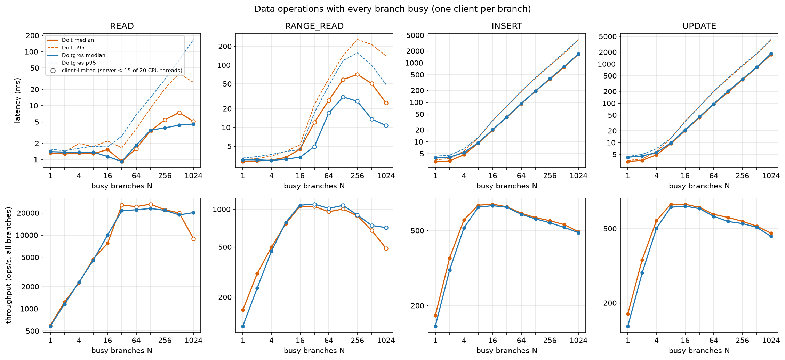
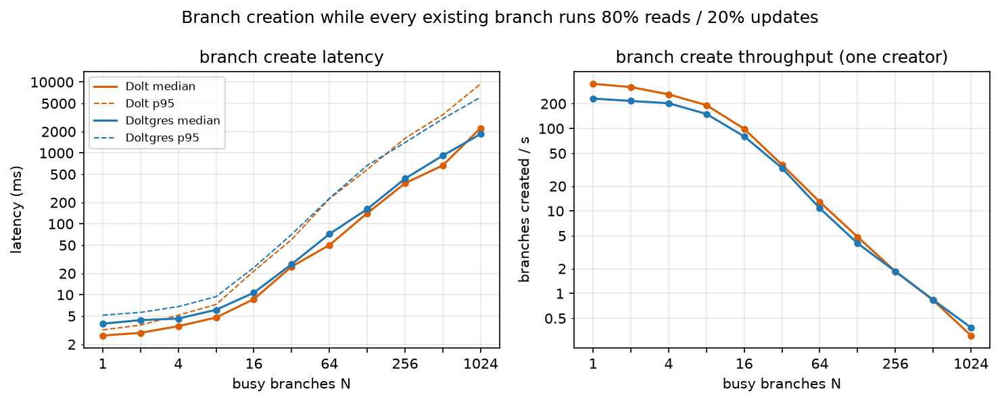

# Dolt with Every Branch Busy

*Experiment 2 · CloudLab c220g2 · 18 Oct 2026 · Dolt 2.4.2 and Doltgres 1.4.0*

Data operations and branch creation with N existing branches, N = 1 to 1,024, where every existing branch is running a
workload. Experiment 1 measured the same things with the other branches idle.

- **Data operations.** One client per branch runs the operation back to back, so all N branches are busy.
- **Branch creation.** One client per branch runs 80% point reads and 20% point updates. One more client creates 100
  branches, starting once all of them are working.

110 runs, 0 failed operations.

## Result

- **Reads run in parallel across busy branches until the server's CPU is full.** Point reads take about 1.3 ms and
  throughput grows linearly up to 16 busy branches. After that the total stays flat out to 1,024 busy branches: about
  40,000 reads/s on Dolt and 22,000-24,000 on Doltgres (both measured with a minimal client, see "Read check"). More
  busy branches do not block reads; they share the same server capacity, so latency rises by queueing. The benchmark's
  own read numbers beyond 16-32 busy branches (hollow markers) are limited by the benchmark client, not the server.
- **Writes are serialized across all branches.** Total write throughput peaks at about 680/s with 8-16 busy branches and
  then falls slowly, to about 480/s at 1,024 (−30%). Latency grows in proportion to the number of busy branches, to
  about 1.7-1.8 s at 1,024. The server uses only about 3 of its 20 CPU threads while doing this.
- **Branch creation slows sharply when branches are busy.** It takes 2.7 ms (Dolt) and 3.9 ms (Doltgres) with one busy
  branch, 9-11 ms with 16, 50-72 ms with 64 and about 2 s with 1,024. One client then creates fewer than one branch per
  second. With idle branches (experiment 1) creation stayed at 3-4.5 ms even at 1,024 branches.
- **The write and branch-creation runs really had about 1,000 busy branches at N = 1,024.** On average 894-1,015 of the
  1,024 branches had a request outstanding at any moment. The benchmark's own read runs did not (see "How many branches
  were really busy").

## Setup

**Client and server share one physical machine, on separate CPU sockets.** Each database ran alone on its own CloudLab
node (Dolt on `c220g2-010806`, Doltgres on `c220g2-010812`). Each node has two CPU sockets of 10 cores and 20 hardware
threads each.

| | Server | Benchmark client |
|---|---|---|
| CPU | socket 0 only (hardware threads 0-9, 20-29), via `numactl --cpunodebind=0` in its systemd unit | socket 1 only (10-19, 30-39), via `numactl --cpunodebind=1` |
| Memory | bound to socket 0's memory (`--membind=0`; all of the server's pages are there) | bound to socket 1's memory |
| Storage | the node's local SSD (`/dev/sdc` at `/mnt/ssd`) | not used |
| Connection | listens on `127.0.0.1` | connects to `127.0.0.1`: loopback through the kernel, no physical network |

- The two never compete for CPU cores or memory, so client load cannot take CPU from the server. `server_cpu_cores` in
  the results counts socket 0's 20 hardware threads only.
- They share the operating system kernel (each side's loopback processing runs on its own cores), the link between the
  sockets, and the machine's memory system outside each socket.
- No network sits between them, so latencies are lower than a client on another machine would see (a LAN adds roughly
  0.1-0.2 ms per request).

**How N clients run on 20 hardware threads.** Every branch has its own client: a thread with its own connection, bound to
that branch, with one request in flight, issued back to back. The threads are spread over up to 20 client processes
(about 51 threads per process at N = 1,024; one process per thread for N ≤ 20). A thread waiting for the server's reply
is blocked on its socket and uses no CPU, so 1,024 threads can all be waiting at once; a thread needs CPU only between
requests. When the server answers slowly (a write takes about 1.7 s at N = 1,024), the client keeps every branch busy
with little CPU. When the server answers fast (a point read in about 1 ms), every thread needs CPU almost constantly,
and the 20 client hardware threads become the limit.

**Differences from experiment 1.** Experiment 1 measured data operations with one client on one of the N branches while
the other N−1 were idle, and branch creation with no other load. Its benchmark client was a single Python process, and
every write also ran an untimed information_schema query (removed here). RANGE_READ read 200 rows in experiment 1's
single-client runs and reads 100 rows here (the throughput script fixes it at 100). Machines, server versions and
configurations, data, table and branch divergence are the same; Dolt's connection limit was raised from 1,000 to 2,048
for 1,024 clients. At N = 1 both experiments run the same thing and agree (Dolt point read 1.33 ms in both, UPDATE 3.27
and 3.31 ms). Full comparison: [README.md](README.md).

## Data operations

*Top: median (solid) and p95 (dashed) latency. Bottom: total throughput of all clients. Hollow markers: the server used
fewer than 15 of its 20 CPU threads, so the client limited the point.*

| | 1 branch | 16 busy | 1,024 busy |
|---|---:|---:|---:|
| READ, Dolt: median / total ops/s | 1.33 ms / 594 | 1.53 ms / 7,732 | client-limited (read check: 23 ms / 40,273) |
| READ, Doltgres | 1.40 ms / 580 | 1.13 ms / 10,023 | 4.56 ms / 20,216 |
| UPDATE, Dolt | 3.31 ms / 175 | 20.2 ms / 675 | 1,720 ms / 472 |
| UPDATE, Doltgres | 4.23 ms / 150 | 21.0 ms / 659 | 1,822 ms / 454 |
| INSERT, Dolt | 3.16 ms / 177 | 19.7 ms / 690 | 1,654 ms / 493 |
| INSERT, Doltgres | 3.92 ms / 155 | 20.2 ms / 677 | 1,674 ms / 487 |

RANGE_READ reads 100 rows.

Reads on different branches run in parallel. Writes do not: the total stops growing at 8 busy branches, and each further
busy branch only lengthens the queue. The server is not CPU-bound on writes (about 3 busy CPU threads), so the limit is
serialization inside the server.

### Read check: benchmark limit or server limit?

The benchmark client is Python with heavy per-operation bookkeeping. Beyond 16-32 busy branches it could not issue
reads as fast as the servers answer them. This is a limit of the benchmark, not of Dolt: concurrent reads are not
blocked. To measure the servers, `scripts/read_ceiling_check.py` repeats the same load shape (N busy branches, one
connection per branch, one request in flight on each, 20 client processes on socket 1) with a minimal asyncio client,
for 20 s per point:

| Busy branches | 16 | 64 | 256 | 1,024 |
|---|---:|---:|---:|---:|
| Dolt point reads/s (median) | 8,503 (1.9 ms) | 39,116 (1.5 ms) | 40,644 (6.0 ms) | 40,273 (23 ms) |
| Dolt range reads/s | 3,097 | 6,052 | 6,128 | 6,035 |
| Doltgres point reads/s (median) | 15,487 (1.0 ms) | 24,190 (2.1 ms) | 23,629 (6.3 ms) | 21,851 (34 ms) |
| Doltgres range reads/s | 5,694 | 7,149 | 6,675 | 6,160 |
| Benchmark, Dolt point reads/s | 7,732 | 24,389 | 22,079 | 8,928 |
| Benchmark, range reads/s (Dolt / Doltgres) | 1,057 / 1,076 | 954 / 1,015 | 885 / 898 | 489 / 714 |

- Dolt point reads stay at about 40,000/s from 64 to 1,024 busy branches; the server uses 15-18 of its 20 CPU threads.
- Doltgres point reads are capped by its server CPU (19.7-19.8 of 20 threads) at 22,000-24,000/s, and drop 10% from
  64 to 1,024 busy branches. The benchmark measured nearly the same, so its Doltgres point-read curve is server-bound.
- Range reads reach about 6,000-7,000/s, six times the benchmark's. On Dolt the minimal client itself used all 20 client
  CPU threads, so Dolt's real range ceiling is at least that.
- With 1,024 requests really in flight, read latency is queueing: about 23 ms (Dolt) and 34 ms (Doltgres) median.
  The benchmark showed lower high-N read latency because it never had that many requests in flight at once.

## Branch creation

*Left: median (solid) and p95 (dashed) latency of the 100 timed creates. Right: branches created per second by the one
creating client.*

| Busy branches N | 1 | 16 | 64 | 256 | 1,024 |
|---|---:|---:|---:|---:|---:|
| Dolt, median create | 2.7 ms | 8.7 ms | 50 ms | 373 ms | 2,244 ms |
| Doltgres, median create | 3.9 ms | 10.7 ms | 72 ms | 434 ms | 1,850 ms |
| Dolt, creates/s | 348 | 99 | 12.9 | 1.85 | 0.31 |
| Doltgres, creates/s | 231 | 80 | 10.8 | 1.85 | 0.39 |
| Background workload, Dolt ops/s | 306 | 2,404 | 2,579 | 2,337 | 2,073 |
| Background workload, Doltgres ops/s | 321 | 2,348 | 2,464 | 2,230 | 1,965 |

From about 16 busy branches on, creation latency grows faster than the number of busy branches (Dolt: ×5.8 from 16 to
64, ×7.4 from 64 to 256), and p95 is 3-5 times the median (Dolt 9.4 s at 1,024). The server uses only 5-7 of its 20 CPU
threads here. The creates wait behind the workload's updates rather than for CPU, which matches the write serialization
above.

### Is the write limit the disk flush?

Dolt makes each committed write durable with an `fsync` of its journal file. DoltHub's post
[fdatasync vs. fsync for WAL commits](https://www.dolthub.com/blog/2026-10-13-overwrites-and-fdatasync-vs-fsync/)
(13 Oct 2026) switches this to `fdatasync` on a pre-zeroed journal, so a commit overwrites instead of appending and no
longer flushes file metadata. It reports 10-40% better serial-write performance, mostly on ext4 and XFS over network
storage. The change is merged to Dolt's main branch but not in a release. `scripts/fsync_probe.sh` checked whether
this explains our write limit (results: `data/fsync_probe.md`):

| | Dolt | Doltgres |
|---|---:|---:|
| Server `fsync` calls during 500 sequential UPDATEs | 519 | 502 |
| Time per UPDATE, one client | 3.51 ms | 4.33 ms |
| Our SSD: `fsync` or `fdatasync`, 4 KiB append | 0.28 ms | 0.28 ms |
| Our SSD: `fsync` or `fdatasync`, 4 KiB overwrite | 0.17 ms | 0.17 ms |

- Both servers flush once per committed write, as the post describes.
- On this SSD the flush takes 0.28 ms: about 8% of a single write, and under 20% of the roughly 1.5 ms per write at the
  serialized ceiling of about 680 writes/s. `fdatasync` is no faster than `fsync` here; overwriting instead of
  appending saves about 0.11 ms per commit. The post's change should therefore raise our write throughput by well
  under 10%, and leave branch creation unaffected.
- The limit is the serialized commit path itself, about 1.2 ms of work per write done one at a time while most server
  cores sit idle. DoltHub's [Q4 roadmap](https://www.dolthub.com/blog/2026-10-07-roadmap-update/) plans row-level
  exclusive locks for Dolt and Doltgres in early 2027; today Dolt merges concurrent writes and checks for conflicts,
  and its [troubleshooting guide](https://docs.dolthub.com/sql-reference/server/troubleshooting) says this serializes
  all writes at roughly 300 writes per second.
- On network storage where a flush costs 1 ms or more (the post measured AWS EBS), the flush would be a much larger
  share and the post's change would matter more.

## How many branches were really busy

A client has at most one request in flight. Summing the time every request spent at the server and dividing by the
measurement window gives the average number of requests outstanding (Little's law). Close to N means all N branches
were busy at once. Computed from the result rows by `scripts/branch_activity.py` (all runs: `figures/activity.csv`):

| Average requests in flight | N = 16 | 64 | 256 | 1,024 |
|---|---:|---:|---:|---:|
| UPDATE, Dolt / Doltgres | 14 / 14 | 61 / 61 | 237 / 239 | 900 / 905 |
| INSERT, Dolt / Doltgres | 14 / 14 | 61 / 61 | 236 / 237 | 894 / 897 |
| Background workload during branch creation, Dolt / Doltgres | 14 / 14 | 61 / 61 | 252 / 251 | 1,015 / 1,014 |
| Point READ (benchmark), Dolt / Doltgres | 12 / 12 | 46 / 56 | 164 / 212 | 75 / 606 |
| RANGE_READ (benchmark), Dolt / Doltgres | 5 / 4 | 28 / 21 | 83 / 42 | 21 / 11 |

Every branch received operations in every run.

- **Writes and branch creation: yes.** At N = 1,024 about 900 (writes) and 1,015 (background workload) requests were
  outstanding on average, and the median branch had a request outstanding 89-99% of the time. The slowdowns in these
  runs come from about 1,000 truly busy branches.
- **The benchmark's reads: no, beyond a few dozen branches.** At N = 1,024 only about 75 Dolt point reads and 11-21 range
  reads were outstanding on average; the median branch had a request at the server 1-7% of the time. Those runs were
  effectively tens of active branches. Doltgres point reads came closer (about 600), because its slower server gave the
  client time to keep up.
- **The read check: yes.** Throughput times median latency gives about 930 (Dolt) and 750 (Doltgres) point reads and
  830-1,020 range reads outstanding at N = 1,024. The read conclusions above come from these runs.

## What limits these numbers

- **Reads: the benchmark client.** It is Python: 20 processes on socket 1's 20 hardware threads, shared by up to 1,024
  client threads. Dolt point reads beyond 16 busy branches and range reads on both servers hit that limit before the
  server did. Those points (hollow) understate the servers; the read check measures the servers instead.
- **Writes: the server.** The client used 1.2-1.7 of its 20 hardware threads, and about 900 of 1,024 requests were
  outstanding at the server on average. The time is spent waiting inside the server, which used only about 3 CPU
  threads, so the limit is the server's write serialization, not its CPU and not the client.
- **Branch creation: the server.** The background clients kept about 1,015 of 1,024 requests outstanding, and totalled
  only 2,000-2,600 ops/s (about 100-130 per client process, far below the 1,000+ per process the client sustained in
  the read runs). The creating client ran one request at a time. Client CPU is not recorded for these runs.
- **Not yet done:** the write and branch-creation runs have not been repeated with the minimal client, as the reads
  were. The evidence above (low client CPU, about 1,000 requests outstanding at the server) points to the server, but
  a minimal-client rerun would also rule out client-side delay inside each measured request.
- One data size (CH-benCHmark, one warehouse, about 608,000 rows) and one table (`stock`).
- The Dolt branch-creation point at N = 1 is from a rerun: the first run came right after a server restart and measured
  12 ms. The original is kept in `data/superseded/first_run_dolt_mysql_create_n1`.

Data, scripts and how to reproduce: [README.md](README.md), [REPRODUCE.md](REPRODUCE.md).
