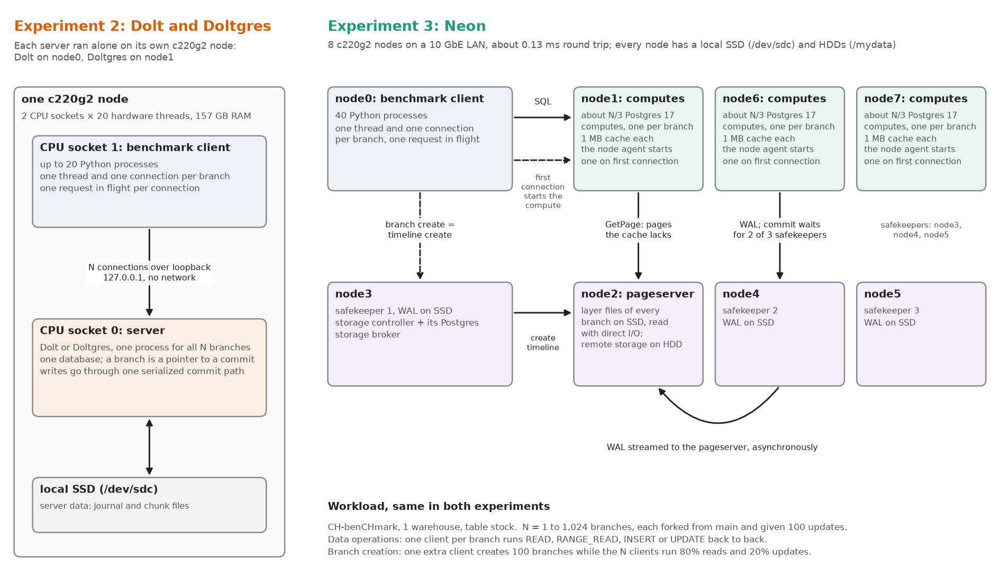
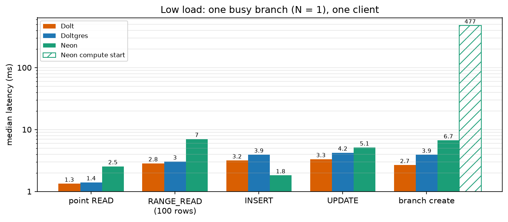
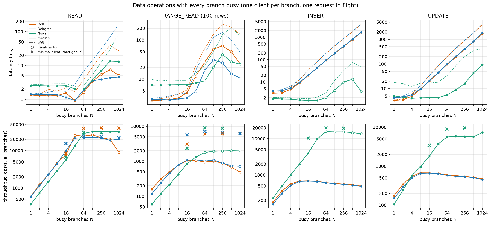
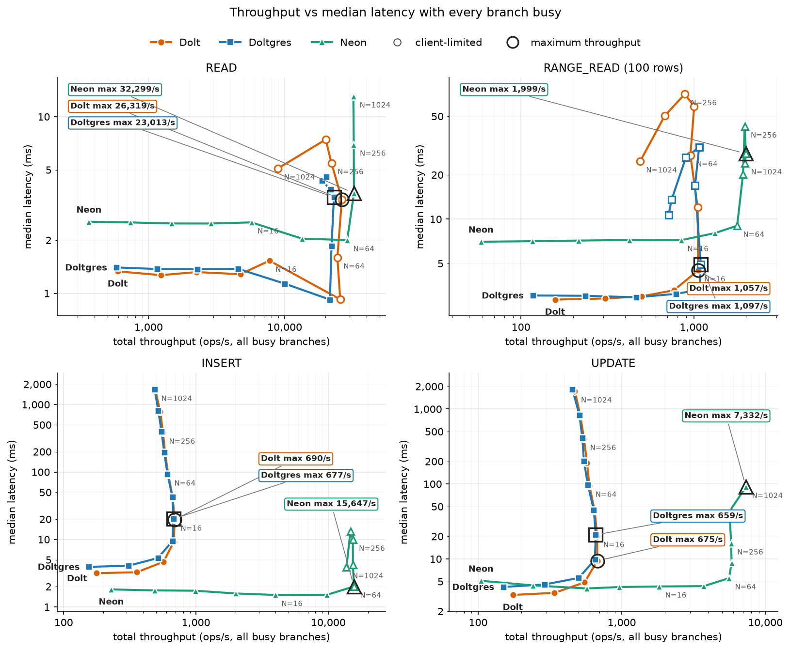
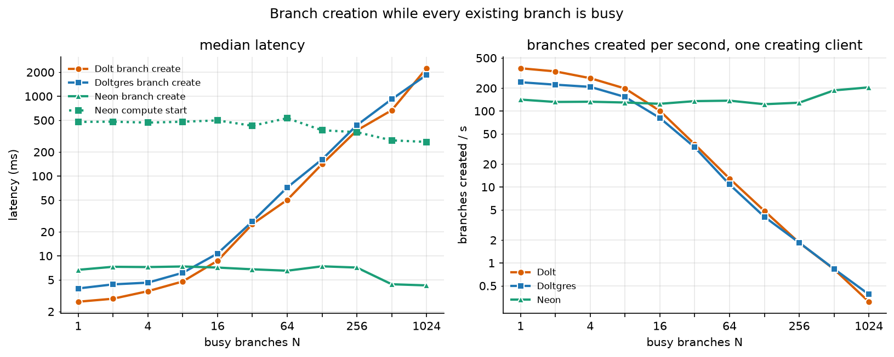
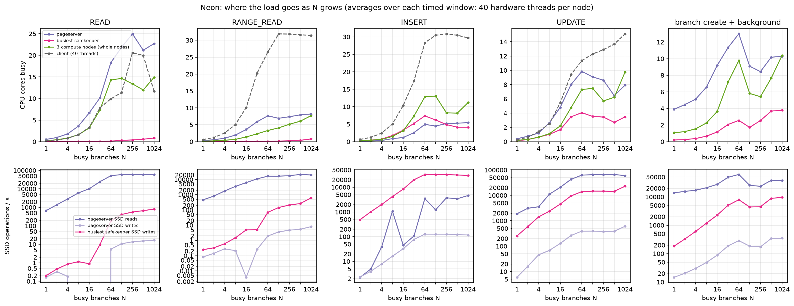

# Neon vs Dolt with Every Branch Busy

*Experiment 3 · CloudLab c220g2 · 19 Oct 2026 · self-hosted Neon (commit `4187e2da7`, Postgres 17.5) against
experiment 2's Dolt 2.4.2 and Doltgres 1.4.0*

Experiment 2's workload on Neon: data operations and branch creation with N existing branches, N = 1 to 1,024, every
branch busy. One client per branch with one request in flight runs READ, RANGE_READ (100 rows), INSERT or UPDATE back
to back. For branch creation, one more client creates 100 branches while every existing branch runs 80% point reads
and 20% point updates. The Dolt and Doltgres series are experiment 2's data, unchanged.

## Hypothesis and verdict

> Neon's branch and data operations are slower than Dolt's at low load because Neon is distributed, but Neon scales
> further, until the safekeepers and the pageserver become the bottleneck as the load grows.

**Largely confirmed, with two corrections.**

- **Low load: Neon is slower for reads and branch creation, but not for inserts.** With one busy branch a point read
  takes 2.5 ms on Neon against 1.3 ms on Dolt, a range read 7.0 ms against 2.8 ms, and a branch create 6.5 ms against
  2.7 ms. Updates are close (5.1 against 3.3 ms). Inserts are faster on Neon (1.8 ms against 3.2 ms): a commit only
  waits for two of three safekeepers to write the WAL, and nothing on the commit path is serialized across branches.
- **Neon scales much further.** Writes reach 15,000-20,000 inserts/s and 6,000-9,600 updates/s, against Dolt's
  ceiling of about 680 writes/s for all branches together. Branch creation stays at 4-7 ms (median) with up to 1,024
  existing branches, where Dolt's grows to 2.2 s. Point reads top out at about 31,000-32,000/s; Dolt reached about
  40,000/s with a minimal client.
- **Neon's limits are where the hypothesis put them, but they are the SSDs, not CPU.** Reads and updates level off
  when the pageserver's SSD does about 55,000-66,000 reads/s. The pageserver uses 20-25 of its 40 CPU threads at that
  point, and its own GetPage latency rises from 0.6 ms to 13 ms (reads) and 45 ms (updates). Inserts level off when
  each safekeeper's SSD does about 40,000 writes/s, every commit being flushed on each safekeeper. The compute nodes
  stay below 15 of 120 threads throughout.
- **Correction: Neon's p95 latency rises at high N, but nothing near Dolt's.** At 1,024 busy branches Dolt's median
  write takes 1.7 s; Neon's median update takes 91 ms and its median point read 13 ms.
- **Reliability finding.** Under concurrent writes this pageserver build sometimes fails a page read
  (`dio vec read failed`, 141 times over the final sweep). The affected statement fails; when it hit a client's
  start-up scan, that client lost its whole run, and such points were rerun.

## Setup

**Neon is spread over seven nodes; the client has its own.** All are CloudLab c220g2 nodes (2× Xeon E5-2660 v3, 40
hardware threads, 157 GB RAM, Intel S3500 SSD for data, 10 GbE LAN with a 0.12-0.15 ms round trip).

| Node | Role |
|---|---|
| node0 | benchmark client (Python runner, up to 40 processes) |
| node1, node6, node7 | Neon computes: one Postgres 17 compute per branch, started by a node agent on first connection |
| node2 | pageserver (data on the SSD, direct I/O, the default; "remote storage" on the local HDD) |
| node3 | safekeeper 1, storage controller (with its own Postgres), storage broker |
| node4, node5 | safekeepers 2 and 3 |

- **Storage devices (checked on the nodes).** The pageserver's layer files (`/mnt/ssd/ps`) and each safekeeper's
  WAL (`/mnt/ssd/sk`) are on the node's Intel S3500 SSD (`/dev/sdc`, XFS). Since boot the pageserver SSD served 150
  million reads (405 GB) and each safekeeper SSD took 37.7 million writes (398 GB). The HDDs (`/mydata`, LVM over two
  10k-rpm disks) hold only the "remote storage" directories that stand in for S3: the pageserver's uploaded layers
  and the safekeepers' offloaded WAL, written in the background (25-29 GB on the pageserver node, about 100 GB per
  safekeeper node). The one synchronous use is at timeline creation, which waits for the new timeline's index file to
  be "uploaded"; Neon's `local_fs` storage writes and renames it without fsync, so the HDD is not waited on there.
- **Computes keep almost no cache** (`shared_buffers=1MB`, no local file cache), so reads go to the pageserver.
  A commit waits for two of the three safekeepers.
- **A branch is a timeline.** The timed branch create is one storage-controller call
  (`POST /v1/tenant/<t>/timeline` with the parent as ancestor). Starting the new branch's compute is timed separately:
  every 5th created branch is connected to, and that connection (compute start plus first connection) is the
  "compute start" series.
- **Same workload as experiment 2.** CH-benCHmark at one warehouse (about 608,000 rows), table `stock`, FAN_OUT
  branches each with 100 untimed updates, one client per branch with one request in flight.
- **Differences from experiment 2.**
  - Dolt's client ran on the server's own machine over loopback; Neon's crosses the LAN (about 0.13 ms per round trip).
  - Neon's storage services have whole nodes; Dolt's server had one 20-thread CPU socket.
  - From N = 8 on, Neon gets at least 3,000 point reads, 600 range reads or 2,500 writes per client per run
    (experiment 2: 50, 10, 10). Neon finished experiment 2's op counts in under a second from N = 16 up, so those windows measured the client
    starting up rather than Neon.
  - Range reads use per-column key bounds (`s_w_id = 1 AND s_i_id BETWEEN ...`) instead of a row comparison; same
    rows, see "What went wrong first".
- **Seed data.** Loaded once into a seed timeline, compacted into image layers; each run's root branch is created
  from it.

## Low load

| One busy branch (N = 1), median | Dolt | Doltgres | Neon |
|---|---:|---:|---:|
| Point READ | 1.33 ms | 1.40 ms | 2.54 ms |
| RANGE_READ (100 rows) | 2.84 ms | 3.03 ms | 7.02 ms |
| INSERT | 3.16 ms | 3.92 ms | 1.82 ms |
| UPDATE | 3.31 ms | 4.23 ms | 5.11 ms |
| Branch create | 2.66 ms | 3.90 ms | 6.53 ms |
| Neon: start the new branch's compute and connect | | | 454 ms |

- **Reads pay for remote pages.** With almost no compute cache, a point read fetches two or three pages from the
  pageserver (0.55 ms each, measured by the pageserver), and a 100-row range read about a dozen.
- **Inserts are cheaper than on Dolt.** The compute streams WAL to the safekeepers and waits for two of three to
  write it (0.4 ms flush each). There is no shared commit structure across branches.
- **Updates first read the row's page from the pageserver,** then commit like an insert.
- **Branch creation is a metadata call** (6.5 ms through the storage controller), but a branch is not usable until
  its compute runs: about 0.45 s more.

## Data operations as N grows

*Top: median (solid) and p95 (dashed) latency. Bottom: total throughput. Hollow markers: limited by the benchmark
client (Dolt: experiment 2's rule; Neon: client at 25 or more of its 40 threads). × marks: the same load from a
minimal asyncio client (experiment 2's read check for Dolt and Doltgres; `data/neon_local/ceiling_check.csv` for
Neon).*

*The same data as throughput against median latency; each line walks from 1 to 1,024 busy branches. Where a line
turns upward, adding busy branches no longer adds throughput, only queueing. Dolt's and Doltgres's writes turn at
about 680 writes/s; Neon's turn at 15,000 inserts/s and 5,600-7,300 updates/s, and its reads at about 32,000/s.
Hollow markers: client-limited. Ringed points: each line's highest throughput. Where that point is hollow (Dolt's
point reads, Doltgres's and Neon's range reads, Neon's inserts) the benchmark client set it; the minimal-client ceilings in
the table below are higher.*

| | 1 branch | 16 busy | 64 busy | 256 busy | 1,024 busy |
|---|---:|---:|---:|---:|---:|
| READ, Neon: median / total ops/s | 2.54 ms / 365 | 2.52 ms / 5,702 | 2.00 ms / 28,790 | 6.94 ms / 32,188 | 13.0 ms / 32,096 |
| READ, Dolt | 1.33 ms / 594 | 1.53 ms / 7,732 | client-limited (minimal client: 1.5 ms / 39,116) | client-limited (6.0 ms / 40,644) | client-limited (23 ms / 40,273) |
| INSERT, Neon | 1.82 ms / 229 | 1.51 ms / 3,987 | 2.01 ms / 15,647 | 9.91 ms / 15,351* | 3.90 ms / 13,734* |
| INSERT, Dolt | 3.16 ms / 177 | 19.7 ms / 690 | 92 ms / 618 | 383 ms / 564 | 1,654 ms / 493 |
| UPDATE, Neon | 5.11 ms / 105 | 4.29 ms / 1,825 | 5.54 ms / 5,584 | 16.1 ms / 5,778 | 91 ms / 7,332 |
| UPDATE, Dolt | 3.31 ms / 175 | 20.2 ms / 675 | 95 ms / 596 | 398 ms / 547 | 1,720 ms / 472 |
| RANGE_READ, Neon | 7.02 ms / 59 | 7.20 ms / 846 | 9.02 ms / 1,778* | 42.6 ms / 1,965* | 24.0 ms / 1,974* |

\* limited by the benchmark client. Doltgres tracks Dolt within 10-30% (figure; experiment 2's report).

**Minimal-client ceilings for Neon** (20 s per point, same load shape, 40 client processes using at most 7.5 of
the client node's 40 threads):

| Busy branches | 16 | 64 | 256 |
|---|---:|---:|---:|
| Point reads/s (median) | 6,639 (2.5 ms) | 31,161 (2.0 ms) | 30,399 (7.7 ms) |
| Range reads/s | 2,349 (6.8 ms) | 8,983 (7.0 ms) | 8,746 (27 ms) |
| Inserts/s | 10,307 (1.5 ms) | 19,833 (3.1 ms) | 19,294 (12 ms) |
| Updates/s | 3,424 (4.6 ms) | 8,988 (6.8 ms) | 9,600 (23 ms) |

- **Reads and writes scale with the number of busy branches until about 64 branches.** Then throughput stays flat and
  latency grows with N, which is queueing at a saturated component.
- **Point reads: same ceiling with both clients** (about 31,000/s), so this one is Neon's.
- **Range reads and inserts: the benchmark client was the limit beyond 32-64 branches.** The minimal client reached
  about 9,000 range reads/s and 19,500 inserts/s.
- **Updates: Neon's limit,** about 9,600/s with the minimal client. The benchmark's 5,800-7,300/s is lower because
  its clients add per-update work (key tracking, wider rows), though its client used at most 15 of 40 threads.
- **The busy branches really were busy.** For point reads and updates, Little's law gives 91-96% of the N branches
  with a request outstanding at N = 256 and 1,024 (`figures/activity.csv`). The client-limited insert and range-read
  runs at N = 1,024 kept only 8-14% busy.

## Branch creation as N grows

*Left: median latency of the 100 timed creates, and Neon's median compute start (every 5th new branch). Right:
branches created per second by the one creating client (1 / mean create latency). Neon ran with the storage
controller's per-tenant API rate limit lifted (`--tenant-rate-limit 1000`, data/neon_local_nolimit); the first runs
with the default limit and the background workload are in the table below. From N = 128 on, Neon's background
clients kept fewer than half the branches busy.*

| Busy branches N | 1 | 16 | 64 | 256 | 1,024 |
|---|---:|---:|---:|---:|---:|
| Neon, median create (p95) | 6.7 ms (8.6) | 7.1 ms (9.8) | 6.5 ms (10.9) | 7.1 ms (10.2)* | 4.3 ms (7.1)* |
| Neon with the default rate limit, median (p95) | 6.5 ms (8.5) | 7.4 ms (9.6) | 6.1 ms (10.4) | 7.3 ms (99)* | 6.9 ms (100)* |
| Dolt, median create (p95) | 2.7 ms (3.2) | 8.7 ms (22) | 50 ms (225) | 373 ms (1,610) | 2,244 ms (9,424) |
| Neon, creates/s (1 / mean) | 142 | 125 | 137 | 129 | 205 |
| Neon with the default rate limit, creates/s | 144 | 127 | 142 | 46 | 42 |
| Neon compute start, median | 477 ms | 498 ms | 531 ms | 355 ms | 268 ms |
| Background ops/s, Neon | 251 | 4,336 | 14,967 | 6,974* | 13,902* |
| Background ops/s, Dolt | 306 | 2,404 | 2,579 | 2,337 | 2,073 |

\* background load limited by the benchmark client (first runs: 13 of 256 and 12 of 1,024 requests outstanding on
average).

- **Neon's branch creation does not slow down with busy branches.** The median stays at 4-7 ms and p95 at 7-11 ms
  from 1 to 1,024 branches. At 64 busy branches, with 56 of them really busy and 15,000 background ops/s (six times Dolt's), it is
  6.5 ms against Dolt's 50 ms. Creating a timeline is a metadata write on the pageserver; it does not wait behind
  other branches' writes the way Dolt's creates wait behind its serialized commits.
- **The storage controller's API rate limit, not load, made the first runs slow down from N = 128.** It throttles
  each tenant to 10 requests per second by default (`--tenant-rate-limit`, a token bucket holding up to 10). The
  creating client sends creates back to back (about 8 ms each) and pauses only for every 5th branch's compute start.
  Pauses of about 0.5 s (N ≤ 64) refill five tokens; the shorter ones at N ≥ 128 (0.28-0.38 s) did not, so the 4th
  or 5th create of each group waited up to 100 ms (the storage controller logged `tenant ... is rate limited`).
  With the limit lifted the waits disappear: p95 stays at 7-11 ms at every N, creates/s stays at 123-205, and the
  storage controller logged no rate limiting.
- **With the default limit a tenant creates at most about 10 branches per second.** The runs' overall rate (9-19
  creates/s) is set mostly by the design, every 5th create being followed by a compute start; lifting the limit
  raised it from about 12.5 to 13.5-19 creates/s at N ≥ 128.
- **In the rerun, creates were faster at 512 and 1,024 busy branches** (median 4.3-4.4 ms against 6.5-7.4 ms at
  smaller N). The first runs did not show this, and I have not found the cause.
- **Compute start does not grow with N:** 0.27-0.53 s, mostly Postgres and compute_ctl start-up on the compute node.
- From N = 128 on, the benchmark client could not keep every background branch busy against Neon (7,000-14,000
  ops/s). Those creation points show many existing branches with running computes, but not all of them busy.

## What a compute start costs, and whether a pool helps

`scripts/compute_start_probe.py` started 10 computes cold and 10 from a pool on node1 with the cluster otherwise
idle, each on a fresh branch (`data/neon_local/compute_start_probe.jsonl`). A pooled compute is compute_ctl
started without a spec: it pre-warms Postgres, then waits until a control plane binds it to a branch with
`POST /configure`.

| Median | Cold | Pooled |
|---|---:|---:|
| Branch to first `SELECT 1` | 292 ms | 258 ms |
| compute_ctl's own startup total | 169 ms | 164 ms |
| - sync-safekeepers (find the branch's WAL position) | 39 ms | 36 ms |
| - basebackup from the pageserver (82 KB) | 67 ms | 64 ms |
| - start Postgres | 61 ms | 61 ms |
| Getting the pooled compute ready beforehand | | 1.1 s |

**Where one start's time goes.** From the timestamps in compute_ctl's log of the last pooled start in the probe
(`data/neon_local/compute_start_probe_last_pooled.log`; 265 ms to the first `SELECT 1`). Times are from the moment
compute_ctl received `POST /configure`:

| From | To | Step | What happens |
|---:|---:|---|---|
| 0 ms | 37 ms | sync-safekeepers | compute_ctl runs a short-lived Postgres in a special mode to learn where the branch's WAL ends: about 25 ms to start that process and load the Neon extension, about 8 ms for the vote with the three safekeepers |
| 37 ms | 108 ms | basebackup | the pageserver assembles the branch's small non-table files (82 KB) from its layers and sends them; table pages are fetched later, on demand |
| 108 ms | 172 ms | start Postgres | see the next table |
| 172 ms | about 265 ms | first query | the probe's polling, a `psql` launch, and the first connection, which has to load the catalog pages it needs from the pageserver (not broken down further) |

Inside the 64 ms Postgres start:

| From | To | Step |
|---:|---:|---|
| 0 ms | 10 ms | launch the process and read the configuration |
| 10 ms | 29 ms | load the Neon extension (`neon.so` and its libraries) and register its WAL record handler |
| 29 ms | 46 ms | set up shared memory and start listening |
| 46 ms | 64 ms | start from the basebackup (no WAL to replay) and accept connections |

**What each step does.** A compute start brings up one Postgres for one branch, in a state consistent with
everything already committed on that branch.

1. **Sync-safekeepers: find where the branch's WAL ends.** The safekeepers hold the authoritative WAL, so before a
   new Postgres becomes the branch's writer, compute_ctl must learn the position (LSN) up to which WAL is committed;
   starting earlier could miss committed changes. A fast check (1 ms) first asks whether the safekeepers already
   agree. For a new branch they do not, so compute_ctl runs the Postgres binary in a special mode
   (`--sync-safekeepers`): it loads the Neon extension, connects to the three safekeepers, wins a quick election
   for a new term, takes the highest LSN a majority has, brings any lagging safekeeper up to it, prints it and
   exits. About 25 ms is starting that process and loading `neon.so`; the vote took about 8 ms. A new branch has no
   WAL yet, so the answer is "start where the branch was created".
2. **Basebackup: fetch the files Postgres needs to start.** compute_ctl asks the pageserver for a basebackup of the
   branch at that LSN and unpacks it into the compute's data directory: the control file (`pg_control`), the
   transaction status logs (`pg_xact`, multixact), the relation map files that locate the catalog tables, version
   and config files, and a `neon.signal` file saying "start exactly at this LSN" (82 KB in all). Table and index
   pages are not included; the pageserver assembles these few files from the branch's layers, and Postgres fetches
   table pages later, one at a time, as queries need them. compute_ctl then writes `postgresql.conf` from the spec
   and allows connections from the network in `pg_hba.conf`.
3. **Start Postgres on those files.**
   - Launch and read the configuration (10 ms).
   - Load the Neon extension (19 ms): `shared_preload_libraries=neon` loads `neon.so` and its libraries. The
     extension registers its WAL record handler, replaces Postgres's storage layer with one that asks the
     pageserver for pages, and registers the walproposer background worker that streams WAL to the safekeepers.
   - Set up shared memory and listen (17 ms): the 1 MB buffer cache, lock tables, slots for 100 connections and the
     extension's own structures, then the network socket.
   - Start from the basebackup (18 ms): the startup process reads the control file, sees `neon.signal` and begins
     at that LSN. There is no WAL to replay, because the pageserver already holds the branch's history. Postgres
     starts its background processes and reports ready; the walproposer then connects to the safekeepers and wins
     the election that makes this Postgres the branch's writer. compute_ctl applies the rest of the spec (nothing
     here; catalog updates are skipped) and marks the compute running.
4. **First query.** The probe polls every 10 ms by launching `psql`, so part of this is waiting and launching. The
   connection makes Postgres start a backend process and authenticate it, and that backend builds its cache of
   catalog metadata: the data directory is new, so there is no saved cache file, and catalog tables such as
   `pg_class` and `pg_attribute` are read through the 1 MB cache from the pageserver at about 0.5 ms per page. This
   account of step 4 follows from how Postgres and Neon work; its parts were not measured separately.

- Every step is a fixed cost: none depends on the size of the data, because table pages are not part of the start.
  A plain Postgres takes a similar 50-100 ms to start; the throwaway Postgres compute_ctl runs to warm a pooled
  compute took 98 ms. Neon adds the extension load, the safekeeper vote and the basebackup fetch.
- A cold start adds about 30 ms before this timeline: launching compute_ctl and its HTTP servers.
- A pool saves only about 35 ms (12%) here. What remains is per-branch work that cannot happen before the branch is
  known: asking the safekeepers where the branch's WAL starts, fetching the branch's basebackup, and starting
  Postgres on it.
- Neon's cloud runs each compute in a virtual machine, where booting takes seconds; that is the cost its compute
  pools hide. This deployment runs computes as plain processes, so there is little to hide.
- The 0.27-0.53 s compute starts measured in the branch-creation runs add the agent's HTTP call, its readiness
  polling, the client's connection over the LAN, and the load on the cluster.

## Where Neon saturates

*Per run, averaged over the timed window. Top: CPU threads busy on the pageserver, the busiest safekeeper, the three
compute nodes together, and the client. Bottom: SSD operations per second on the pageserver and the busiest
safekeeper.*

From the pageserver's and safekeepers' own metrics, saved before and after every run
(`figures/internal_latency.csv`; each pair covers the whole run, setup included):

| Run | Pageserver GetPage, mean | Pageserver SSD reads/s | Safekeeper WAL flush, mean | Safekeeper SSD writes/s |
|---|---:|---:|---:|---:|
| READ, 64 busy | 0.58 ms | 51,456 | | |
| READ, 256 busy | 2.75 ms | 59,179 | | |
| READ, 1,024 busy | 12.9 ms | 60,380 | | |
| UPDATE, 64 busy | 2.75 ms | 62,777 | 1.1 ms | 14,069 |
| UPDATE, 256 busy | 15.0 ms | 65,859 | 4.1 ms | 14,612 |
| UPDATE, 1,024 busy | 45.5 ms | 59,495 | 9.6 ms | 22,890 |
| INSERT, 64 busy (benchmark / minimal client) | 0.62 ms | 3,463 | 0.82 ms | 32,846 / 40,100 |

- **Reads: the pageserver's SSD.** The pageserver reads its layer files with direct I/O (the default), so a page not
  in its small internal caches is an SSD read. Reads stop scaling at about 55,000-66,000 SSD reads/s, close to what
  this SSD model does for small random reads. Past that point, extra branches only add queueing: GetPage latency
  grows from 0.6 ms to 12.9 ms. The pageserver's CPU stays at 20-25 of 40 threads.
- **Updates: the pageserver first, the safekeepers second.** An update reads its page from the pageserver (the same
  SSD ceiling; GetPage latency grows to 45 ms at 1,024), then commits through the safekeepers, whose flush time
  also rises from 0.5 to 9.6 ms.
- **Inserts: the safekeepers.** Inserts hardly touch the pageserver. Each commit is written and flushed on each
  safekeeper's SSD, and inserts stop at about 40,000 SSD writes/s per safekeeper (minimal client), with 7-8 threads of
  safekeeper CPU.
- **Not the computes.** The three compute nodes together use at most 15 of their 120 threads.
- **One tenant, one pageserver, one SSD.** All branches share one pageserver because Neon keeps a branch on its
  parent's pageserver. More safekeepers would raise the insert limit, but nothing spreads one tenant's reads over
  more pageservers short of sharding the tenant.

## What went wrong first

These attempts are kept in `data/superseded/` and not analysed.

- **No image layers.** The first sweep's seed timeline was a single delta layer from the bulk load: Neon creates
  image layers only after several deltas pile up. Every page read replayed the page's whole history (about 131 WAL
  records per read), and point reads took 4.2 ms with one branch and capped at about 5,000/s. A long-lived Neon database has
  image layers, so the seed was compacted into them. The images are written one LSN above the timeline's last record,
  and branches made at that record could not use them until a little more WAL was written to the seed.
- **Range reads as a sequential scan.** Postgres estimated the benchmark's row-comparison range predicate as
  matching every row and scanned the whole table (4.7 s per read). Even forced onto the index it read about 200
  pages for 100 rows. Per-column bounds select the same rows from about 15 pages (7 ms).
- **Too few operations per run.** With experiment 2's op counts, Neon's windows from N = 16 up lasted under a second,
  of which up to 0.6 s was the 40 client processes starting. Only 34 of 256 insert clients had a request in flight.
- **Shared-memory ids ran out.** Each force-stopped compute left a SysV shared-memory segment behind. After a few
  thousand computes the kernel limit (4,096) was reached and computes stopped starting, which failed the first
  branch-creation run at N = 1,024. The node agent now removes orphaned segments and the limit is 32,768.

## Limits of this comparison

- **The client.** Python benchmark client on 40 threads. It limited range reads and inserts from 32-64 branches on,
  and the background load during branch creation from 128 on; the minimal-client check covers the data operations
  at 16, 64 and 256 branches.
- **Dolt numbers are experiment 2's.** Dolt ran with the client on the same machine over loopback and a 20-thread
  CPU socket. Neon paid a LAN round trip per request and had whole nodes for its services. Dolt's range reads used
  the row-comparison predicate; Dolt's planner used its index.
- **One small cache setting.** With a normal compute cache (Neon's default 128 MB shared_buffers or a local file
  cache), the 30 MB `stock` table would be served from compute memory and reads would not reach the pageserver.
- **One data size, one table, one tenant, one pageserver.** Remote storage was a directory on each node's HDD, not
  S3; with S3, timeline creation would also wait for an S3 upload of the timeline's index.
- **No GC or compaction pressure.** Each run's branches live for minutes; no run lasted long enough for layer
  compaction to matter.
- **Pageserver read errors.** The data includes the statements that failed this way: under 0.01% of updates in the
  final sweep (25 of 1.28 million at N = 512, 90 of 2.56 million at N = 1,024), 0.3% in the minimal-client update
  runs. Three runs in which an error stopped one client for the whole
  run were rerun (`data/neon_local_reruns`).

Data, scripts and how to reproduce: [README.md](README.md), [REPRODUCE.md](REPRODUCE.md).
