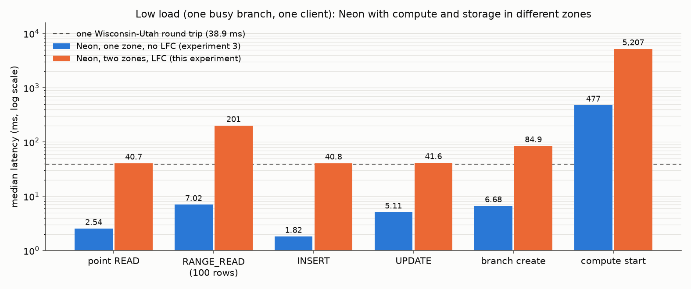
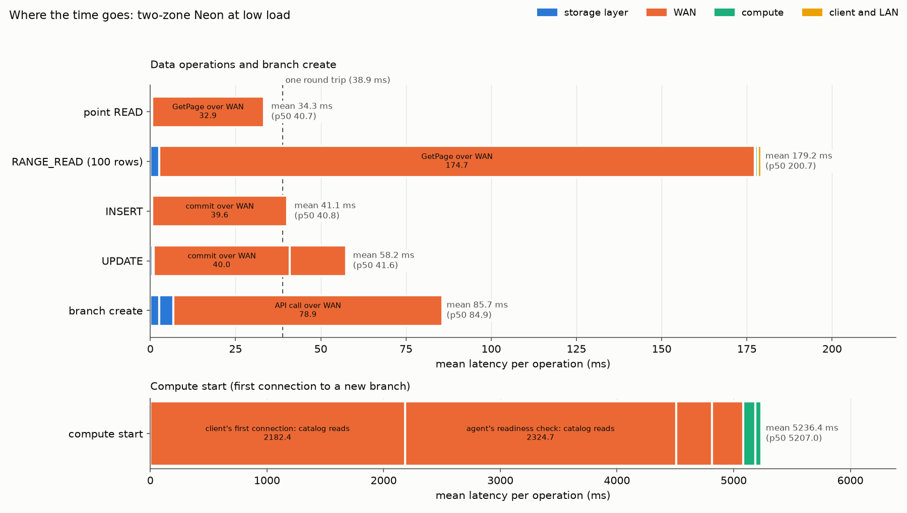

# Experiment 4: Neon at low load with compute and storage in different zones

## Verdict

With the compute and the client in Utah and Neon's storage layer in Wisconsin (38.9 ms round trip), every
operation at low load costs a whole number of WAN round trips, and almost nothing else. Each median is 8 to 29
times its value in experiment 3, where everything ran on one LAN:

| Operation | Experiment 3, one zone (ms) | This experiment, two zones (ms) | Round trips paid |
|---|---:|---:|---|
| Point read | 2.54 | 40.7 | one for the 84% of reads that miss the compute's cache; none for the other 16% (0.9 ms) |
| Range read, 100 rows | 7.02 | 201 | about 4.5 sequential page fetches |
| Insert | 1.82 | 40.8 | one, the commit waiting for the safekeeper quorum |
| Update | 5.11 | 41.6 | one for the commit, plus one page fetch for 42% of updates |
| Branch create | 6.68 | 84.9 | two: the client opens a new connection to the storage controller per call |
| Compute start | 477 | 5,207 | about 130: startup, then each first connection reads catalog pages one at a time |

The storage layer itself is fast: a GetPage takes 0.58 ms on the pageserver, a WAL flush 0.57 ms on a
safekeeper, and a timeline create 6.8 ms on the storage controller. The compute's local file cache serves a
read in under 1 ms but cannot help the operations that must reach the storage layer: commits always cross the
WAN, and range reads fetch their pages one round trip at a time.

## Setup

| | |
|---|---|
| Storage zone (Wisconsin, c220g2, all data on SSD) | a2 pageserver; a0 storage controller, broker and safekeeper 1; a1, a3 safekeepers 2 and 3; a4 used only to load the data |
| Compute zone (Utah, r320) | b0 benchmark client; b1 compute node (computes on a tmpfs: no SSD in Utah) |
| Spare for later scaling | a5-a7 (SSD nodes for more pageservers), b2-b7 (compute nodes) |
| Network | 38.9 ms round trip between zones, 0.2 ms within Utah; compute-to-storage traffic on the public addresses |
| Dataset | CH-benCHmark with 60 warehouses: 30 M rows, 5.1 GiB in Postgres, 14 GB on the pageserver's SSD (447 GB) |
| Compute | shared_buffers 128 MB, local file cache (LFC) 448 MB, effective_io_concurrency 2 |
| Cache design | The LFC holds the whole stock primary key (128.5 MiB) plus 15% of the stock heap (1996 MiB). Before each data-op run the client fills it with `pg_prewarm` (untimed), so the run starts in the cache's steady state. |
| Workload | Experiment 3's N = 1 point: one branch, one client, synchronous. 40,000 point reads, 10,000 range reads, 6,000 inserts, 6,000 updates, each after a 10% untimed warm-up. 100 branch creates; every fifth new branch is connected to, which starts its compute. |

Each bar is the median client latency, defined as in experiment 3. Data operations use SQL statement time,
branch create uses the storage controller call, and compute start uses the first connection to a new branch.

## Latency per operation

The latencies sit on round-trip multiples, and the spread within each step is small:

| Operation | Share of operations by WAN round trips |
|---|---|
| Point read | 0: 16.2% (mean 0.9 ms), 1: 83.8% |
| Range read | 0: 8%, 1-4: 15%, 5: 54%, 6: 20%, 7-8: 3% |
| Insert | 1: 99.5% |
| Update | 1: 58%, 2: 42% |
| Compute start | 5.1 to 5.5 s for all 20 starts |

## Where the time goes

Mean ms per operation, from `figures/breakdown.csv`. In every bar the components add up to the client's mean
latency.

| Component | Point read | Range read | Insert | Update |
|---|---:|---:|---:|---:|
| Client to compute on the Utah LAN, and the driver | 0.58 | 0.94 | 0.62 | 0.64 |
| Parse, plan, protocol (reads) | 0.22 | 0.19 | | |
| Commit: WAN to the safekeepers | | | 39.58 | 40.02 |
| Commit: safekeeper WAL flush on SSD | | | 0.57 | 0.69 |
| Executor CPU | 0.10 | 0.77 | 0.20 | 0.14 |
| LFC reads (tmpfs) | 0.00 | 0.00 | 0.00 | 0.00 |
| GetPage: WAN and compute side | 32.87 | 174.74 | 0.07 | 16.48 |
| GetPage: pageserver | 0.48 | 2.58 | 0.00 | 0.26 |
| **Mean total** | **34.26** | **179.22** | **41.05** | **58.24** |
| GetPage requests per operation | 0.84 | 4.46 | 0.00 | 0.42 |

| Branch create | ms |
|---|---:|
| Client to storage controller over the WAN | 78.92 |
| Storage controller | 2.62 |
| Pageserver timeline create (called by the storage controller) | 4.16 |
| **Mean total** | **85.70** |

| Compute start | ms |
|---|---:|
| Client's first connection to `bench`: catalog reads over the WAN | 2,182 |
| Agent's readiness check, a first connection to `postgres`: catalog reads over the WAN | 2,325 |
| compute_ctl: other steps (the sync-safekeepers check and the rest) | 104 |
| compute_ctl: start Postgres | 53 |
| compute_ctl: basebackup (82 KB from the pageserver) | 306 |
| compute_ctl: sync safekeepers | 267 |
| **Mean total** | **5,236** |

What each bar shows:

- **Point read.** 84% of reads need one heap page from the pageserver: one round trip plus 0.58 ms of
  pageserver time. The other 16% find the page in the compute's caches and finish in 0.9 ms. The share matches
  the cache design, 15% of the heap in the LFC plus a little in shared_buffers. The index leaf pages stay cached.
- **Range read.** A 100-row range looks up about 6 pages in the LFC; 4.5 of them come from the pageserver, and the waits do
  not overlap. Prefetch is limited to 2 requests in flight (experiment 3's setting), and the reads still
  queue one round trip after another. A deeper prefetch would cut this; experiment 3's LAN hid it.
- **Insert.** The pages being written stay in the compute's cache, so the whole cost is the commit. The
  walproposer waits for 2 of 3 safekeepers to flush the WAL: one round trip plus a 0.57 ms SSD flush.
- **Update.** Every update pays the commit round trip. Half of the updates pick a fresh random row, and 85% of
  those miss the cache and fetch the page first. That gives 0.42 fetches per update, the second round trip for
  42% of them.
- **Branch create.** The storage controller needs 6.8 ms, including the pageserver's timeline create. The other
  79 ms are two round trips: the benchmark's Neon backend opens a new TCP connection for every
  storage-controller call. With a kept-alive connection it would be one round trip, about 46 ms.
- **Compute start.** compute_ctl's own startup takes 0.73 s. Syncing the safekeepers takes 267 ms and the
  basebackup 306 ms, several round trips each; experiment 3 measured 39 ms and 67 ms for them on the LAN. The other 4.5 s come from the first two
  connections to the fresh compute. A new backend reads the catalog pages of its database from the pageserver,
  about 50 of them, one at a time. The agent's readiness check pays this for database `postgres`, and the
  client's first connection pays it again for `bench`. A probe on a fresh compute measured the client's part at
  1.85 s to connect plus 0.2 s for the first query, with 108 GetPage waits (`logs/connect_probe.out`).

## Caveats

- **LFC chunk size.** The LFC uses 8 kB chunks instead of Neon's default 1 MB (128 pages). With uniform random
  reads over a table 4 times the cache, 1 MB chunks would each hold a few pages, and the hit ratio would fall to
  a few percent. Page-sized chunks give the 15% hit ratio the design asked for.
- **The cache is filled before each run.** Every run starts a fresh compute with an empty LFC, so the client
  fills it untimed (shared code change 2 in the README). Without that, a 40,000-read run would see a hit ratio
  rising from 0 to about 15%.
- **The reference is not like for like.** Experiment 3 had no LFC, a 1-warehouse dataset and 1 MB of
  shared_buffers, so every read there was a GetPage at 0.6 ms. The difference between the two experiments is
  still almost entirely WAN time; the breakdown shows the rest of each operation costs about the same as in
  experiment 3.
- **Measurement overhead.** The measured compute logs every statement's duration, and the agent queries its
  counters once a second. That is microseconds per statement and about 9 small queries per second.
- **One run per operation.** Distributions are tight: the point-read p95 is 0.1 ms above its median, and all
  20 compute starts fall between 5.1 and 5.5 s. Run-to-run variance is small next to the effects.
- **The WAN is Internet2, not a cloud backbone.** The 38.9 ms round trip is stable, with no loss in the probes.
  Its single-stream bandwidth (60-600 Mbit/s) did not limit these single-client runs.
- **Split points.** "GetPage: WAN and compute side" is the compute's wait minus the pageserver's processing
  time, so it includes the compute's protocol handling, which was about 0.1 ms in experiment 3. The commit WAN
  share is the commit wait minus the median safekeeper's flush time.

## Data quality

- **Statement counts match.** Every client statement has a matching duration line in the compute's log:
  40,000, 10,000, 6,000 and 6,000.
- **Breakdowns add up.** Components sum to the client mean for every bar, and 20 of 20 compute starts were
  matched to compute_ctl's startup metrics.
- **Clocks.** Agent clocks were within 6 ms of the client before and after the runs, measured over a 40 ms
  round trip. That is negligible against windows of 4 to 30 minutes and 1 s counter samples.
- **No failures.** No operation failed, and the background client during branch create had no failures.
