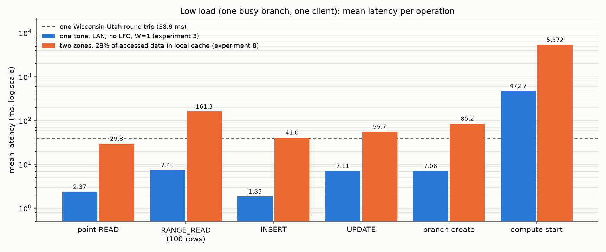
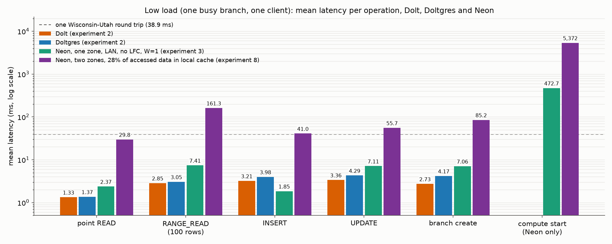
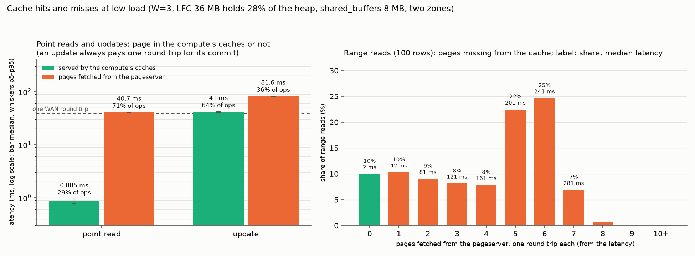
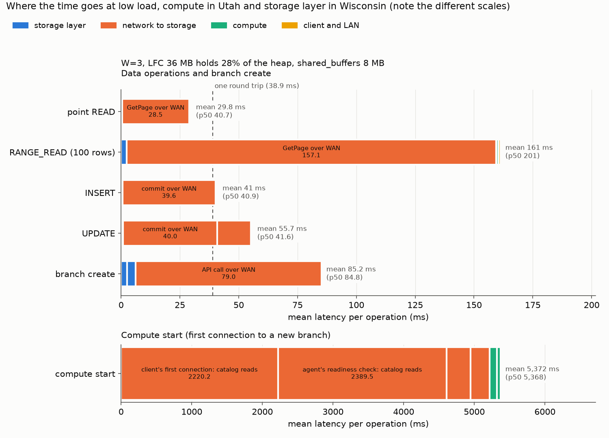
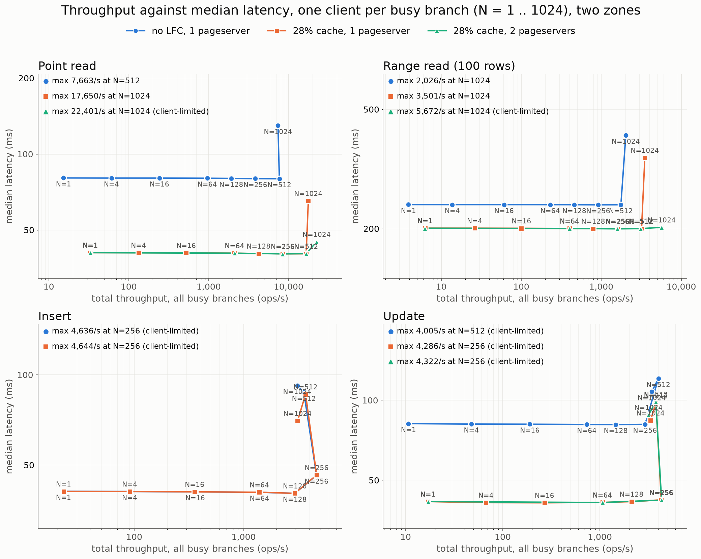
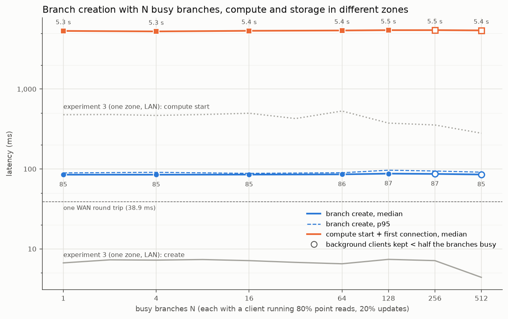
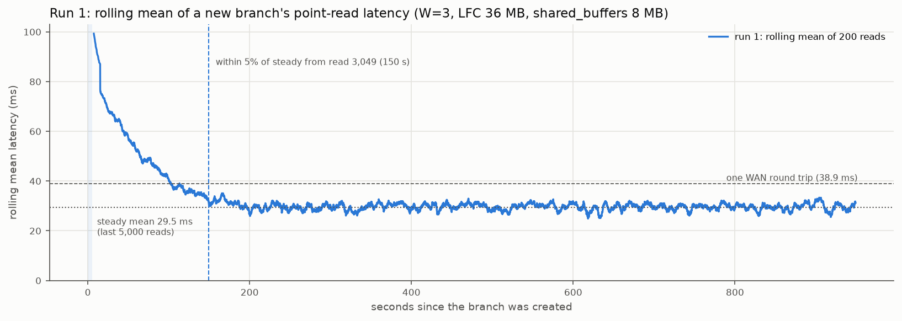

# Experiment 5: Neon across two zones with a compute cache

*Self-hosted Neon (commit `4187e2da7`, Postgres 17.5), storage layer in Wisconsin, client and computes in Utah
(38.9 ms round trip). Regenerated on 25 Oct 2026: every result that uses the local file cache (LFC) now comes from
experiment 8's runs (W=3, the 36 MB LFC holds 28% of the stock heap, 25 Oct); the no-LFC sweep is this
experiment's own (W=4, 22-23 Oct). The first version of this report (W=4, the LFC held 20% of the heap) is in
`superseded/report_lfc_w4/`.*

## Verdict

With the compute in Utah and the storage layer in Wisconsin, every Neon operation pays whole WAN round trips
(38.9 ms) to the pageserver or the safekeepers, and the storage layer's own work stays below a millisecond. With a
cache holding 28% of the heap, 28.6% of point reads are served by the compute in 0.9 ms and the rest wait one round
trip; at scale the cache more than doubles the reads a pageserver can serve, and a second pageserver nearly
doubles them again.

| Sub-experiment | Result |
|---|---|
| A. Low load | Mean point read 29.8 ms, range read 161 ms, insert 41.0 ms, update 55.7 ms, branch create 85.2 ms, compute start 5.4 s. The medians are whole round trips (point read 40.7 ms, range read 201 ms) because most reads still miss: a hit takes 0.89 ms, a miss 40.7 ms |
| B. Scaling | One pageserver saturates its 1 GbE WAN link at about 12,500-13,000 pages/s between N = 512 and 1,024: 7,400 point reads/s without the LFC, 18,200/s with it (1.67 against 0.71 pages per read). Two pageservers (tenant split into 2 shards) reach 30,900 point reads/s at N = 1,024 with the median still at one round trip, and 6,300 range reads/s against 3,700/s; there the busier shard's pageserver is at its link. Writes do not touch the pageserver: inserts reach 16,500/s and updates 7,500-7,700/s at N = 1,024, limited by the safekeepers |
| C. Branch creation | 85-87 ms median (mean 86-89 ms, p95 below 97 ms) from 1 to 512 busy branches; compute start 5.3-5.5 s throughout. Neither depends on the load |
| D. Cold start | A new branch is usable after 5.3 s (3 s compute start, 2.2 s first connection); its first reads fetch index and heap pages (86 ms on average), and it reaches the warm mean of 29.5 ms after 150-156 s and about 3,100 reads, losing about 52 s against a warm branch |

## Setup

| | |
|---|---|
| Placement | pageserver a2, storage controller + safekeeper 1 a0, safekeepers a1 and a3 (Wisconsin, c220g2, SSD); client b0 and computes in Utah (r320, 15 GB, no SSD); computes on seven nodes (b1-b7) and a second pageserver (a5) for the two-pageserver variant |
| Network | 38.9 ms between zones; each pageserver sends at most about 915 Mbit/s to Utah (its 1 GbE control NIC), about 13,900 pages of 8 kB per second; the two pageservers' paths are independent (`logs/probe_wan.out`) |
| Dataset, LFC runs (experiment 8) | CH-benCHmark, 3 warehouses: 1.6 M rows, 0.27 GiB; the workload's table, stock, has 300,000 rows: heap 12,774 pages, primary key 825 pages |
| Dataset, no-LFC runs (this experiment) | 4 warehouses: 2.1 M rows, 0.36 GiB; stock 400,000 rows: heap 17,032 pages, primary key 1,099 pages |
| Compute cache | shared_buffers 8 MB; LFC 36 MB in 8 kB pages (4,608 pages). Before a client starts, its branch's LFC is filled with the first 3,674 heap pages and then the whole primary key, so the LFC holds the key, about 109 catalog pages and 28% of the heap (low load: 28.6% of point reads hit) |
| Workload | one client per busy branch, one request in flight, point reads, range reads of 100 rows, inserts, updates on stock; branch creation as one storage-controller call |

## A. Low load: one busy branch

One branch, one client, 40,000 point reads, 10,000 range reads, 6,000 inserts and 6,000 updates, each after a 10%
warm-up; then 100 branch creates while the branch runs a background client (experiment 8's runs).

| | Experiment 3: one zone, LAN, no LFC, W=1: mean (median) | Two zones, W=3, LFC 28% of the heap: mean (median) |
|---|---:|---:|
| Point read | 2.37 ms (2.54) | 29.8 ms (40.7) |
| Range read, 100 rows | 7.41 ms (7.02) | 161 ms (201) |
| Insert | 1.85 ms (1.82) | 41.0 ms (40.9) |
| Update | 7.11 ms (5.11) | 55.7 ms (41.6) |
| Branch create | 7.06 ms (6.76) | 85.2 ms (84.8) |
| Compute start (first connection to a new branch) | 473 ms (477) | 5,372 ms (5,368) |

**Across zones every operation is a number of WAN round trips.** A miss is one round trip, so the median read
(a miss: 71% of point reads) is 40.7 ms; the mean is lower because 28.6% of reads are served by the compute. Writes
wait one round trip for their commit; a branch create makes two. The pageserver answers a GetPage in 0.42 ms, a
hundredth of the round trip.

*The same low-load point for every system measured so far: experiment 3's comparison (Dolt and Doltgres from
experiment 2's runs, Neon in one zone, all on CloudLab's Wisconsin c220g2 nodes with W=1) and Neon in two zones
from the figure above. Means at one busy branch; compute start applies to Neon only, since a Dolt or Doltgres
branch needs no compute (`figures/low_load_all.csv`).*

| Mean, one busy branch | Dolt | Doltgres | Neon, one zone | Neon, two zones |
|---|---:|---:|---:|---:|
| Point read | 1.33 ms | 1.37 ms | 2.37 ms | 29.8 ms |
| Range read, 100 rows | 2.85 ms | 3.05 ms | 7.41 ms | 161 ms |
| Insert | 3.21 ms | 3.98 ms | 1.85 ms | 41.0 ms |
| Update | 3.36 ms | 4.29 ms | 7.11 ms | 55.7 ms |
| Branch create | 2.73 ms | 4.17 ms | 7.06 ms | 85.2 ms |
| Compute start | | | 473 ms | 5,372 ms |

In one zone Neon is within a few milliseconds of Dolt and Doltgres (faster for inserts); across zones every Neon
operation grows by its WAN round trips, 8 to 22 times its one-zone time.

### Cache hits and misses

Each statement's latency is a whole number of WAN round trips plus about 0.5 ms, so the number of pages it fetched
from the pageserver can be read off its latency (`figures/hit_miss.md`).

| | Share | Median | p95 |
|---|---:|---:|---:|
| Point read, page in the compute's caches | 28.6% | 0.89 ms | 0.94 ms |
| Point read, page fetched | 71.4% | 40.7 ms | 40.9 ms |
| Update, no page fetched (commit only) | 64% | 41.0 ms | 41.9 ms |
| Update, page fetched first | 36% | 81.6 ms | 82.0 ms |
| Range read, every page in the cache | 10% | 1.7 ms | 1.8 ms |
| Range read, pages fetched (4.5 on average) | 90% | 201 ms | 281 ms |

- **A hit is 46 times faster than a miss.** 0.89 ms is the client's LAN trip and Postgres; the LFC read itself
  rounds to 0.00 ms per read in the counters.
- **The hit share is what the cache holds.** 28.6% of point reads hit, and the LFC holds 28% of the stock heap.
  1.2% of reads also fetch their index leaf (two round trips): the hot leaves live in shared_buffers, which does
  not refresh their LFC entries, but the 825-page index almost fits in the 1,024 pages of shared_buffers. The
  breakdown's 0.73 GetPage requests per read are these shares together.
- **Range reads rarely avoid the pageserver.** A 100-row range touches about 6 heap pages, and with 28% of the heap
  cached only 10% of ranges find all of them. The fetches are not overlapped (prefetch depth 2), so the latency
  grows by one round trip per page fetched.
- **Updates pay the commit either way.** The commit waits one round trip for two of three safekeepers. An update
  whose row's page is not cached fetches it first: one more round trip.

### Where the time goes

Mean ms per operation (`figures/breakdown.md`); components add up to the client's mean in every bar.

| Component | Point read | Range read | Insert | Update |
|---|---:|---:|---:|---:|
| Client to compute on the LAN, and the driver | 0.57 | 0.91 | 0.64 | 0.64 |
| Parse, plan, protocol | 0.22 | 0.19 | | |
| Executor CPU | 0.09 | 0.75 | 0.00 | 0.00 |
| Commit: WAN to the safekeepers | | | 39.61 | 39.95 |
| Commit: safekeeper WAL flush | | | 0.55 | 0.68 |
| GetPage: WAN and compute side | 28.50 | 157.12 | 0.29 | 14.41 |
| GetPage: pageserver | 0.42 | 2.34 | 0.01 | 0.21 |
| **Mean** | **29.81** | **161.31** | **41.00** | **55.74** |

*The writes' executor CPU is a small negative estimate (-0.10 and -0.15 ms: the query timer minus the GetPage and
commit waits), shown as 0.00; their components add up to the mean with it.*

The branch create (85.2 ms) is two WAN round trips (79.0 ms; the backend opens a new connection per call) and 6.2
ms in the storage controller and pageserver. The compute start (5.4 s) is mostly two first connections that read
their database's catalog pages one round trip at a time (2.2 s and 2.4 s).

## B. Scaling: N busy branches

N busy branches (1 to 1,024), one client per branch with one request in flight, running point reads, range reads,
inserts or updates back to back on stock. Every client's branch has its own compute; the computes are spread evenly
over the seven Utah nodes (about 146 per node at N = 1,024). Three variants:

| Variant | Runs | Compute cache | Pageservers | N | Operations |
|---|---|---|---|---|---|
| No LFC | this experiment, W=4 | shared_buffers 8 MB only | one (a2) | 1, 4, 16, 64, 128, 256, 512, 1,024 | all four |
| Default LFC | experiment 8, W=3 | LFC 36 MB, prewarmed | one (a2) | same | all four |
| Two pageservers | experiment 8, W=3 | LFC 36 MB, prewarmed | two: the tenant split into 2 shards (2 MiB stripes), a2 and a5 | 1, 64, 256, 512, 1,024 | point reads, range reads, updates |

The two-pageserver variant skips N = 4, 16 and 128 and the inserts: below the first knee both pageservers are
lightly loaded, and an insert fetches no pages, so the second pageserver cannot change it. At every point a minimal
asyncio client (`scripts/ceiling_check.py`, a third of the benchmark client's CPU per operation) re-measured N = 128
to 1,024 for 30 s, because the benchmark client itself runs out of CPU at about 10 of its 16 threads.

*"28% cache": the LFC holds 28% of the accessed data. Each line walks N = 1 to 1,024; every point is labelled with its N, and each panel lists each line's highest
throughput ("client-limited" where the benchmark client used 10 or more of its 16 threads). The minimal client's
runs are in the tables, not in the figure.*

### Point reads and range reads

Cells: throughput; median / mean latency. The minimal client records the median, not the mean.

| Point reads | N = 256 | N = 512 | N = 1,024 | Highest, minimal client |
|---|---|---|---|---|
| No LFC (W=4) | 3,838/s; 79.9 / 65.3 ms | 7,663/s; 79.8 / 65.4 ms | 7,362/s; 129.6 / 117.4 ms | 7,355/s at N = 1,024 (131 ms) |
| Default LFC | 8,436/s; 40.2 / 29.1 ms | 16,575/s; 40.2 / 29.3 ms | 17,650/s; 65.2 / 50.6 ms | 18,238/s at N = 1,024 (65 ms) |
| Two pageservers | 8,432/s; 40.2 / 29.1 ms | 16,562/s; 40.3 / 29.3 ms | 22,401/s; 44.9 / 41.7 ms (client-limited) | 30,894/s at N = 1,024 (41 ms) |

| Range reads (100 rows) | N = 256 | N = 512 | N = 1,024 | Highest, minimal client |
|---|---|---|---|---|
| No LFC (W=4) | 917/s; 240 / 250 ms | 1,759/s; 240 / 252 ms | 2,026/s; 410 / 438 ms | 2,283/s at N = 1,024 (412 ms) |
| Default LFC | 1,613/s; 200 / 150 ms | 3,190/s; 200 / 150 ms | 3,501/s; 345 / 265 ms | 3,746/s at N = 1,024 (318 ms) |
| Two pageservers | 1,590/s; 200 / 150 ms | 3,104/s; 200 / 151 ms | 5,672/s; 202 / 160 ms (client-limited) | 6,342/s at N = 1,024 (200 ms) |

- **Below the knee every branch adds its share.** Throughput doubles with N and is N divided by the mean latency;
  the median stays at whole round trips: two for a point read without the LFC (index leaf and heap page), one with
  it, five to six for a range.
- **With one pageserver the knee is its WAN uplink.** Point and range reads stop scaling between N = 512 and
  1,024 in both one-pageserver variants, at 12,400-13,000 GetPage requests per second. The pageserver then sends
  860-900 Mbit/s to Utah, its 1 GbE control NIC (915 Mbit/s with iperf3). Its CPU stays at 6-7 of 40 cores and
  its own time per GetPage below 1 ms; the median grows by tens of milliseconds, which is queueing on the link
  (`figures/resource_use.csv`, `figures/scaling_bottleneck.png`).
- **The LFC multiplies the throughput at that knee, not the knee's N.** It cuts the pages per point read from 1.67
  to 0.71 and per range from 6.4 to 3.7, so the same link carries 2.5 times the point reads (18,200/s against
  7,400/s) and 1.6 times the range reads. The knee stays at the same N because a cached read also takes less time,
  so each client asks the pageserver for pages at about the same rate.
- **Two pageservers reach the knee at N = 1,024.** With the tenant's pages split over two pageservers, each
  pageserver serves part of every branch's GetPage requests over its own uplink. At N = 1,024 the minimal client
  reaches 30,894 point reads/s at a 41.0 ms median (p95 49 ms against 42 ms at N = 512), 1.7 times one
  pageserver's; range reads reach 6,342/s at 200 ms. Below N = 512 the two variants are the same to within 1-2%:
  spreading a range's pages over two pageservers does not shorten it, because its fetches are not overlapped.
- **The split is uneven, and the busier pageserver limits.** A page goes to shard `hash(relation, block / 256) mod 2`
  (`pgxn/neon/libpagestore.c`, `get_shard_number`): each 256-page stripe of the heap lands on a shard by a hash,
  not alternately. For this 50-stripe heap, 62% of the uncached part maps to shard 1 on a5 (recomputed with Neon's
  hash for stock's relfilenode), and a5 served 58-61% of the GetPage requests. At the minimal client's N = 1,024
  point a5 read 13,900 pages/s, its link's limit, while a2 served 9,500: 13,900 / (0.61 x 0.73) = about 31,000
  point reads/s, which is what was reached. An even split would allow about 38,000/s.

### Inserts and updates

| | N = 256 | N = 512 | N = 1,024 | Minimal client, N = 1,024 |
|---|---|---|---|---|
| Inserts, no LFC (W=4) | 4,636/s; 46.2 / 50.5 ms (client-limited) | 3,550/s (client-limited) | 3,090/s (client-limited) | 16,346/s at 59 ms |
| Inserts, default LFC | 4,644/s; 46.3 / 50.6 ms (client-limited) | 3,682/s (client-limited) | 3,109/s (client-limited) | 16,530/s at 60 ms |
| Updates, no LFC (W=4) | 2,921/s; 81.2 / 82.2 ms | 4,005/s (client-limited) | 3,423/s (client-limited) | 7,169/s at 143 ms |
| Updates, default LFC | 4,286/s; 42.2 / 56.1 ms (client-limited) | 3,784/s (client-limited) | 3,323/s (client-limited) | 7,691/s at 133 ms |
| Updates, two pageservers | 4,322/s; 42.1 / 56.0 ms (client-limited) | 3,773/s (client-limited) | 3,171/s (client-limited) | 7,549/s at 134 ms |

| Default LFC, minimal client | N = 128 | N = 256 | N = 512 | N = 1,024 |
|---|---:|---:|---:|---:|
| Inserts/s; median | 3,096; 40.0 ms | 6,268; 40.0 ms | 12,434; 40.2 ms | 16,530; 59.5 ms |
| Safekeeper WAL flushes/s (each) | 3,190 | 6,370 | 12,620 | 15,500-17,000 |
| Mean fsync per flush | 0.37 ms | 0.41-0.43 ms | 0.69-1.79 ms | 12-26 ms |
| WAL received per safekeeper | 1.9 MB/s | 3.7 MB/s | 7.3 MB/s | 9.4-10.1 MB/s |
| Safekeeper NIC receive | 21 Mbit/s | 40 Mbit/s | 78 Mbit/s | 100-117 Mbit/s |
| Updates/s; median | 1,559; 80.9 ms | 3,289; 81.0 ms | 6,693; 82.4 ms | 7,691; 133 ms |
| Safekeeper WAL flushes/s (each) | 1,630 | 3,360 | 6,860 | 7,300-8,700 |
| Mean fsync per flush | 0.73-0.77 ms | 1.10-1.12 ms | 2.6-4.1 ms | 36-50 ms |
| WAL received per safekeeper | 22 MB/s | 43 MB/s | 85 MB/s | 92-113 MB/s |
| Safekeeper NIC receive | 189 Mbit/s | 362 Mbit/s | 720 Mbit/s | 778-816 Mbit/s |

*From the safekeepers' own counters (`safekeeper_flush_wal_seconds`, `safekeeper_pg_io_bytes_total`) and their
control NICs, sampled every second on a0, a1 and a3 over each 30 s window of experiment 8's minimal-client check;
ranges are over the three safekeepers. During the N = 1,024 windows the safekeepers' metrics endpoint missed some
samples, so those windows are averaged over 8-27 good samples.*

- **The benchmark client is the limit from N = 256.** Each write costs this client about 4 ms of CPU, so it tops
  out at 4,000-4,700 writes/s; its higher-N write points mostly measure itself (hollow markers). The minimal client
  (table above) is not limited there: it used 6.4 of 16 cores for inserts and 3.7 for updates at N = 1,024.
- **Inserts: the safekeepers' synchronous disk writes.** Every commit is flushed (fsync) on every safekeeper, one
  flush per insert. Up to N = 512 an fsync takes under 2 ms and inserts double with N; at N = 1,024 the mean fsync
  jumps to 12-26 ms, the safekeepers' SSDs do 41,000-42,000 writes/s (about 2.5 device writes per flush), and
  inserts grow by only a third while the median rises by 19 ms, about the fsync wait. The other resources are far
  from their limits: 10 MB/s of WAL and about 110 Mbit/s on each safekeeper's 1 GbE link, 6-7 of 40 cores, the
  compute nodes at 4 of 16 cores, and the pageserver serves no pages for inserts. Whether the SSD itself or the
  file system's handling of a thousand concurrently fsynced WAL files sets the 12-26 ms is not separated: the
  disks' utilisation was not sampled in these windows.
- **Updates: the safekeepers' link and disks together.** An update's WAL carries a full page image (12.4 kB per
  update, against 0.6 kB per insert): with full_page_writes, the first change to a page after a checkpoint logs
  the whole page, and with random keys spread over many new branches almost every update is such a first change.
  So each safekeeper receives 720 Mbit/s already at N = 512 and 780-816 Mbit/s at N = 1,024, close to its 1 GbE
  link (about 915 Mbit/s usable), while its fsyncs, now of 12 kB writes, slow to 36-50 ms. Updates reach only
  7,700/s and the median rises by 51 ms, about the fsync wait. Both the network and the disk of the safekeepers are
  near their limits, so the data cannot separate the two; neither the pageserver (it serves 0.36 GetPage per
  update) nor the computes is. Two pageservers therefore change nothing for updates.
- **Why the safekeepers and not the client or the computes.** An insert fetches no pages, so its latency is the
  client's LAN trip plus the commit, which waits only for the safekeepers; its median rises by 19 ms at N = 1,024,
  in the same windows in which the safekeepers' own flush time rises to 12-26 ms. The client and the compute
  nodes used under half their CPU there.

## C. Branch creation with N busy branches

N busy branches (1 to 512), each with a background client running 80% point reads and 20% updates on a filled
cache; one more client creates 100 branches and connects to every fifth, which starts its compute (experiment 8's
runs).

| Busy branches N | 1 | 4 | 16 | 64 | 128 | 256 | 512 |
|---|---:|---:|---:|---:|---:|---:|---:|
| Branch create, median (ms) | 84.8 | 84.8 | 85.0 | 85.6 | 87.4 | 86.7 | 85.3 |
| Branch create, mean (ms) | 86.4 | 85.6 | 85.6 | 86.3 | 88.5 | 87.6 | 86.3 |
| Branch create, p95 (ms) | 89.3 | 90.8 | 88.1 | 89.7 | 96.5 | 94.3 | 91.1 |
| Compute start + first connection, median (s) | 5.34 | 5.26 | 5.36 | 5.41 | 5.46 | 5.46 | 5.42 |
| Compute start + first connection, mean (s) | 5.38 | 5.29 | 5.39 | 5.44 | 5.47 | 5.44 | 5.41 |
| Background load (ops/s) | 42 | 164 | 659 | 2,636 | 4,899 | 3,995 | 3,889 |
| Branches with a request in flight | 96% | 96% | 96% | 96% | 90% | 37% | 19% |

- **Branch creation does not slow down with load.** The median stays at 85-87 ms and the p95 below 97 ms from 1 to
  512 busy branches. Creating a timeline is a metadata operation on the storage controller and pageserver (6.2 ms
  at low load); the rest is the client's two WAN round trips, which no load on the storage layer touches.
- **Nor does compute start.** 5.3-5.5 s at every N: the first connections read catalog pages one round trip at a
  time, and those reads do not compete with the busy branches for anything that saturates.
- **The background clients stopped scaling at N = 256.** Their throughput peaked at 4,900 ops/s at N = 128 and
  stayed near 4,000 ops/s at 256 and 512, so there only 37% and 19% of the branches had a request in flight
  (hollow markers in the figure): the Python client's limit, as in the scaling runs. Up to N = 128 the branches
  were busy.
- **Against experiment 3 (one zone, LAN).** There, a create took 6.5-7.4 ms and a compute start 0.3-0.5 s, also
  flat in N. Across zones both grow by the round trips they make; neither depends on the load.

## D. Cold start: a new branch's first reads

Each of three runs creates a branch from the run's root, starts its compute with the first connection, and runs
30,000 uniformly random point reads on one connection, back to back (`scripts/cold_start.py`; experiment 8's runs).
The compute starts with empty shared_buffers and an empty LFC, and nothing prewarms it.

*Top: every read of the three runs (log scale) and each run's rolling mean of 200 reads. Bottom: per 10 s, the share
of reads that needed 0, 1 or 2 round trips, and the LFC's fill.*

*Run 1 alone: its rolling mean of 200 reads on a linear scale, with its steady mean (29.5 ms) and the read from which
it stays within 5% of it (read 3,049, 150 s after the branch was created).*

| Run | Branch create | Compute start | First connection | First read | Mean of reads 1-200 | Steady mean (last 5,000) | Steady from | Extra time over steady reads |
|---|---:|---:|---:|---:|---:|---:|---:|---:|
| 1 | 85 ms | 3.01 s | 2.16 s | 2.16 s | 86.9 ms | 29.5 ms | read 3,049 (150 s) | 52 s |
| 2 | 98 ms | 3.08 s | 2.29 s | 2.16 s | 85.2 ms | 29.4 ms | read 3,121 (152 s) | 52 s |
| 3 | 99 ms | 3.00 s | 2.16 s | 2.16 s | 86.2 ms | 29.5 ms | read 3,208 (156 s) | 53 s |

*Steady from: the first read after which the rolling mean of 200 reads stays within 5% of the steady mean; extra
time: the reads' latency above the steady mean, summed over the reads before that point.*

- **The new branch is usable after 5.3 s.** Creating it takes 85-99 ms. Starting its compute takes 3 s, and the
  first connection 2.2 s more: compute_ctl's and the backends' catalog reads, one round trip each. The first query
  then takes 2.2 s for the planner's catalog lookups on stock and its index and the index path to the row.
- **The first reads cost two round trips.** With an empty cache a point read fetches its index leaf page and its
  heap page: 56-59% of the first 1,000 reads took two round trips, and the first 200 averaged 85-87 ms against the
  steady 29.5 ms.
- **The cache warms in about 2.5 minutes.** The index's leaf pages enter the cache first, because every read
  touches one. The LFC is full after 174-175 s, and from then on the latency stays at the steady state of the
  low-load runs: 29% of reads from the cache, mean 29.5 ms. Over those first 3,000-3,200 reads the branch loses
  about 52 s against a warm one.
- **Prewarming would remove most of it.** Filling the cache with `pg_prewarm` (the scaling runs' preparation)
  takes about 20 s per branch, because it reads pages many to a round trip, against the 150 s and 52 s of extra
  latency the reads pay to warm it one page at a time.

## Caveats

- **Two datasets in one report.** The LFC results (A, the default-LFC and two-pageserver sweeps, C, D) are
  experiment 8's runs at W=3; the no-LFC sweep is this experiment's at W=4. Without the LFC the dataset size
  matters too: at W=4 the 1,099-page primary key does not fit in the 8 MB of shared_buffers (1,024 pages) and a
  point read fetches 1.67 pages; at W=3 the 825-page key nearly fits, so a no-LFC sweep at W=3 would probably fetch
  closer to one page per read and reach a higher knee. It was not run, so the no-LFC line is not a like-for-like
  baseline for the LFC lines.
- **The two-pageserver result depends on the stripe hash.** With 50 stripes, Neon's hash gave the second
  pageserver 61% of the misses; at W=4 (67 stripes) it gave 52%. Another table, stripe size or dataset changes the
  split and so the two-pageserver ceiling.
- **The benchmark client limits writes from N = 256 and the two-pageserver reads at N = 1,024.** Every insert and
  update costs this Python client about 4 ms of CPU, so its 16 threads top out near 4,000-4,700 writes/s (hollow
  markers). The minimal asyncio client measures those points instead. Its statements are not identical to the
  runner's (it picks range bounds and update keys uniformly, so its updates fetch their row's page more often).
- **Fewer operations per client at N >= 512.** The client node (15 GB) keeps every result row in memory until a
  run ends. From N = 512 on a run is capped at 1,000,000 reads and 640,000 writes (976-1,953 point reads and
  625-1,250 writes per client); each timed window still lasts 1-5 minutes at a steady rate. The no-LFC runs at
  N = 512 ran before the cap with the full counts.
- **The cache is prewarmed, and a short run sees a little less than the long-run steady state.** Over the scaling
  runs' windows every index leaf stays cached (0.71 GetPage per point read, mean 29.1 ms); in the 44,000-read
  low-load run 1.2% of point reads fetch a leaf as well (0.73 per read, mean 29.8 ms).
- **The compute nodes were nearly full at N = 1,024 with the LFC.** Each Utah node ran about 147 computes (83 MB each in
  this experiment's memory probe), leaving 1.2-1.4 GB free. No compute was killed and no statement failed.
- **Statement timeout.** The bench role has `statement_timeout = 600s`, so that a stuck statement would fail
  instead of stopping a run; none timed out.
- **Measurement-only settings.** Statement logging is off in the scaling and branch-creation runs (thousands of
  computes); the compute's data directory is on the node's disk there, only the LFC on the tmpfs; max_connections
  is 25.
- **One run per point.** Within a run the latencies are tight (point-read p95 within 1 ms of the median below the
  knee).
- **Walproposer warnings at high N.** The computes' logs hold "terminating connection to safekeeper ... no messages
  received during the last 10000ms" and an immediate reconnect, mostly from the N = 512 and 1,024 runs and from
  computes left idle; commits at N <= 256 stay at one round trip.

## Data quality

- **Every run is complete.** All benchmark runs (this experiment's 32 no-LFC runs, experiment 8's 59 runs) had all
  N clients reporting, and none had failed operations. The only non-OK rows are inserts rejected for a duplicate
  key (20 of about 2.5 million in experiment 8's runs, at most 11 in a run here): the benchmark client's random key
  generator collides now and then. No statement hit the 600 s statement timeout.
- **Low-load breakdowns add up.** Components sum to the client mean in every bar; the compute's log has a duration
  line for 39,999 of the 40,000 point reads and every range read, insert and update; 20 of 20 compute starts were
  matched to compute_ctl's metrics.
- **The minimal client agrees with the benchmark client where neither is limited.** At N = 512: 16,406 and 16,575
  default-LFC point reads/s, 16,290 and 16,562 with two pageservers; at the no-LFC knee 7,355 and 7,362.
- **Clocks.** Agent clocks were within 2.2 ms of the client's (`data/clock_offsets.json`, and experiment 8's).
- **Load balance.** The computes of N branches were spread evenly over the seven compute nodes (146-148 each at
  N = 1,024); the two pageservers carried 39-44% and 56-61% of the GetPage requests (the stripe hash, above).
- **Superseded data** (`data/superseded/`, README): the smoke runs, the first default-LFC sweep (prewarm order) and
  the no-LFC runs interrupted by two client-side faults. Since this regeneration, this experiment's own W=4 LFC
  runs are no longer used either; they stay where they were (`data/scaling/lfc25*`, `data/low_load`,
  `data/branch_create`, `data/cold_start`) and the first report, built from them, is in `superseded/report_lfc_w4/`.
