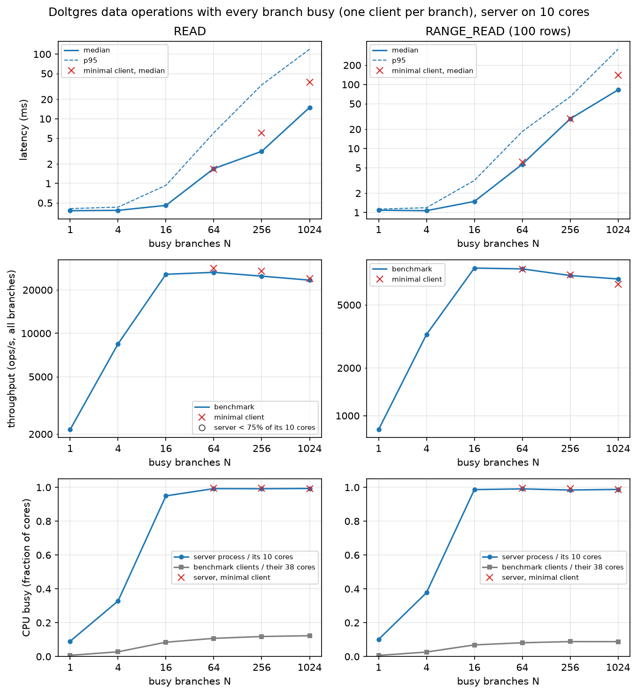
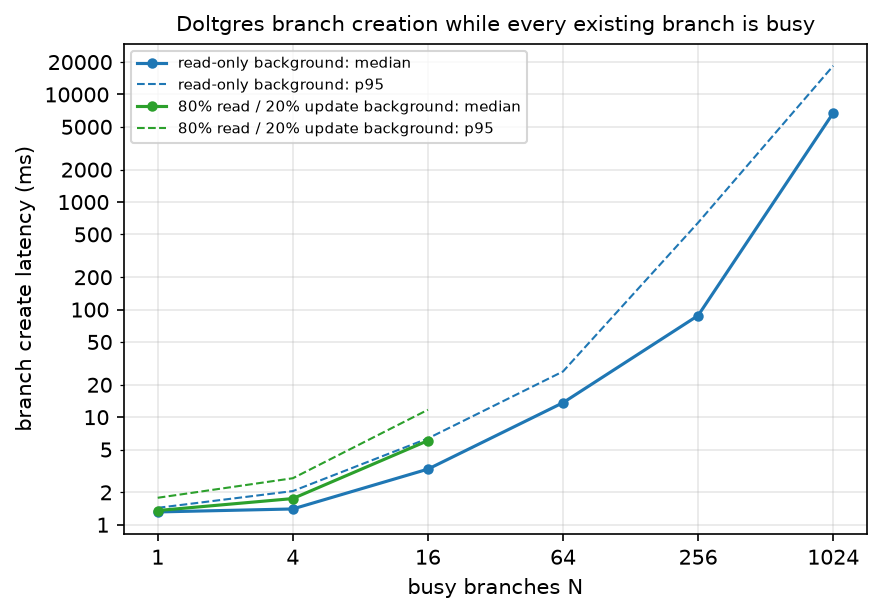

# Doltgres Reads and Branch Creation, Server on 10 Cores

*Experiment 7 · local server `dassl-serv-01` (Xeon Gold 6418H) · 23 Oct 2026 · Doltgres 1.4.0*

Experiment 2's Doltgres read runs and branch-creation runs, repeated on one local machine with the server limited to
10 cores, to answer two questions:

1. **Are reads across busy branches limited by the server's CPU, and nothing else?**
2. **Do only writes slow branch creation?** Experiment 2 ran the busy branches with 80% reads / 20% updates; here
   they run point reads only.

18 benchmark runs and 8 minimal-client points (2 of them the 5-core sweep), plus a 6-run smoke test, an
8-run follow-up on branch creation and 9 branch-creation runs with an 80/20 read/update background (25 Oct); 0 failed
operations.

## Result

- **Reads are limited by the server's CPU.** From 16 busy branches on, the server uses 9.5-9.99 of its 10 cores
  (from 64 on, every core is 98-99% busy, 0% iowait) and throughput stays flat: about 25,000 point reads/s and 7,300-8,500 range
  reads/s out to 1,024 busy branches. The clients use 3-5 of their 38 cores. A minimal client reaches the same
  ceiling, and halving the server's cores halves it (point 27,041 → 13,672/s, range 7,706 → 4,164/s at 256 busy
  branches). More busy branches only add queueing: latency grows roughly in proportion to N.
- **Read-only busy branches slow branch creation only by using up the server's CPU, not through locks or other
  database logic.** In the benchmark, creating a branch takes 1.3 ms with 1 busy branch, 3.3 ms with 16, 14 ms
  with 64, 88 ms with 256 and 6.7 s with 1,024. That is as soon as and as much as the reads fill the server's
  cores. In a follow-up with 1,024 busy branches, the same 23,000 reads/s that make creates take 2.4 s on 10 full
  cores leave them at 1.84 ms (unloaded speed) when the server has 20 cores and spare CPU. Halving the reads on 10
  cores has the same effect, and doubling them until 20 cores are full brings the slowdown back.
- **Updates slow branch creation without filling the CPU** (follow-up, 25 Oct): with the busy branches running 80%
  reads / 20% updates, as in experiment 2, creating a branch takes 5.5-6.0 ms at 16 busy branches against 3.3 ms
  with reads only, while the server uses about half its cores (4.9-5.2 of 10, against 9.1).
- **Under a full CPU a create suffers far more than a read**: at 1,024 busy branches creates take 95 ms to 24.6 s
  while the reads beside them have a median of 16 ms. The cause of that difference is not identified.

## Setup

**One machine, server and clients on separate cores.** The machine has 4 sockets of 24 cores (no hyperthreading),
one NUMA node per socket. Only nodes 2 and 3 were used.

| | Server | Benchmark client |
|---|---|---|
| CPU | 10 cores of node 2 (`numactl --physcpubind`, `GOMAXPROCS=10`); 5 for the core sweep | the other 14 cores of node 2 and all 24 of node 3: 38 cores |
| Memory | node 2 | nodes 2 and 3 |
| Storage | NVMe (`/mydata`, ext4) | not used |
| Connection | listens on `127.0.0.1:5433` | TCP loopback, one connection per branch |

- Pinning was checked during the 256-branch read run (`logs/pinning_busy.log`). The server ran only on its 10 cores,
  each 99.7-100% busy (92-95% user, 4-6% system, 1-3% softirq, 0% iowait). Every client process was restricted to
  the 38 client cores, and the server's memory (2.4 GB) was on node 2. Before the runs the server's cores were 100%
  idle (`logs/pinning_idle.log`). Other users' jobs ran on other nodes; one used about 6% of two client cores.
- **CPU measurement** (all over each run's timed window):
  - the server process's CPU, from `/proc/<pid>`;
  - the client processes' own CPU;
  - every server and client core, sampled every 0.5 s (`figures/cpu_window.csv`).
- **The workload is the same as experiment 2's**, apart from the changes listed below:
  - CH-benCHmark data (1 warehouse, 608,435 rows) and its `stock` table;
  - branches forked from `main`, each with 100 untimed updates;
  - one client per branch with one request in flight; RANGE_READ reads 100 rows;
  - branch creation is one client creating 100 branches while the background runs.
- **What changed from experiment 2:**
  - the server has 10 cores instead of 20 hardware threads;
  - N = 1, 4, 16, 64, 256, 1,024 (not every power of 2);
  - five times as many reads per run, for longer timed windows (2-9 s);
  - the branch-creation background is point reads only;
  - the client has 38 cores.

## Reads

*Top: median (solid) and p95 (dashed) latency; red crosses are the minimal client. Middle: total throughput of all
clients. Bottom: CPU used in the timed window, as a fraction of the cores each side may use.*

| Busy branches N | 1 | 4 | 16 | 64 | 256 | 1,024 |
|---|---:|---:|---:|---:|---:|---:|
| READ, median | 0.38 ms | 0.38 ms | 0.46 ms | 1.70 ms | 3.13 ms | 15.0 ms |
| READ, total ops/s | 2,150 | 8,452 | 25,684 | 26,487 | 24,931 | 23,377 |
| RANGE_READ, median | 1.09 ms | 1.07 ms | 1.49 ms | 5.67 ms | 29.1 ms | 82.4 ms |
| RANGE_READ, total ops/s | 817 | 3,252 | 8,534 | 8,432 | 7,656 | 7,286 |
| Server cores used (of 10), READ / RANGE_READ | 0.9 / 1.0 | 3.3 / 3.8 | 9.5 / 9.9 | 9.9 / 9.9 | 9.9 / 9.8 | 9.9 / 9.9 |
| Client cores used (of 38), READ / RANGE_READ | 0.3 / 0.3 | 1.1 / 1.0 | 3.2 / 2.6 | 4.1 / 3.1 | 4.5 / 3.4 | 4.7 / 3.3 |

Throughput grows with N until the server's 10 cores are full, at about 16 busy branches. After that it stays flat
and latency grows by queueing. Point-read throughput drops 12% from 64 to 1,024 busy branches at the same CPU use,
so each read costs a little more server CPU when there are more connections (0.37 → 0.42 ms per read).

### Is it really the server's CPU?

Four checks, each pointing to the server's CPU:

| Check | Result |
|---|---|
| Server cores during the plateau, N ≥ 64 (`figures/cpu_window.csv`) | 98.6-99.9% busy on average; the least busy core 97.7-99%. Mostly user time (93-96%); system 2-5%, softirq (loopback networking) 0.7-2.4%, iowait 0 |
| Client cores | 7-12% busy. The client has spare CPU at every point (none of the hollow "server < 75% busy" markers appear) |
| Minimal client (`scripts/read_ceiling_check.py`: asyncio, no per-operation bookkeeping, 20 s per point) | the same ceiling: 28,358 / 27,041 / 23,922 point reads/s and 8,394 / 7,706 / 6,755 range reads/s at 64 / 256 / 1,024 busy branches, with the server at 9.9 of 10 cores and the client at 2 of 38 |
| Server restarted on 5 cores (minimal client, 256 busy branches) | throughput halves, and the server uses all 5 cores |

Core sweep (`figures/core_sweep.md`):

| 256 busy branches | Server cores | ops/s | Median | p95 | Server cores used |
|---|---:|---:|---:|---:|---:|
| Point reads | 10 | 27,041 | 6.0 ms | 30.4 ms | 9.96 |
| Point reads | 5 | 13,672 (×0.51) | 16.1 ms | 42.8 ms | 4.96 |
| Range reads | 10 | 7,706 | 28.8 ms | 76.0 ms | 9.92 |
| Range reads | 5 | 4,164 (×0.54) | 57.1 ms | 108.9 ms | 4.99 |

Experiment 2's open question was whether the client limited the reads; here it does not. The minimal client keeps
more requests in flight (about 880 of 1,024 point reads, against about 350 for the benchmark client), so its latency
at 1,024 busy branches is higher (37 ms against 15 ms median). Its throughput is the same.

## Branch creation with read-only busy branches

*Median (solid) and p95 (dashed) latency of the 100 timed creates. Blue: busy branches running point reads only.
Green: the same setup with busy branches running 80% reads / 20% updates (N = 1 to 16, follow-up below).
Experiment 2's CloudLab numbers are in the table, not in the figure.*

| Busy branches N | 1 | 4 | 16 | 64 | 256 | 1,024 |
|---|---:|---:|---:|---:|---:|---:|
| Median create, read-only background | 1.32 ms | 1.40 ms | 3.29 ms | 13.6 ms | 88.1 ms | 6,730 ms |
| p95 create | 1.44 ms | 2.06 ms | 6.34 ms | 26.6 ms | 643 ms | 18,460 ms |
| Background reads/s | 1,504 | 6,152 | 20,523 | 23,594 | 24,002 | 23,052 |
| Server cores used (of 10) | 1.7 | 4.4 | 9.1 | 9.9 | 10.0 | 10.0 |
| Experiment 2, 80/20 background: median create | 3.9 ms | 4.6 ms | 10.7 ms | 71.9 ms | 434 ms | 1,850 ms |
| Experiment 2: background ops/s; server threads used (of 20) | 321; 3.6 | 1,187; 3.1 | 2,348; 5.8 | 2,464; 7.3 | 2,230; 6.7 | 1,965; 6.2 |

- **Up to 4 busy branches, creation is unaffected** (1.3-1.4 ms), with the server's CPU partly idle.
- **From 16 busy branches on, creation slows**, as soon as the reads fill the server's cores. It stays below
  experiment 2's times up to 256 busy branches, but at 1,024 it is 3.6 times slower (6.7 s against 1.85 s median).
- **The creates at 1,024 busy branches are erratic**: 95 ms at best, 24.6 s at worst. The point reads in the same
  window had a median of 16 ms and p99 150 ms (`dolt_chw1_tp_t1_b1024.parquet`). A create waits about 400 times
  longer than a read. Between 256 and 1,024 busy branches, read latency grows 4× and create latency 76×.

### Is it the reads or the full CPU? (follow-up)

The two experiments differ in more than the kind of background load:

- Experiment 2's read/update mix was held back by Doltgres's serialized writes to about 2,000 ops/s, and the server
  used only 3-7 of its 20 threads.
- Here the reads run at 23,000-24,000/s and keep all 10 server cores full from 16 busy branches on.

A slowdown could come from the reads themselves (locks or other database logic that reads and a branch creation
share) or only from the full CPU. To separate them, `scripts/create_under_reads.py` keeps 1,024 busy branches (one
connection each, one point read in flight) and times branch creations from one more connection. It varies two
things independently:

- **the read traffic**: back to back, or paced to a fixed total rate;
- **the server's CPU headroom**: 10 or 20 cores of node 2.

The key run repeats the slow run's exact read rate from the same 1,024 sessions on 20 cores. The read traffic, and
any lock traffic it causes, is the same; only the CPU is no longer full. The clients run on the other 28 cores of
nodes 2-3 in every run. 30 creates when they are slow, 100 otherwise.

| Run | Branches | Server cores | Reads | Reads/s | Server CPU used | Median create | p95 create | Max |
|---|---|---:|---|---:|---:|---:|---:|---:|
| D0 | 100 updates each, as in the benchmark | 10 | back to back | 23,017 | 9.96 of 10 | 2,400 ms | 6,231 ms | 8,693 ms |
| D2 | same | 10 | paced to D0 / 2 | 11,474 | 6.4 of 10 | 1.76 ms | 2.33 ms | 2.84 ms |
| **D1** | **same** | **20** | **paced to D0's rate** | **23,019** | **13.9 of 20** | **1.84 ms** | **3.71 ms** | **30 ms** |
| D3 | same | 20 | back to back | 44,238 | 19.7 of 20 | 2,072 ms | 3,914 ms | 4,739 ms |
| C0 | plain (no updates) | 10 | back to back | 19,879 | 9.96 of 10 | 165 ms | 262 ms | 302 ms |
| C2 | plain | 10 | paced to C0 / 2 | 9,796 | 5.6 of 10 | 1.68 ms | 2.01 ms | 3.26 ms |
| C1 | plain | 20 | paced to C0's rate | 19,874 | 12.3 of 20 | 1.76 ms | 3.96 ms | 9.4 ms |
| C3 | plain | 20 | back to back | 35,969 | 19.3 of 20 | 145 ms | 226 ms | 235 ms |

(`data/dolt/create_under_reads.csv`, per-create latencies in `create_under_reads_latency.csv`.)

- **D0 reproduces the benchmark's slowdown**: 2.4 s median and up to 8.7 s with the CPU full (benchmark: 6.7 s).
- **D1 removes it with the read traffic unchanged.** Same 23,000 reads/s from the same 1,024 sessions, server at
  70% of 20 cores: creating a branch takes 1.84 ms, the same as with almost no load (1.3-1.8 ms).
- **The slowdown follows the CPU, not the read rate.** Half the reads on 10 cores (D2) is fast; twice the reads on
  20 cores with the CPU full again (D3) is slow again.
- **Plain branches show the same pattern** (C0-C3), with smaller slowdowns under a full CPU (165 ms against 2.4 s).
  With uncommitted changes on every busy branch, a create suffers much more from a full CPU, but with CPU to spare
  it is equally fast either way (1.76 ms against 1.84 ms).

**So the busy reads do not hold up branch creation through locks or other database logic; they slow it only by
competing for the server's CPU.** Doltgres 1.4.0 has no profiling endpoint and kernel tracing needs root, so this
is shown by the controlled comparison, not by observing lock waits directly. Why a create suffers so much more than
a read from the full CPU (seconds against milliseconds) is not identified.

### With experiment 2's 80% read / 20% update background (follow-up, 25 Oct 2026)

The same benchmark runs as above (server on the same 10 cores, clients on the same 38, same data, 100 creates, the
benchmark client), with one change: every busy branch runs experiment 2's mix of 80% point reads and 20% updates
instead of point reads only (`run_busy_branches.sh --background-op MIXED`). N = 1, 4 and 16, three times each
(the plotted run in `data/dolt/branch_create_mixed/`, two repetitions in `data/dolt/repeats_mixed/`).

| Busy branches N | 1 | 4 | 16 |
|---|---:|---:|---:|
| Median create, 80/20 background (3 runs) | 1.32-1.36 ms | 1.74-1.76 ms | 5.53-6.05 ms |
| Mean / p95 create, plotted run | 1.45 / 1.78 ms | 1.87 / 2.71 ms | 6.54 / 11.7 ms |
| Background ops/s during the creates, plotted run | 895 | 3,107 | 5,810 |
| Server cores used (of 10), 3 runs | 1.6-2.1 | 3.1-4.0 | 4.9-5.2 |
| Median create, read-only background (above) | 1.32 ms | 1.40 ms | 3.29 ms |
| Server cores used, read-only background | 1.7 | 4.4 | 9.1 |

- **With one busy branch the background does not matter** (1.3 ms either way).
- **With 4 and 16 busy branches, updates slow creation more than reads do, without filling the CPU.** At 16 busy
  branches a create takes 5.5-6.0 ms with the 80/20 mix against 3.3 ms with reads only, although the server uses
  only about half its cores (4.9-5.2 of 10) against 9.1 with reads only, and serves fewer operations (5,800/s
  against 20,500/s). Unlike the reads, then, the updates delay branch creation by something other than CPU; what
  that is (Dolt's serialized writes, the branches' working sets, storage) was not measured.
- **Against experiment 2.** Its CloudLab runs with the same mix took 3.9, 4.6 and 10.7 ms at 1, 4 and 16 busy
  branches: slower throughout on the older machine, but growing in the same way from 4 to 16.
- The create windows are short (0.15-0.7 s for 100 creates); the three repetitions agree within 10% at every N.
- During these runs another user's job kept one client core (CPU 91) busy; the runs used at most 17 of the 38
  client cores, and the server's cores were not affected.

## What limits these numbers

- **Reads: the server's CPU**, as shown above. The ceiling is for this server CPU (Sapphire Rapids, 10 cores at up to
  ~4 GHz); experiment 2 measured 22,000-24,000 point reads/s on 20 hardware threads of 2.6 GHz Haswell.
- **Branch creation: the server's CPU, for reads.** With read-only busy branches, creation slows only when the
  reads fill the server's cores (follow-up above). With updates in the mix it slows before the CPU is full. Why a create waits so much longer than a read under a full CPU is not
  identified.
- **Short windows:** the READ runs at N ≤ 16 have 1.9-2.5 s timed windows, and the branch creations at N ≤ 16 take
  0.1-0.35 s. The CPU numbers for those runs come from the process's exact CPU time, not the 0.5 s samples.
- **The server stopped after the last run.** After the 1,024-branch creation run's timed window, while the client was
  merging 35 million result rows, the server process disappeared without an error in its log. The run's
  measurements were complete and written; only the run's final database drop failed. The kernel log is not readable
  without root. The likely cause is memory pressure on node 2 (the server's memory is bound to it). The read check
  and core sweep ran after a restart.
- One data size (CH-benCHmark, one warehouse) and one table (`stock`), as in experiment 2.

Data, scripts and how to reproduce: [README.md](README.md), [REPRODUCE.md](REPRODUCE.md).
