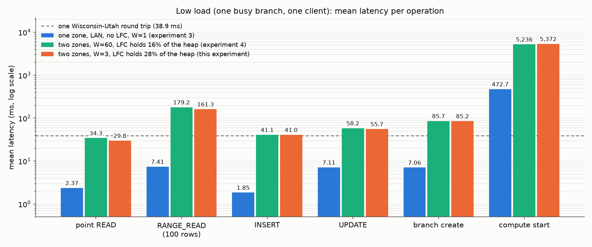
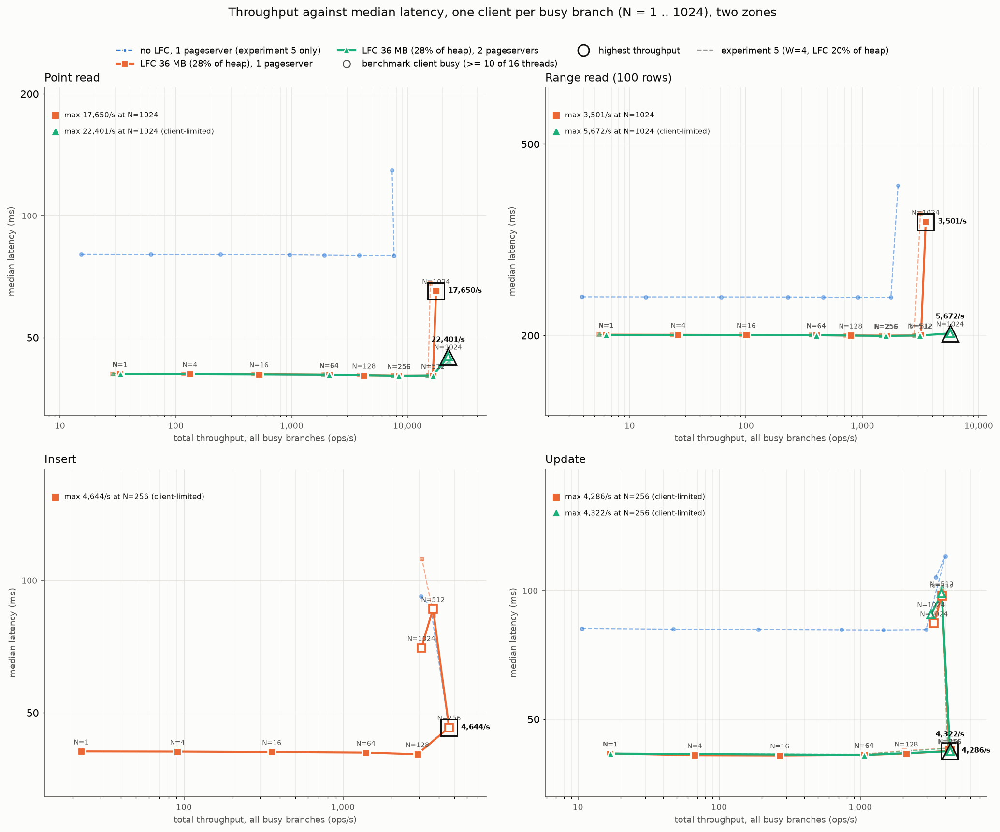
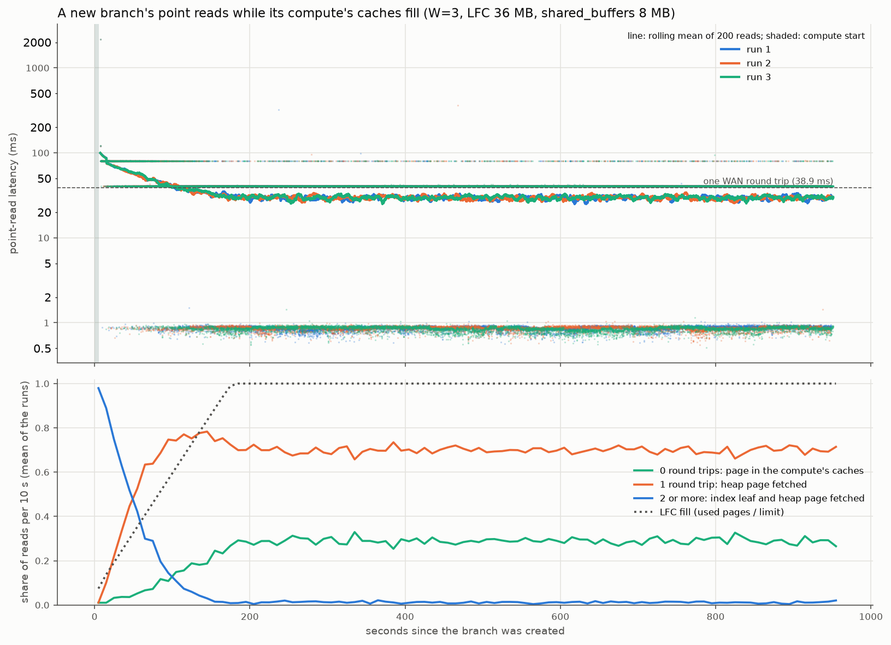

# Experiment 8: experiment 5 with the cache holding 28% of the heap

*Self-hosted Neon (commit `4187e2da7`, Postgres 17.5), storage layer in Wisconsin, client and computes in Utah
(38.9 ms round trip), 25 Oct 2026. Same cluster, scripts and 36 MB local file cache (LFC) as experiment 5; only the
dataset is smaller.*

## Verdict

Making the dataset smaller so that the same 36 MB cache holds 28% of the heap instead of 20% speeds up whatever
is limited by page fetches over the WAN, by about the ratio of pages fetched per read, and changes nothing else.

| Sub-experiment | Result (experiment 5 in brackets) |
|---|---|
| A. Low load | 28.6% of point reads hit the compute (20.4%), so the mean point read falls to 29.8 ms (34.6) and the mean range read to 161 ms (184). Medians stay at one round trip: point read 40.7 ms, range read 201 ms, insert 40.9 ms, update 41.6 ms, all as before, because most reads still miss. Reads that fetched an index leaf as well fell to 1.2% (4.6%) |
| B. Scaling | One pageserver: same knee (N = 512 to 1,024, a2's 1 GbE uplink at 12,400-13,000 pages/s), 12% higher: 18,200 point reads/s (16,300), 3,700 range reads/s (3,300). Below the knee the mean point read is 29 ms (33) and the mean range read 150 ms (168), medians unchanged. Two pageservers: 30,900 point reads/s at a 41 ms median (29,100), 6,300 range reads/s (5,900), now at the knee: Neon's stripe hash puts 61% of the uncached heap on the second pageserver, whose uplink saturates first. Writes unchanged: 16,500 inserts/s and 7,500-7,700 updates/s at N = 1,024, set by the safekeepers |
| C. Branch creation | 85-87 ms median from 1 to 512 busy branches, compute start 5.3-5.5 s (the same) |
| D. Cold start | Usable after 5.3 s, cache full after 174 s (the same); the warm mean it reaches is 29.5 ms (34.1-34.7), so the cold period costs about 52 s of extra latency (48-52 s) |

## What changed from experiment 5

Experiment 5's "LFC 25%" was the 36 MB LFC against the whole stock table, heap and primary key. Experiment 4's
"15%" was the share of the heap the LFC held after the whole primary key. On experiment 4's measure experiment 5's
cache held 20% of the heap, close to experiment 4's 16%, and their low-load latencies came out the same. This
experiment keeps the cache and makes the dataset smaller so that, on experiment 4's measure, the cache holds 30%:

| | Experiment 4 | Experiment 5 | Experiment 8 |
|---|---:|---:|---:|
| Warehouses (W) | 60 | 4 | 3 |
| stock heap (pages of 8 kB) | 255,488 | 17,032 | 12,774 |
| stock primary key (pages) | 16,448 | 1,099 | 825 |
| LFC (pages) | 57,344 (448 MB) | 4,608 (36 MB) | 4,608 (36 MB) |
| shared_buffers | 128 MB | 8 MB | 8 MB |
| Heap share in the LFC (LFC - key - catalogs) / heap | about 16% | 20% | 28% |
| Point reads served by the compute's caches, low load | 16.2% | 20.4% | 28.6% |

W = 3 is the whole number of warehouses closest to 30% (W = 2 would give 46%); the user chose it over changing the
number of items per warehouse. The prewarm fills the LFC with the first 3,674 heap pages and then the primary key,
as in experiment 5. Everything that used the LFC was rerun: low load, the default-LFC scaling sweep and its
two-pageserver sweep with their minimal-client checks, branch creation, cold start; not the no-LFC sweep.

## A. Low load: one busy branch

| | Experiment 5: median (mean) | Experiment 8: median (mean) |
|---|---:|---:|
| Point read | 40.7 ms (34.6) | 40.7 ms (29.8) |
| Range read, 100 rows | 201 ms (184) | 201 ms (161) |
| Insert | 40.8 ms (41.0) | 40.9 ms (41.0) |
| Update | 41.6 ms (57.6) | 41.6 ms (55.7) |
| Branch create | 84.8 ms (85.7) | 84.8 ms (85.2) |
| Compute start | 5,159 ms | 5,368 ms |

- **The medians do not move; the means do.** With fewer than half of the reads hitting the cache, the median read
  is a miss: one round trip, 40.7 ms, in experiments 4, 5 and 8 alike. The mean follows the share of hits: 29.8 ms
  against 34.6 ms for point reads (14% less) and 161 ms against 184 ms for range reads (12% less).
- **Writes are unchanged.** An insert waits one round trip for its commit and fetches no pages. Updates gain a
  little (55.7 against 57.6 ms): fewer of them fetch their row's page first (36% against 41%).
- **Branch create and compute start do not depend on the cache.** The compute start is 4% slower (5.37 against
  5.16 s), within the spread of its first connections' catalog reads.

### Cache hits and misses

| | Experiment 5 | Experiment 8 |
|---|---:|---:|
| Point reads served by the compute's caches (0.89 ms) | 20.4% | 28.6% |
| Point reads with one page fetched (40.7 ms) | 75.0% | 70.2% |
| Point reads with two pages fetched (about 80 ms) | 4.6% | 1.2% |
| GetPage requests per point read | 0.85 | 0.73 |
| Range reads with every page cached | 6% | 10% |
| GetPage requests per range read | 4.59 | 4.01 |
| Updates with a page fetched | 41% | 36% |

- **The hit share is the heap share.** 28.6% of point reads hit, and the LFC holds 28% of the heap; experiments 4
  and 5 matched the same way (16% and 20%).
- **The second fetches almost disappear.** In experiment 5, 5% of point reads also missed their index leaf: the
  hot leaves live in shared_buffers, which does not refresh their LFC entries, so they age out of the LFC. With the
  smaller index (825 pages against 1,099) almost all of it fits in the 8 MB of shared_buffers (1,024 pages), and
  only 1.2% of reads fetch a leaf.

### Where the time goes

Mean ms per operation (`figures/breakdown.md`); components add up to the client's mean in every bar.

| Component | Point read | Range read | Insert | Update |
|---|---:|---:|---:|---:|
| Client to compute on the LAN, and the driver | 0.57 | 0.91 | 0.64 | 0.64 |
| Parse, plan, protocol; executor CPU | 0.31 | 0.94 | -0.10 | -0.15 |
| Commit: WAN to the safekeepers | | | 39.61 | 39.95 |
| Commit: safekeeper WAL flush | | | 0.55 | 0.68 |
| GetPage: WAN and compute side | 28.50 | 157.12 | 0.29 | 14.41 |
| GetPage: pageserver | 0.42 | 2.34 | 0.01 | 0.21 |
| **Mean** | **29.81** | **161.31** | **41.00** | **55.74** |

As in experiments 4 and 5, page fetches over the WAN are almost all of every read's time (96% of a point read,
97% of a range read), the pageserver's own work is 1.5%, and a write is one WAN round trip to the safekeepers.
The negative executor CPU of writes is the remainder after subtracting the measured parts (within the clock's
error). One of the 40,000 point reads is missing from the compute's statement log (39,999 server-side rows).

## B. Scaling: N busy branches

Experiment 5's sweep with the smaller dataset: N busy branches (1 to 1,024), one client per branch with one
request in flight, each branch with its own compute (spread evenly over b1-b7). Two variants, both with the 36 MB
LFC: one pageserver (a2), and the tenant split into 2 shards (stripes of 256 pages) on a2 and a5, at N = 1, 64,
256, 512, 1,024 without inserts, as in experiment 5. The minimal asyncio client (`scripts/ceiling_check.py`)
re-measured N = 128 to 1,024 for 30 s per point, because the benchmark client runs out of CPU at about 10 of its 16
threads.

*Solid lines: this experiment; thin dashed lines: experiment 5 (W = 4) in the same colours, including its no-LFC
variant. Every point is labelled with its N, each line's highest throughput is ringed, hollow markers are runs
where the benchmark client used 10 or more of its 16 threads. The minimal client's runs are in the tables, not in
the figure.*

### Point reads and range reads

Cells: throughput; median / mean latency. The minimal client records only the median and p95, not the mean.

| Point reads | N = 256 | N = 512 | N = 1,024 | Minimal client, N = 1,024 | Experiment 5, minimal client |
|---|---|---|---|---|---|
| One pageserver | 8,436/s; 40.2 / 29.1 ms | 16,575/s; 40.2 / 29.3 ms | 17,650/s; 65.2 / 50.6 ms | 18,238/s; 64.6 ms | 16,326/s; 66 ms |
| Two pageservers | 8,432/s; 40.2 / 29.1 ms | 16,562/s; 40.3 / 29.3 ms | 22,401/s; 44.9 / 41.7 ms (client-limited) | 30,894/s; 41.0 ms (p95 49 ms) | 29,066/s; 41 ms |
| Experiment 5, one pageserver | 7,597/s; 40.3 / 32.6 ms | 15,085/s; 40.3 / 32.6 ms | 15,744/s; 68.1 / 57.0 ms | | |
| Experiment 5, two pageservers | 7,546/s; 40.2 / 32.5 ms | 14,883/s; 40.3 / 32.7 ms | 22,916/s; 43.7 / 41.1 ms (client-limited) | | |

| Range reads (100 rows) | N = 256 | N = 512 | N = 1,024 | Minimal client, N = 1,024 | Experiment 5, minimal client |
|---|---|---|---|---|---|
| One pageserver | 1,613/s; 200 / 150 ms | 3,190/s; 200 / 150 ms | 3,501/s; 345 / 265 ms | 3,746/s; 318 ms | 3,325/s; 325 ms |
| Two pageservers | 1,590/s; 200 / 150 ms | 3,104/s; 200 / 151 ms | 5,672/s; 202 / 160 ms (client-limited) | 6,342/s; 200 ms | 5,864/s; 201 ms |
| Experiment 5, one pageserver | 1,447/s; 200 / 168 ms | 2,798/s; 200 / 169 ms | 3,152/s; 359 / 299 ms | | |
| Experiment 5, two pageservers | 1,443/s; 200 / 168 ms | 2,866/s; 200 / 168 ms | 5,594/s; 201 / 171 ms (client-limited) | | |

- **The mean shows the cache; the median does not.** Below the knee the median is one round trip in both
  experiments, while the mean point read is 29.1 ms against 32.6 ms in experiment 5 (11% less) and the mean range
  read 150 ms against 168 ms (11% less). The scaling runs' means are a little lower than the low-load run's
  (29.8 and 161 ms) because each client runs only 2,000-3,300 reads after the prewarm, too few for index leaves to
  age out of the LFC: 0.71 GetPage per point read and 3.75 per range read, against 0.73 and 4.01 in the 44,000-read
  low-load run. At the one-pageserver knee (N = 1,024) the mean rises to 50.6 ms (experiment 5: 57.0 ms).

- **Below the knee every branch adds its share, a little faster than in experiment 5.** The median stays at one
  round trip (40 ms) and throughput is N divided by the mean latency: 33 point reads/s per branch at N = 256
  (29.1 ms mean) against 30/s in experiment 5 (32.6 ms), 11% more.
- **One pageserver: the same knee, 12% higher.** Point and range reads stop scaling between N = 512 and 1,024 as in
  experiment 5, when a2 sends 860-900 Mbit/s to Utah (12,400-13,000 GetPage/s), its 1 GbE uplink; its CPU stays at
  6 of 40 cores and its own time per GetPage below 1 ms (`figures/resource_use.csv`, `figures/scaling_bottleneck.png`).
  Each point read now needs 0.71 pages instead of 0.80, so the same link carries 18,238 point reads/s instead of
  16,326 (+12%, against 0.80 / 0.71 = +13% expected), and range reads (3.7 pages instead of 4.2) gain the same.
- **Two pageservers: at the knee at N = 1,024, and only 6% above experiment 5.** The minimal client reaches 30,894
  point reads/s with the median still at 41 ms but the p95 up from 42 to 49 ms, and 6,342 range reads/s.
  Pageserver 2 (a5) is then at its uplink: 13,900 GetPage/s, the iperf3 rate of 915 Mbit/s, while a2 serves 9,500.
- **Why the two pageservers are uneven.** A page goes to shard `hash(relation, block / 256) mod 2`
  (`pgxn/neon/libpagestore.c`, `get_shard_number`), so each 256-page stripe of the stock heap lands on a shard by a
  hash, not alternately. With 50 stripes in this heap, 58% of the heap and 62% of its uncached part (blocks 3,674
  onward) map to shard 1 on a5 (recomputed with Neon's hash for stock's relfilenode 16464); a5 served 58-61% of the
  GetPage requests in the two-pageserver runs (61% at N = 1,024). In experiment 5's 67-stripe heap the same hash gives 52% (assuming the
  same relfilenode: the seed creates the tables in the same order), matching its measured 52%. The busier shard sets the limit: 13,900 / (0.61 x 0.73) = about 31,000 point reads/s, which
  the minimal client reached. More cache hits per read helped, but a less even split took most of it back.

### Inserts and updates

| | N = 256 | N = 512 | N = 1,024 | Minimal client, N = 1,024 | Experiment 5, minimal client |
|---|---|---|---|---|---|
| Inserts, one pageserver | 4,644/s; 46.3 / 50.6 ms (client-limited) | 3,682/s; 86.1 / 117.6 ms (client-limited) | 3,109/s; 70.2 / 146.6 ms (client-limited) | 16,530/s; 59.5 ms | 16,288/s; 59 ms |
| Updates, one pageserver | 4,286/s; 42.2 / 56.1 ms (client-limited) | 3,784/s; 97.5 / 118.6 ms (client-limited) | 3,323/s; 84.0 / 124.0 ms (client-limited) | 7,691/s; 133 ms | 7,387/s; 135 ms |
| Updates, two pageservers | 4,322/s; 42.1 / 56.0 ms (client-limited) | 3,773/s; 98.7 / 119.7 ms (client-limited) | 3,171/s; 88.1 / 148.5 ms (client-limited) | 7,549/s; 134 ms | 7,368/s; 134 ms |

At N = 256 the mean update is 56 ms against 58 ms in experiment 5 (fewer updates fetch their row's page); inserts
are the same (50.6 ms in both). From N = 512 the benchmark client's own queueing sets both the median and the mean.

- **Writes do not depend on the cache.** As in experiment 5, the benchmark client limits them from N = 256 and the
  minimal client finds the safekeepers' limits at N = 1,024, within 2-4% of experiment 5. Inserts are limited by
  the safekeepers' synchronous disk writes: the mean fsync per WAL flush goes from 0.4 ms (N <= 256) to 12-26 ms
  at N = 1,024, while their links carry only about 110 Mbit/s. Updates write a full page image per update (12.4 kB
  of WAL), so each safekeeper receives 720 Mbit/s at N = 512 and 780-816 Mbit/s at N = 1,024, near its 1 GbE link,
  while its fsyncs slow to 36-50 ms: both are near their limits (experiment 5's report, section B, has the table).

## C. Branch creation with N busy branches

| Busy branches N | 1 | 4 | 16 | 64 | 128 | 256 | 512 |
|---|---:|---:|---:|---:|---:|---:|---:|
| Branch create, median (ms) | 84.8 | 84.8 | 85.0 | 85.6 | 87.4 | 86.7 | 85.3 |
| Branch create, mean (ms) | 86.4 | 85.6 | 85.6 | 86.3 | 88.5 | 87.6 | 86.3 |
| Branch create, p95 (ms) | 89.3 | 90.8 | 88.1 | 89.7 | 96.5 | 94.3 | 91.1 |
| Compute start + first connection, median (s) | 5.34 | 5.26 | 5.36 | 5.41 | 5.46 | 5.46 | 5.42 |
| Compute start + first connection, mean (s) | 5.38 | 5.29 | 5.39 | 5.44 | 5.47 | 5.44 | 5.41 |
| Background load (ops/s) | 42 | 164 | 659 | 2,636 | 4,899 | 3,995 | 3,889 |
| Branches with a request in flight | 96% | 96% | 96% | 96% | 90% | 37% | 19% |

The same as experiment 5: creating a branch takes 85-87 ms (two WAN round trips and 6-7 ms in the storage
controller and pageserver) and starting its compute 5.3-5.5 s, whatever the load. The background clients reach
4,900 ops/s at N = 128 (experiment 5: 4,200), because more of their reads hit the cache; from N = 256 the benchmark
client cannot keep more than about 4,000 ops/s going, so fewer than half the branches were busy (hollow markers).

## D. Cold start: a new branch's first reads

*Run 1 alone: its rolling mean of 200 reads on a linear scale, with its steady mean (29.5 ms) and the read from which
it stays within 5% of it (read 3,049, 150 s after the branch was created).*

| Per run (3 runs) | Experiment 5 | Experiment 8 |
|---|---|---|
| Branch create; compute start; first connection | 85-98 ms; 2.9-3.1 s; 2.1-2.2 s | 85-99 ms; 3.0-3.1 s; 2.2-2.3 s |
| First query | 2.24 s | 2.16 s |
| Mean of the first 200 reads | 88-89 ms | 85-87 ms |
| Steady mean (last 5,000 reads) | 34.1-34.7 ms | 29.4-29.5 ms |
| Steady hit share | 20-21% | 29% |
| Steady from | read 2,750-3,386 (150-175 s) | read 3,049-3,208 (150-156 s) |
| LFC full after | 174 s | 174-175 s |
| Extra time over steady reads before that | 48-52 s | 52-53 s |

The branch becomes usable as fast, and its cache fills as fast: the LFC is the same size, so it is full after the
same 174 s of misses. The warm state it reaches is 5 ms faster per read, so the cold period costs about the same
extra time (52 s) against a lower baseline.

## Caveats

- **"28% of the heap" is experiment 4's measure.** The LFC (4,608 pages) holds the whole primary key (825 pages),
  about 109 catalog and other pages and 3,674 heap pages: 28.8% of the heap after prewarm, and 28.6% of point reads
  hit in the long low-load run. Against the whole table (heap and key) the LFC is 34% of stock.
- **The two-pageserver result depends on the hash.** The shard split is Neon's own mechanism, and with 50 stripes
  its hash gave the second pageserver 61% of the misses; another table, stripe size or seed changes the split. An
  even split would put the two-pageserver ceiling near 13,900 x 2 / 0.73 = 38,000 point reads/s, beyond what the
  client node can drive.
- **The benchmark client limits writes from N = 256 and the two-pageserver reads at N = 1,024** (hollow markers),
  as in experiment 5; the minimal client measures those points. Its statements are not identical to the runner's
  (it picks range bounds and update keys uniformly, so its updates fetch their row's page more often: median two
  round trips), as in experiment 5.
- **Fewer operations per client at N >= 512** (1,000,000 reads, 640,000 writes per run), as in experiment 5.
- **The compute nodes were nearly full at N = 1,024**: 1.2-1.4 GB available of 15 GB with 147-148 computes per
  node; no compute was killed.
- **Walproposer reconnects.** The computes' logs hold about 4,500 "no messages received during the last 10000ms"
  safekeeper reconnects, spread over 786 computes (at most 32 each); half come from the minimal client's 1,024
  computes that sat idle while it measured smaller N, most of the rest from the N = 512 and 1,024 runs. Commits at
  N <= 256 stayed at one round trip.
- **One run per point**; the low-load and one-pageserver numbers move from experiment 5's by the amounts the
  page-fetch counts predict (above), which is the check that the difference is the cache and not run-to-run noise.

## Data quality

- **Every run is complete.** All 59 benchmark runs (5 low load, 7 branch creation, 32 one-pageserver, 15
  two-pageserver; plus 3 cold-start runs) had all N clients reporting and no failed operations. The only non-OK
  rows are 20 inserts (at most 6 in a run of 640,000) rejected for a duplicate key, the benchmark client's random key
  collisions. The minimal client had no errors. No step of the sequence failed or was retried.
- **Low-load breakdowns add up**: components sum to the client mean in every bar; the compute's statement log has
  39,999 of the 40,000 point reads (one line missing) and all range reads, inserts and updates; 20 of 20 compute
  starts matched compute_ctl's metrics.
- **The minimal client agrees with the benchmark client where neither is limited**: 16,406 and 16,575 one-pageserver
  point reads/s at N = 512, 16,290 and 16,562 with two pageservers.
- **Load balance**: the computes of N branches were spread evenly over the seven compute nodes (147-148 each at
  N = 1,024). The two pageservers carried 39-44% and 56-61% of the GetPage requests in the two-pageserver runs
  (the stripe hash, above).
- **Clocks**: agent clocks within 2.2 ms of the client's (`data/clock_offsets.json`).
